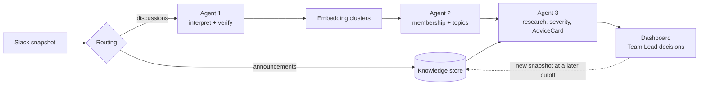

# ThreadSense

ThreadSense is a multi-agent research assistant for Team Leads overseeing AI
data-labeling projects. It turns a daily snapshot of synthetic Slack discussions
and project knowledge into an evidence-linked briefing.

Recurring questions often appear in several threads, while the governing
guidance may be spread across instructions, announcements, and past decisions.
ThreadSense connects those reports, checks what the evidence supports, and
proposes a next step when the issue warrants one.

[Open the saved demo briefing](https://threadsense-snowy.vercel.app/#run=threadsense_full_v1_combined_v2)

## How it works

1. **Interpret threads.** Agent 1 extracts the central question, resolution
   state, and authority evidence. Verification can correct an interpretation
   or flag it for review.
2. **Group related questions.** Local embeddings propose candidate clusters.
   Agent 2 checks their membership, splits mixed topics, and preserves links
   to the source threads.
3. **Research and recommend.** Agent 3 searches current and historical
   guidance, checks claims and proposed actions against the evidence, and
   produces an AdviceCard for the briefing.

Each card links back to its supporting evidence. Team Leads can review
uncertainty, record a decision, and report problems with the AI output.
The research workflow has read-only access. Team Leads carry out approved
changes separately.

## Review a worked example

Open the fictional-contact quarantine card. Compare the older help-page
wording against the dated clarification, then inspect the proposed edit and
the confirmation still required. The historical inspection supports a targeted
proposal. The currently published wording still needs to be verified, so the
card remains in Needs Review.

**Where to find it.** In the demo, choose the *safety_classification* project and open
*QN handling for fictional contact details* ([filtered briefing](https://threadsense-snowy.vercel.app/#run=threadsense_full_v1_combined_v2&project=safety_classification)).
Direct links to the two sources being compared:
[old help page v1.0](https://threadsense-snowy.vercel.app/#run=threadsense_full_v1_combined_v2&project=safety_classification&panel=evidence:k:safety-qn-help-page@1.0:983cdeaa)
and [September 10 clarification](https://threadsense-snowy.vercel.app/#run=threadsense_full_v1_combined_v2&project=safety_classification&panel=evidence:k:safety-fictional-pii-clarification@1.0:3682998e).

What the card shows (`card_a03615c8bc678a84c906d5831a4ba1b0`):

- **Situation:** six threads in which three QA tutors and two tutors ask how to treat fictional phone numbers and
  email addresses; three people report two differing versions of a note.
- **Evidence:** the current instructions (v1.4) and FAQ (v1.1) say verified fictional placeholders alone do not need
  QN; the September 10 clarification replaced only the old help page's blanket rule; a later documentation follow-up
  records that the help page is still stale.
- **Proposal:** *Update the documentation*: a draft replacement for the help page's "Contact details" section, scoped to
  the superseded fictional-contact branch.
- **Why it stays in Needs Review:** four recorded reasons. It is HIGH severity under the rubric, four Agent 1 review
  flags are still open, an October status note does not say which guide it means (so the target must be confirmed),
  and one advisor statement that presented history as current was withheld. The card's confidence is 0.94; high
  confidence does not lift a HIGH-severity card out of review.

| | Path |
| --- | --- |
| Slack input (synthetic) | [`C_SAFETY_GENERAL.json`](data/fixtures/slack_generated_demo/channels/C_SAFETY_GENERAL.json), [`C_SAFETY_QA.json`](data/fixtures/slack_generated_demo/channels/C_SAFETY_QA.json) |
| Knowledge input | [old help page](data/knowledge/instructions/history/safety_qn_help_page_v1.0.md), [clarification](data/knowledge/decisions/safety_classification/safety_fictional_pii_clarification_2026-09-10.md), [instructions](data/knowledge/instructions/safety_classification_instructions.md), [FAQ](data/knowledge/faq/safety_classification_faq.md), [documentation follow-up](data/knowledge/decisions/safety_classification/2026-09-18_documentation_sync_partial.md) |
| Card and its saved research | [`topics/consolidated__consolidated_1eef9f984ee99bde.json`](data/experiments/threadsense_full_v1_combined_v2/topics/consolidated__consolidated_1eef9f984ee99bde.json), card record in [`cards.json`](data/experiments/threadsense_full_v1_combined_v2/cards.json) |
| Whole briefing | [`morning_brief.md`](data/experiments/threadsense_full_v1_combined_v2/morning_brief.md) |

## The accepted briefing

The demo and the local dashboard open `data/experiments/threadsense_full_v1_combined_v2`. Its counts, checked from the
run's own files and from the dashboard API:

- **63 active cards:** 52 Needs Review, 8 Recommended Action, 3 Observation. Three more cards sit outside the brief
  (two social greetings and a routine admin question).
- **37 Model Review Queue items**, all inherited Agent 1 review flags.
- **177 discussion threads:** 174 on active cards and 3 in processing history.

It is built from one live end-to-end run (`threadsense_full_v1`, 2026-11-05) in offline steps, plus two small live
refreshes:

1. **Live run.** 937 requests sent, $15.32 of a $39 ceiling. Models: Agent 1 `gpt-4o-mini-2024-07-18` with verifier
   `gpt-4.1`, Agent 2 `gpt-5.4-2026-03-05`, Agent 3 `gpt-6.1-sol`.
2. **Briefing routing** re-applied with developer-audited relevance labels.
3. **Relevance and consolidation** rebuilt from those labels and prepared merge decisions.
4. **14 merged issues** re-advised live (32 requests, $2.23).
5. **Two cards** re-grounded live after wording edits (2 requests, $0.09).
6. **Combination** of all of the above, plus a display layer.

So it is a combination of live and audited steps, not one untouched live run. Earlier runs under `data/experiments/agent3_*` are
development pilots and evaluations on older prompt versions; they are not the briefing. The lineage is in
[docs/architecture/THREADSENSE_END_TO_END.md](docs/architecture/THREADSENSE_END_TO_END.md).

## Quick start

| Path | What you get | Credentials | Network | Provider calls |
| --- | --- | --- | --- | --- |
| [1. Inspect saved output](#1-inspect-saved-output) | the briefing, cards, evidence and review queue | no | demo site, or install only | no |
| [2. Offline checks](#2-offline-checks) | guardrail tests, an offline Agent 3 run, benchmarks | no | install and a one-time model download | no |
| [3. Fresh model-backed run](#3-fresh-model-backed-run) | a new run from Slack to cards | `OPENAI_API_KEY` | yes | yes (paid) |

### Requirements

- [uv](https://docs.astral.sh/uv/getting-started/installation/), which installs Python 3.13 (the project requires
  `>=3.13,<3.14`) and the locked dependencies from `uv.lock`. Checked with uv 0.11.33 and Python 3.13.15.
- Node.js and npm for the dashboard (`web/package-lock.json`). Checked with Node 22.12.0 and npm 10.9.0.
- Google Chrome only for the browser tests.
- On Windows, clone into a short folder (for example `D:\ts`). The longest tracked path is 189 characters.

```sh
git clone https://github.com/christie0902/threadsense.git
cd threadsense
uv sync --locked --extra dev
```

All commands below run from the repository root. None of them needs a `.env` file.

### 1. Inspect saved output

The quickest way is the [demo site](https://threadsense-snowy.vercel.app/#run=threadsense_full_v1_combined_v2). It is
the same dashboard built as a static site, reading a bundled copy of the briefing; your decisions stay in your browser.

To run the dashboard locally against the saved runs:

```sh
npm --prefix web ci
npm --prefix web run build
uv run --locked python scripts/run_dashboard.py
```

Open http://127.0.0.1:8000. It opens the accepted briefing: 63 cards in the header tiles (52 needs review,
8 recommended, 3 observation) and 37 items under Model Review Queue. Decisions you save go to `.state/dashboard/`
(ignored by git); nothing is posted or executed. Without the dashboard, read
[`morning_brief.md`](data/experiments/threadsense_full_v1_combined_v2/morning_brief.md) directly.

### 2. Offline checks

**Guardrail tests** (67 tests, about 100 seconds). The list is in [`tests/guardrails.txt`](tests/guardrails.txt) and is
explained [below](#guardrails).

```sh
uv run --locked --extra dev python -m pytest -q -p no:cacheprovider --basetemp ../threadsense-pytest-guardrails @tests/guardrails.txt
```

Expected: `67 passed`. pytest empties the `--basetemp` folder first, so use a new one each time.

**Load a saved run through the real dashboard, network disabled** (about 6 seconds):

```sh
uv run --locked python scripts/run_threadsense_full.py render data/experiments/threadsense_full_v1
```

Expected: `"brief_status": 200`, `"cards": 81`, `"card_endpoint_statuses": [200]`. The 81 is the live run's own card
count (`threadsense_full_v1`), before the offline steps that produced the 63-card accepted briefing.

**Offline Agent 3 run.** This takes two steps. First build the local retrieval index. The first build downloads the
pinned embedding model (`all-MiniLM-L6-v2`, about 88 MB), which takes about 45 seconds; later builds are offline.

```sh
uv run --locked python scripts/build_retrieval_index.py --allow-download
uv run --locked python scripts/run_agent3_overnight.py --cutoff 2026-10-02T12:00:00Z --scripted --write ../threadsense-scripted-run
```

This runs the whole LangGraph workflow over the 87 work items of the earlier pilot handoff
(`data/processed/agent2_handoff_v2_projection`, not the accepted briefing) with prepared (scripted) judgments instead of model calls,
in about 40 seconds. Expected `morning_brief.json` counts: status `COMPLETE`, 87 cards, all Needs Review, 52 review
queue items. These match the saved [`agent3_overnight_offline_v2`](data/experiments/agent3_overnight_offline_v2). The
scripted judgments test routing and accounting, not answer quality.

**Temporal benchmarks:**

```sh
uv run --locked python scripts/evaluate_temporal.py --golden data/evaluation/temporal_golden_policy_v1.json
uv run --locked python scripts/evaluate_temporal.py --golden data/evaluation/temporal_golden.json
```

Expected `joint_accuracy`: `17/17` for the first and `14/15` for the second (see [Evaluation](#evaluation)).

**Full test suite** (about 1,280 tests, about 17 minutes):

```sh
uv run --locked --extra dev python -m pytest -q -p no:cacheprovider --basetemp ../threadsense-pytest-full
```

This passes in full in the original checkout. In a clone at another path, 10 tests fail, for reasons described under
[Limitations](#limitations); the guardrail list above passes in both.

**UI checks:** `npm --prefix web run test:unit` (view model, no browser). `npm --prefix web run build:demo` followed by
`npm --prefix web run test:demo` tests the static demo with no API server.

### 3. Fresh model-backed run

Check the plan and the cost estimate first. This makes zero model calls and needs no key:

```sh
uv run --locked python scripts/run_threadsense_full.py preflight
```

Expected: an estimate of about $15.20 ($19.00 with margin), a hard ceiling of $39, and wiring checks over 178 threads
and 81 Agent 2 payloads.

A live run needs `OPENAI_API_KEY` in a `.env` file (copy `.env.example`) or in the environment, and it costs money:

```sh
uv run --locked python scripts/run_threadsense_full.py live --write data/experiments/<new folder> --run --max-cost 39
```

Every request reserves its maximum price in a ledger before it is sent, so the run stops before passing `--max-cost`.
To spend less, `scripts/run_agent3_overnight.py --run --write <dir> --max-requests N --max-cost USD` runs Agent 3 alone
on the saved handoff. A live run was not repeated for this release.

Other variables: `THREADSENSE_MODEL` and `THREADSENSE_VERIFIER_MODEL` override the Agent 1 models;
`OPENROUTER_API_KEY` is for OpenRouter routes. Values in the terminal take precedence over `.env`.

## Architecture



| Stage | Implementation | Bounds |
| --- | --- | --- |
| Routing | `routing.py`, `source_ingestion.py`: announcement channels become versioned knowledge sources | no model calls |
| Agent 1 | CrewAI interpreter plus an independent evidence audit and prose check (`agents/thread_interpreter.py`, `interpretation_verifier.py`, `verification_pipeline.py`) | up to 4 requests per thread, one revision, no retries |
| Grouping | sentence-transformers embeddings and agglomerative clustering per project and batch (`topic_grouping.py`) | local |
| Agent 2 | one structured request per candidate group: coherence check, splits, topic names (`agents/topic_taxonomy.py`) | 1 request per group, no repairs |
| Agent 3 | CrewAI Advisor in a LangGraph overnight workflow (`agents/overnight.py`, `advisor_*.py`): hybrid retrieval (BM25 + embeddings over Chroma), severity from the Team Lead rubric, Tree of Thought for close action choices, and a final grounding call that judges every displayed sentence | up to 4 requests and 6 retrievals per topic, 24,000 input tokens per request |
| Dashboard | FastAPI (`dashboard/`), React + Vite (`web/`) | read-only over saved runs; decisions are append-only |
| Execution | `execution/`: request guard, response cache, SQLite budget ledger, content-addressed store | every request reserved before sending |

### Repository map

| Path | Contents |
| --- | --- |
| `src/threadsense/agents/` | Agents 1–3 ([overview](src/threadsense/agents/README.md)) |
| `src/threadsense/retrieval/` | chunking, index, hybrid search, version and enactment rules |
| `src/threadsense/execution/` | full-run pipeline, guard, ledger, pricing |
| `src/threadsense/dashboard/` | API, run catalog, decision, feedback and lesson stores |
| `src/threadsense/legacy/` | earlier contracts, kept so saved runs can still be checked |
| `web/` | dashboard UI and static demo (`web/demo/briefing.json`) |
| `scripts/` | command-line entry points |
| `tests/` | offline tests; model calls are mocked |
| `data/fixtures/slack_generated_demo/` | Slack input: 201 threads, 517 messages, cutoff 2026-10-02T12:00:00Z |
| `data/knowledge/` | instructions, FAQs, decisions, lexicon, severity rubric |
| `data/evaluation/` | labels and benchmarks; never sent to the agents |
| `data/processed/`, `data/experiments/` | saved runs, bound to their inputs by hashes |

## Guardrails

Each rule is checked by tests in [`tests/guardrails.txt`](tests/guardrails.txt). The *Evidence* column says how.

| Rule | Tests | Evidence |
| --- | --- | --- |
| An acknowledgment or a request for more evidence cannot resolve a thread | `test_interpretation_verifier.py`: a Team Lead's "Please send the error state." leaves the decision unanswered; claiming RESOLVED, citing it as authority, or a reaction emoji each produces a finding; confidence 1.0 does not override. Agent 3: resolution is judged per member from thread evidence | offline, deterministic |
| Grouping keeps source membership and inherited review flags | all 200 identities and 49 obligations survive assignment, rejection and failure; an invalid partition is refused, not repaired; a cross-group merge keeps every flag; every thread and obligation lands in exactly one inventory | offline, deterministic |
| HIGH severity stays in review regardless of confidence | the card contract refuses a Recommended HIGH card at confidence 0.99; across the accepted briefing, all 21 HIGH cards are Needs Review, including cards at 0.94 | offline + the saved briefing through the API |
| Withholding an unsupported recommendation keeps the open follow-up | a withheld card has no action, stays in review and must carry its outstanding step; both withheld cards in the briefing do | offline + the saved briefing |
| An Observation needs a supported no-action reason | an Observation without one returns to review; each of the 3 Observations in the briefing has `action:no_action` judged SUPPORTED, and the dashboard shows it as an Observation | offline + the saved briefing |
| Withheld statements are never served to reviewers | the card-detail API (its *Technical* tab, shown with Developer details on), feedback targets and feedback history give a withheld statement's ID, verdict and reason but not its text; no card of the accepted briefing serves one, nor does the static demo bundle (`dashboard/disclosure.py`) | offline + the saved briefing through the API and the demo bundle |
| An unavailable audit cannot pass | a missing audit response cannot pass on structural checks; audit failures are kept; without the semantic verifier, proposed exclusions stay eligible | offline, mocked failures |
| Dated and superseded sources | an older revision does not compete in current mode; a future revision waits for its date; a supersession is not applied before the replacement takes effect; an unenacted decision never becomes current | offline, real ingestion code |
| Request limits | one stage sends exactly one HTTP request; the budget ceiling and persistence failures stop sending; SDK retries are refused; budget exhaustion leaves remaining work unprocessed, not dropped | offline, fake provider |

The temporal benchmarks and the saved live evaluations below add evidence, but they are not part of this list.

## Evaluation

| Metric | Result | Denominator | Pass criterion | Evidence | Type |
| --- | --- | --- | --- | --- | --- |
| Agent 1 verification | 81 verified, 70 corrected, 49 needs review | 200 threads | every thread processed, none dropped | [`agent1_verified_v3/`](data/processed/agent1_verified_v3) | saved live run |
| Agent 2 taxonomy | 90 groups, 97 topics, 3 naming cautions | 200 identities, 49 obligations | all identities and obligations kept; 0 failed groups | [`agent2_taxonomy_final_v7/`](data/processed/agent2_taxonomy_final_v7) | saved live run |
| Full run accounting | 937 requests, $15.32; 177 of 178 threads accepted (1 recorded rejection); 81 cards before the offline briefing steps | $39 ceiling | accounting COMPLETE, under the ceiling | [`threadsense_full_v1/ACCEPTANCE.md`](data/experiments/threadsense_full_v1/ACCEPTANCE.md) | saved live run |
| Briefing routing invariants | 21/21 HIGH in review; 26/26 flagged cards in review; 2/2 withheld keep their follow-up; 3/3 Observations supported | 63 active cards | all hold | `tests/test_accepted_briefing_guardrails.py` | reproducible |
| End-to-end card check | actions in the proposed set 8/8; required review reasons 8/8; 0 unsupported claims shown; 1 unnecessary review | 8 work items, expectations frozen before the run | no unsupported claim displayed | [`agent3_e2e_eval_v1/evaluation.json`](data/experiments/agent3_e2e_eval_v1/evaluation.json) | saved live run, developer inspection |
| Temporal reasoning (policy-aligned) | 17/17 joint; 0 false overrides | 17 cases | all fields correct | [`temporal_golden_policy_v1.json`](data/evaluation/temporal_golden_policy_v1.json) | reproducible, prepared judgments |
| Temporal reasoning (original labels) | 14/15 joint; 0 false overrides | 15 cases | all fields correct | [`temporal_golden.json`](data/evaluation/temporal_golden.json) | reproducible, prepared judgments |
| Held-out fixture, two model plans | Claude Sonnet 5.5: 5 pass, 1 partial; Agent 1 resolution 13/14. Original OpenAI plan: 4 pass, 2 partial; 12/14. Both: 0 missed reviews, 0 unsupported claims shown, HIGH cards in review | 15 Slack roots, 6 scenario checks, answer key frozen before the runs | no failed scenario, no missed review | [`RESULTS.md`](https://github.com/christie0902/threadsense/blob/model-comparison-experiments/experiments/fresh_15_v1/RESULTS.md) (branch `model-comparison-experiments`) | saved live runs, developer-scored |
| Relevance labels confirmed by a Team Lead | not measured | — | — | labels are developer-audited | planned |
| Live answer accuracy across all 87 pilot work items | not measured | — | — | only 8–9 topics per live evaluation | planned |

The held-out fixture was written separately from the development data and run through the unchanged pipeline, once
per model plan. Its runs live on the `model-comparison-experiments` branch, so the accepted briefing and the demo do
not depend on them. A third model, Grok 4.7, produced no output there. Each of its requests reasoned for about four
minutes before answering and ran past the client timeout, so it is not compared.

On the original temporal set, the one miss (T02) expects a decision to override a guideline although the case records
no enactment; the policy-aligned set splits that case. The two scores are not comparable. Both benchmarks use prepared
judgments, so they test the version and enactment logic, not the model. More detail:
[docs/evaluation.md](docs/evaluation.md).

**Optional experiments, not on the accepted path:**
- **Adaptive (ReAct-style) research:** `advise(research_mode='react')` in `agents/advisor_pilot.py`, off by default and
  not reachable from the overnight runner. It was evaluated offline only, with a scripted controller on 3 cases
  ([`agent3_react_comparison_v1/report.md`](data/experiments/agent3_react_comparison_v1/report.md)); the existing
  link expansion already recovered the case it targeted.
- **Flag-impact assessment** (`--flag-impact`) and the **shadow ToT policy** (`--tot-shadow`): recorded alongside a
  run; routing ignores them.

## Limitations

- **Synthetic data only.** The Slack fixtures and knowledge store are invented; relevance labels and merge decisions in
  the accepted briefing are developer-audited, not confirmed by a Team Lead.
- **The held-out test is small.** One run per model plan on one 15-thread fixture, scored by the developer: it shows
  observed behaviour on that fixture, not a general ranking of the models.
- **Grounding is a model judgment.** It has falsely rejected and correctly rejected statements in live runs; withheld
  text goes to Needs Review rather than being repaired.
- **Replay is partial with the current code.** The saved replay `threadsense_full_v1_replay` completed all 7 stages
  when it was recorded. Running `run_threadsense_full.py replay` today reproduces snapshot through Agent 2 from saved
  responses: the same 76 clusters, topics and 37 review items. It then stops at Agent 3 with "no saved response",
  because Agent 3's rules changed after that run, and the guard refuses to call the network. Use `render` and the
  scripted run above instead.
- **Checkout location.** Saved runs record the absolute path they were produced in, and extracted announcements hash
  that path into their version IDs. In a clone at another path, the retrieval index must be rebuilt, and 10 tests that
  compare against recorded inputs or evidence IDs fail: 5 legacy Agent 2 and handoff checks and 5 Agent 3 checks. The
  guardrail list, the dashboard, `render`, the scripted run, the benchmarks and the preflight all work at any path.
- **Some behaviour has only offline evidence:** Tree of Thought replacement and fallback, the relevance-verification
  and consolidation stages of the newer pipeline, and rejection of unsupported routes.
- **Severity for rule-confusion topics** varies across runs and needs a rubric decision.
- **The dashboard has no authentication.** It runs on localhost with one fixed Team Lead per session, and approving a
  card records intent only.

## Documentation

- [Evaluation and results](docs/evaluation.md)
- [Architecture](docs/architecture/THREADSENSE_END_TO_END.md) and [schema and artifact map](docs/architecture/SCHEMA_AND_ARTIFACT_MAP.md)
- [Development guide](docs/development.md): tests, paid-call safety, frozen files
- [Announcement routing](docs/announcement-routing.md), [human feedback loop](docs/human-feedback-loop.md),
  [Tree of Thought design](docs/agent3-tot-design.md), [dashboard walkthrough](docs/agent3-demo-walkthrough.md)
