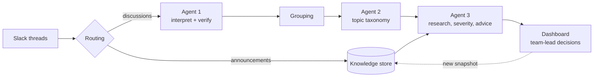

# ThreadSense

ThreadSense turns Slack threads from four annotation projects (audio_multimodal, multilingual_eval,
response_preference, safety_classification) into a morning brief for team leads. Each brief item is an advice card:
what happened, how severe it is, what to do and what still needs a human decision.

All data is synthetic: generated Slack fixtures and a hand-written knowledge store.

## How it works



1. **Routing.** Announcement channels go to the knowledge store; discussion threads go to the agents.
2. **Agent 1** summarises each thread and its central question, then verifies the summary against the source, with
   one revision at most. Unverified threads are flagged for review, never dropped.
3. **Grouping and Agent 2** cluster related threads and name the topics. Agent 2 does not judge severity.
4. **Agent 3** (CrewAI Advisor in a LangGraph overnight workflow) researches each topic with hybrid retrieval
   (BM25 + embeddings) over the instructions, FAQs and earlier decisions. It assesses severity with the team-lead
   rubric and writes a card. A final grounding call checks every sentence; unsupported text is withheld and the card
   goes to Needs Review.
5. **The dashboard** (FastAPI + React) shows the brief and the review queue. Team leads record decisions and report
   AI mistakes. Decisions feed later runs only through a new knowledge snapshot; nothing is executed or posted.

Stack: Python 3.13, CrewAI + LiteLLM, LangGraph, Pydantic v2, sentence-transformers, scikit-learn, ChromaDB, FastAPI;
React, Vite, Tailwind and Framer Motion in `web/`.

## Quick start

Install [uv](https://docs.astral.sh/uv/getting-started/installation/), then from the repository root:

```sh
uv sync --locked --extra dev
uv run --locked --extra dev python -m pytest -q --basetemp D:/tsb/pytest-run
```

Model calls need an API key. Copy `.env.example` to `.env` and set `OPENAI_API_KEY`. Nothing in the quick start or
the dashboard needs it. (With pip instead of uv: create a Python 3.13 environment and run
`pip install -r requirements.txt`.)

### Dashboard

```sh
npm --prefix web ci && npm --prefix web run build
uv run --locked python scripts/run_dashboard.py          # http://127.0.0.1:8000
```

It opens on the presentation briefing (`data/experiments/threadsense_full_v1_combined_v2`). The session is a single
team lead (Priya, U006; change it with `--team-lead`). Decisions are stored in `.state/dashboard/` (ignored by git).
A walkthrough is in [docs/agent3-demo-walkthrough.md](docs/agent3-demo-walkthrough.md).

### Static demo

The same dashboard, with no backend. It reads a bundled copy of the briefing (`web/demo/briefing.json`), and visitors'
changes stay in their own browser.

```sh
npm --prefix web run build:demo                          # -> web/dist-demo
npm --prefix web run test:demo
uv run --locked python scripts/build_web_demo_data.py    # check the bundle; --write web/demo/briefing.json refreshes it
```

The app routes by URL hash, so any static host works. For Vercel: root `web`, build command `npm run build:demo`,
output `dist-demo`.

## Main commands

Scripts are read-only and make no model calls unless you pass `--write` (or `--prepare`) and `--run`; live runs also
take a request and cost cap. **Exception:** `run_agent1_batch.py` and `run_agent1_demo.py` call the model unless
given `--dry-run` / `--inspect`. See [docs/development.md](docs/development.md) before running anything paid.

| Purpose | Command |
| --- | --- |
| Full pipeline (Agent 1 → Agent 3 under one budget) | `scripts/run_threadsense_full.py preflight` · `live --write <dir> --run --max-cost N` · `resume` · `replay` · `render` · `branch` |
| Agent 3 overnight run | `scripts/run_agent3_overnight.py --cutoff <ISO>` (plan) · `--scripted --write <dir>` (offline) · `--run --write <dir> --max-requests N --max-cost N` |
| Agent 1 | `scripts/run_agent1_demo.py --inspect`, `scripts/run_agent1_batch.py --dry-run`, `scripts/run_agent1_verification.py` |
| Grouping and Agent 2 | `scripts/run_thread_grouping.py --check-input`, `scripts/prepare_agent2_grouping.py`, `scripts/run_agent2_sample.py`, `scripts/run_agent2_batch.py --dry-run` |
| Announcement routing | `scripts/route_source_activity.py --dry-run --cutoff <ISO>` |
| Retrieval index | `scripts/build_retrieval_index.py` (add `--allow-download` once for the embedding model), `scripts/evaluate_retrieval.py` |
| Agent 3 input checks | `scripts/validate_agent3_inputs.py` |
| Decisions and feedback → next run | `scripts/build_decision_snapshot.py`, `scripts/build_feedback_snapshot.py`, `scripts/build_lesson_snapshot.py`, `scripts/export_feedback_cases.py` |
| Offline derivations of saved runs | `scripts/derive_briefing_repair.py`, `scripts/derive_consolidated_run.py`, `scripts/derive_combined_brief.py`, `scripts/build_presentation.py`, `scripts/reground_topic.py` |
| Evaluation reports | `scripts/evaluate_temporal.py`, `scripts/evaluate_tot_shadow.py`, `scripts/report_flag_dependence.py`, `scripts/report_flag_impact.py` |
| Dataset authoring and checks | `scripts/generate_thread_blueprint.py`, `scripts/generate_slack_fixtures.py`, `scripts/validate_topic_catalog.py`, `scripts/validate_slack_fixtures.py`, `scripts/validate_threadsense_dataset.py` |

Most accept `--help` (`uv run --locked python <script> --help`). The exception is the dataset authoring and check
scripts, which take no options; the two generators write fixture files as soon as they run.

## Repository layout

| Path | Contents |
| --- | --- |
| `src/threadsense/` | the package: routing, Slack adapter, knowledge ingestion, grouping, config |
| `src/threadsense/agents/` | Agents 1–3 ([overview](src/threadsense/agents/README.md)) |
| `src/threadsense/retrieval/` | hybrid retrieval: chunking, index, search, version eligibility |
| `src/threadsense/execution/` | full-run pipeline, request guard and cache, budget ledger, pricing |
| `src/threadsense/dashboard/` | FastAPI app, run catalog, decision and feedback stores |
| `src/threadsense/legacy/` | historical contracts kept for replaying saved runs |
| `web/` | React dashboard and static demo |
| `scripts/` | command-line entry points |
| `tests/` | offline tests (model calls are mocked) |
| `data/fixtures/` | synthetic Slack input (`slack_generated/`, demo snapshot `slack_generated_demo/`) |
| `data/knowledge/` | knowledge store: instructions, FAQs, decisions, lexicon, severity rubric |
| `data/evaluation/` | labels and benchmarks (not model inputs) |
| `data/processed/`, `data/experiments/` | saved runs (frozen) |

## Documentation

- [Evaluation and results](docs/evaluation.md): what each agent produced, costs, benchmarks and limitations.
- [Architecture](docs/architecture/THREADSENSE_END_TO_END.md) and the
  [schema and artifact map](docs/architecture/SCHEMA_AND_ARTIFACT_MAP.md).
- [Development guide](docs/development.md): tests, paid-call safety, frozen files, environment notes.
- [Announcement routing and knowledge sources](docs/announcement-routing.md) and the
  [source JSON schema](docs/knowledge-source.schema.json).
- [Human feedback loop](docs/human-feedback-loop.md): AI-issue reports and review lessons.
- [Tree of Thought design](docs/agent3-tot-design.md).
- [Dashboard walkthrough](docs/agent3-demo-walkthrough.md).
- [Prose comparison benchmark](experiments/prose_comparison_v1/README.md).

## Troubleshooting

- **`crewai`, `pydantic` or `threadsense` not found:** run `uv sync --locked --extra dev` and use `uv run --locked`.
- **pytest `PermissionError` on Windows:** use a new `--basetemp` outside the repository.
- **Unexpected model or key:** terminal environment variables override `.env`.
- **A preflight reports changed code or inputs:** that's the fingerprint check protecting a saved run. Write to a
  new output directory; don't edit saved metadata.
