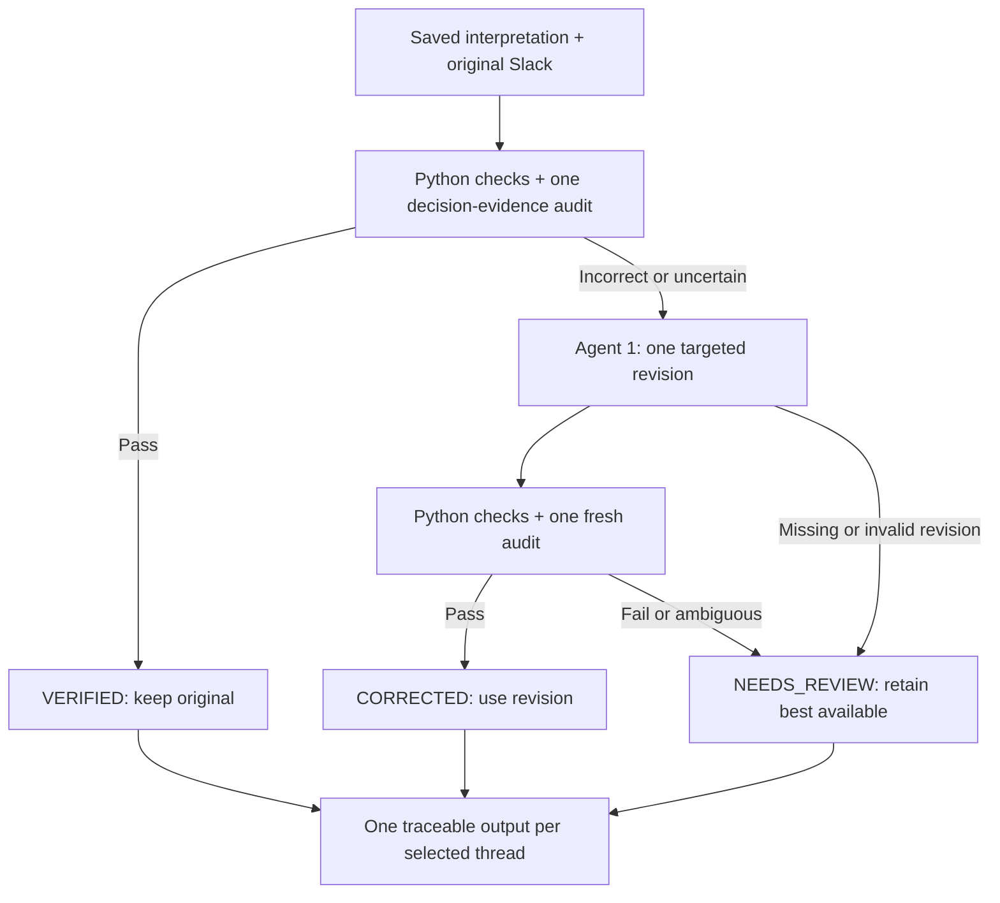

# Agent 1 verification and bounded correction

The verification runner starts from the 200 saved Agent 1 interpretations and
joins each to its original Slack thread. The saved interpretation counts as the
first interpretation attempt. It does not rerun the baseline interpreter or
regenerate the frozen 91 clusters.



## Active implementation

| Module | Responsibility |
| --- | --- |
| `thread_interpreter.py` | Existing interpreter model, prompt rules, schema parser, reference checks, and metadata-based authority eligibility. |
| `decision_evidence_audit.py` | One focused CrewAI task per verification pass. Reconstructs the root request, classifies each reply, assesses coverage of each requested decision, and checks candidate prose against original quotations. |
| `interpretation_verifier.py` | Deterministic schema, ID, role, reaction, terminology, coverage, authority, and audit-evidence checks. No model call and no automatic rewriting. |
| `interpretation_revision.py` | One complete targeted revision using the existing Agent 1 model and rules, original Slack, previous interpretation, concrete findings, audit, and glossary. |
| `verification_pipeline.py` | Enforces the two-pass/one-revision limit, selects the effective interpretation, and retains failures with provisional fields. |
| `contracts.py` | Unchanged `ThreadInterpretation`, `TopicAnalysis`, and `TopicRollup` schemas; focused audit/coverage/findings and final outcome contracts. |
| `terminology.py`, `config.py`, `models.py` | Existing official glossary, local model/key configuration, and Slack metadata/legacy role values. |
| `scripts/run_agent1_verification.py` | Offline preflight, paid opt-in, selection limits, original-source lineage, raw outputs, versioned cache, review queue, and outcome counts. |

The auditor is independent of the interpreter task, but is **not blinded** to
the candidate interpretation. In the same focused task it reconstructs source
evidence first, then compares the candidate's summary, central question, and
resolution rationale. It receives no previous audit or revision reasoning.
Prose findings require actual message IDs and matching verbatim quotations.
Python derives coverage-based resolution and checks substantive answers
separately from metadata eligibility. A fresh audit is requested for a revision;
pass-one audit judgments are not reused as pass-two evidence.

## Guarantees and failure handling

- Maximum two interpretation attempts: saved original plus one revision.
- Maximum two verification passes. A passing first check skips revision and
  the second audit. A missing or malformed revision stops at `NEEDS_REVIEW`
  without spending another audit on an unchanged candidate.
- A correct `UNRESOLVED` conversation can be `VERIFIED`. Verification outcomes
  are separate from conversational resolution.
- QN means Quarantine, LT means Label Tool, and `eyes` is acknowledgement.
  `this`, `agree`, and `white_check_mark` require actual TEAM_LEAD reactor
  metadata. Eligible roles still need substantive, relevant answer evidence;
  engineers also need technical relevance.
- Partial guidance is distinct from diagnostic progress. Multiple decisions
  are assessed individually so mixed coverage is `PARTIALLY_RESOLVED`.
- An announcement with no request keeps its legacy resolution convention;
  the audit checks its prose and the central question must be null. The legacy
  schema has no “not applicable” resolution value.
- On failure after revision, prefer a structurally valid candidate, then fewer
  disputed fields. A tie preserves the original. Model confidence is never
  used as a calibrated score. Both attempts and both audits remain traceable.
- If no candidate can satisfy the schema and reference checks, retain a clearly
  marked provisional placeholder under the correct source thread ID and keep
  the original malformed payload. Placeholder resolution is not an established
  decision; consumers must honor `NEEDS_REVIEW` and `provisional_fields`.
- Statuses describe these pipeline checks, not guaranteed ground truth. A model
  can still misread evidence or miss a factual discrepancy despite valid quotes.

## Offline smoke test

Run from the repository root in PowerShell:

```powershell
$env:PYTHONPATH = (Resolve-Path .\src).Path
uv run python scripts/run_agent1_verification.py --dry-run --limit 1 --thread-id 1790882197.000111
```

This checks all source/baseline joins and any existing cache before selecting
the one-thread pilot. It does not require keys, call a model, write results, or
classify a record as verified. Omit both mode flags and it still runs offline.
`--limit 0` selects all records for an offline coverage check.

## Controlled paid pilot — explicit opt-in

Only run this command when ready to authorize model requests:

```powershell
$env:PYTHONPATH = (Resolve-Path .\src).Path
uv run python scripts/run_agent1_verification.py --run --limit 1 --thread-id 1790882197.000111 --output-dir data/processed/agent1_verified_pilot_v1
```

This uses the API keys already saved in the repository's local `.env`. Agent 1
revision uses `THREADSENSE_MODEL`. The audit uses `THREADSENSE_VERIFIER_MODEL`
when explicitly set, otherwise the same model. There are at most three model
tasks per selected saved interpretation: audit, optional revision, and recheck.
CrewAI may internally retry rate-limit failures; the bound applies to workflow
stages and interpretation attempts, not every underlying HTTP request. This
refactor and its tests make no paid calls.

Use a new directory ending in `_v1`, `_v2`, etc. to intentionally change model,
code, inputs, glossary, or package versions. The default is
`data/processed/agent1_verified_v1/`. Do not reuse an experimental audit cache
or an Agent 2 cache as a new pipeline result.

## Outputs and resume

```text
agent1_verified_v1/
    interpretations.json
    review_queue.json
    manifest.json
    sources/<source-hash>.json
    records/<source-and-baseline-hash>/
        started.json
        audit_1.started.json    # durable stage markers precede model calls
        audit_1.raw.txt
        revision_1.started.json # only when the revision stage is initiated
        revision_1.raw.txt       # only when a revision was attempted
        audit_2.started.json
        audit_2.raw.txt          # only when a revision reached the second audit
        result.json
```

`interpretations.json` retains the legacy wrapper identity fields and the
unchanged `interpretation` schema. Sibling fields expose `verification_status`,
`revision_count`, `provisional_fields`, `review_reason`, and `lineage` to later
consumers. The wrapper's `run_config_sha256` identifies this new verified run;
the baseline configuration, model, creation time, and record hash remain under
`lineage`. Each source thread is stored once, outside the detailed pass records.

Detailed results retain the original/revised interpretations, both passes,
findings, audits, effective-attempt selection, and errors. Raw responses are
written before schema validation. Stage markers record attempted work even when
no response arrives. `revision_count` counts initiated revision stages.
`review_queue.json` links each flagged row
to the reason, evidence findings, original source, and detailed record.

The runner checks source/configuration fingerprints and cached result/raw
checksums before any paid call. Completed outcomes, including `NEEDS_REVIEW`,
are terminal for that output directory and are not silently retried. If an
attempt started but did not finish, it becomes a review record and its calls
are not repeated. Unstarted rows remain resumable. The manifest reports the
selection, retained coverage, attempted and unprocessed counts so a pilot
cannot be mistaken for a completed 200-thread verification.
Later subset runs retain earlier results and previously selected unprocessed
threads in the aggregate. Only newly selected, unstarted threads trigger model
work; a narrower selection never drops earlier rows. `selected` and
`requested_selection` describe this invocation; `retained` and `selection`
describe cumulative output coverage. `unprocessed` counts retained rows that
have never started. All 200 are retained when `--limit 0` is selected.

Only one process may use an output directory. An abrupt process kill can leave
`.running.lock`; confirm no process is using that directory before removing the
stale lock and rerunning the same command. An output directory with foreign
files, mismatched configuration, or altered evidence is rejected.

Exit codes: `0` for successful preflight or all passing outcomes, `1` for an
interrupted run, and `2` for review-needed outcomes or invalid CLI/input/cache.

## Preserved boundaries and superseded experiments

The original baseline runner `run_agent1_batch.py`, MockSlackAdapter, dataset
validators, grouping code, frozen data, and all Agent 2 modules remain in place.
The baseline runner retains its existing execution behavior; the `--run` gate
described here applies to the new verification entry point. Agent 2's existing
loaders still consume historical groups. They are not automatically redirected
to verified records; their later redesign must honor verification metadata.
No production verification code reads `data/evaluation/`.

These overlapping modules were removed after their rules moved into the active
auditor/verifier/controller:

- `audit_signals.py`, `audit_comparison.py`: coverage and authority comparisons
  now live in the deterministic verifier.
- `audit_reconciliation.py`, `reconciliation_gate.py`: replaced by the explicit
  targeted revision and independent recheck.
- `semantic_resolution_check.py`: its additional LLM stage is superseded by
  per-decision coverage inside the single audit.
- `decision_coverage.py`: its useful coverage semantics are included in the
  audit contract, evidence validation, and deterministic resolution derivation.

`run_agent1_verifier_sample.py`, `run_decision_audit_sample.py`,
`run_semantic_check_sample.py`, and `check_agent1_answered_case.py` were removed
after their useful evidence/endorsement checks moved into pytest. Historical
saved experiment outputs are retained as evidence, not accepted as new results.
Unused `InterpretationVerification`, `VerificationStatus`, and standalone
`DecisionCoverageAssessment` contracts were removed; inline coverage remains.

Pre-refactor uncommitted versions of `contracts.py`, `reconciliation_gate.py`,
`decision_coverage.py`, `verification_pipeline.py`, and
`check_agent1_answered_case.py` were saved byte-for-byte in the local, Git-ignored
`.cache/agent1_refactor_20261021/uncommitted_originals.zip` before editing.

## Offline tests

```powershell
$env:PYTHONPATH = (Resolve-Path .\src).Path
uv run --extra dev python -m pytest -q --basetemp .cache/pytest-agent1
```

`--basetemp` uses a dedicated test directory in this checkout and clears that
directory when pytest starts. It avoids the inaccessible old Windows pytest
temporary folder. Do not put project data in that test directory.

Tests mock provider calls. Coverage includes the four reviewed Slack regression
threads; a reversed sentence-location claim in the saved answered-thread summary;
exact citations and quotations; diagnostic versus substantive answers; partial
coverage; actual TL endorsement; wrong terminology; provider/schema failures;
raw response retention; bounded correction; cache rejection/resume; and protected
artifact preservation. Hidden evaluation labels are never model inputs.

## Refactor validation record (2026-10-21)

- Existing baseline tests: 64 passed after using a workspace `--basetemp`.
  The first attempt failed during setup because the old Windows pytest
  temporary directory was inaccessible; this was an environment issue.
- An intermediate full run had 144 passed and 8 failures. The new batch tests
  incorrectly constructed `VERIFIED` results with no audit. The fixtures now
  supply explicit, valid evidence audits; the stricter production validator
  was retained.
- Final full suite: **165 passed, 0 failed**, with 191 dependency warnings.
  Command: `uv run --locked --extra dev python -m pytest -q --disable-warnings --tb=short --basetemp .cache/pytest-agent1-complete`.
- The 200-thread mocked integration test simulated failed audits and revisions,
  retained all 200 unique records, kept every review reason and raw response,
  and resumed without repeating completed attempts. Separate cases cover
  successful verification and correction, subset aggregation, stage recording,
  and interrupted revision accounting.
- All 24 protected files matched their pre-refactor SHA-256 hashes. AST
  comparisons confirmed that `ThreadInterpretation`, `TopicRollup`, and
  `TopicAnalysis` definitions were unchanged. No obsolete production imports
  remained; Python syntax and `git diff --check` passed.
- The documented one-thread `--dry-run` command succeeded against the actual
  200-thread source/baseline join. No paid pilot or full paid batch was run.

Added implementation files: `interpretation_revision.py`,
`scripts/run_agent1_verification.py`, and this guide. Replaced the pre-existing
uncommitted `verification_pipeline.py` with the bounded controller. Updated
`contracts.py`, `decision_evidence_audit.py`, `interpretation_verifier.py`,
`README.md`, and test credential isolation in `tests/conftest.py`. Added five
test files: `test_decision_evidence_audit.py`, `test_interpretation_verifier.py`,
`test_interpretation_revision.py`, `test_verification_pipeline.py`, and
`test_agent1_verification_batch.py`. No dependency changes were needed.
