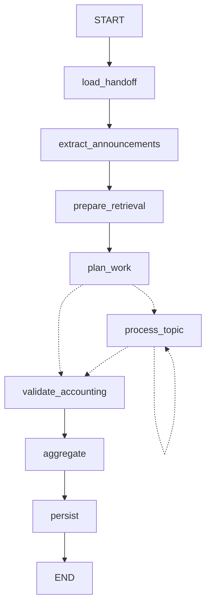

# Agent 3 — Plan

**Status (2026-10-30):** milestones 2-6 implemented; the Milestone 1 audit is not written up; Milestone 7 not
started. Agent 3 consumes the Agent 2 taxonomy handoff (schema 8 / handoff v2 projection) plus last-24h
announcements and produces reviewable AdviceCards (research, final severity, recommendations); the dashboard shows
them and records team-lead decisions.

How each part has been validated (levels: **live** = real model calls; **scripted** = prepared judgments replayed
offline; **placeholder** = a scripted stand-in that judges nothing; **offline** = deterministic code and tests, no
model; **test fixture** = hand-written, labelled data):

| Part | Validation | Where |
| --- | --- | --- |
| Contracts, rubric binding, Markdown ingestion (M2) | offline | `scripts/validate_agent3_inputs.py`, tests |
| Shared retrieval (M3) | offline (local embeddings; tuned set + holdout) | `scripts/evaluate_retrieval.py` |
| Advisor pilot v4-v5 (M4) | live, 6 topics + negative control | `agent3_acceptance_v1`, `agent3_closeout_v1` |
| Advisor v6 prompts | live, audio + Submit only | `agent3_readability_v1` |
| Advisor v6.1 prompts | live, audio + Submit only; its possessive-plural and record-authorship fixes, and the ToT fallback, are offline only | `agent3_overnight_smoke_v1` |
| Overnight workflow (M5), full handoff (87 work items) | scripted for the 6 pilot topics, placeholder for the other 81; no full live run | `agent3_overnight_offline_v2` |
| Overnight workflow, live | 2 topics (audio, Submit), 8 requests | `agent3_overnight_smoke_v1` |
| Dashboard + TL decision loop (M6) | offline: backend tests and browser tests on the saved runs, plus a labelled test-fixture run | `tests/test_dashboard.py`, `web/tests/` |

Open evaluation cases (not used for tuning) are in `data/evaluation/agent3_open_evaluation_cases.json`; the first is
the audio trial-outcome follow-up retrieval miss from the live smoke run (Milestone 6 section).

| # | Milestone | Work | Technologies / details | Done when |
| --- | --- | --- | --- | --- |
| 1 | Audit data against demo scenarios | Compare instructions, FAQs, historical decisions and last-24h announcements against the relevant Slack threads. Check authority, scope, chronology, contradictions and intentional gaps. | Manual review + simple scripts over the knowledge store and Slack fixtures. Map to the 8–9 demo cases: TL confirmation, FAQ edge case, temporal conflict, language routing, escalation, already-announced re-ask, QA misalignment, observation-only, upstream flags. | Coverage matrix (supported / partial / missing / contradicted) per demo case, plus proposed data edits. **No data changes yet.** |
| 2 | Apply approved edits, finalize contracts | Make agreed corrections to mock knowledge. Confirm Agent 2 handoff schema, announcement extraction format, AdviceCard fields, review records, severity rubric (with required evidence triggers), confidence bands (≥0.85 / 0.60–0.84 / <0.60). | Pydantic models: AdviceCard, DecisionRecord, AnnouncementRecord. Severity rubric loader. Explicit `card_line` enum and `needs_review_reason` values. | Validated source snapshot and explicit contracts (AdviceCard, Decision, Announcement, ModelReviewItem). Each edit has a reason and identified downstream impact. |
| 3 | Shared retrieval | Ingest guidelines, FAQ, historical decisions. Dense + BM25 hybrid, MMR re-ranking, metadata filters (project_id, date, tags, status). Read-only for Agent 3. Preserve citations, versions, authority, scope. | Chroma (or FAISS), three collections. MMR λ ≈ 0.6–0.7. Chunking: section-level for instructions/FAQ; whole-record for decisions. | Relevant sources returned, out-of-scope sources filtered, missing evidence stays visible. |
| 4 | Small Agent 3 pilot | CrewAI agent for 4–6 cases: current guidance, history, conflict, insufficient evidence, NO_ACTION/observation. Bounded research, severity assessment, grounding check, temporal priority verifier, card-line routing, shallow manual Tree-of-Thought. | Tools: guideline / FAQ / decision retrievers, temporal verifier, severity assessor, grounding checker. Manual ToT (plain Python or one structured call) only on conflict, low-confidence or open-confirmation paths: 2–3 candidate actions scored on grounding / temporal consistency / severity fit; pick best or surface both if close. Finite call budget. | Reviewable AdviceCards with traceable evidence, correct `card_line`, confidence scores, visible ToT options on flagged cases. No unbounded loops. |
| 5 | Overnight workflow | Agent 2 handoff + last-24h announcement extraction → Agent 3 research (conditional ToT) → guardrail routing → output. One topic failure does not stop the rest. | LangGraph: load handoff → extract announcements → per-topic CrewAI node → optional ToT node → guardrail/routing node → aggregate. Error isolation, non-blocking. | Complete run with no lost members or inherited review obligations. ToT only on intended paths. Failures logged and skipped. |
| 6 | Dashboard + TL decision loop | Single-page morning brief: overview, briefing, topic summary, AdviceCards, Model Review Queue. Approve writes decision + shows draft. Structured resolution on Needs Review (incl. ToT options). Accept/Reject/Defer on Agent 1/2 flags. New TL decisions feed back into the decisions collection. | FastAPI + React (Vite, Tailwind, Framer Motion). Endpoints: briefing, cards, approve, resolve, model-review actions. | A TL decision is saved once and retrievable by a later run. ToT alternatives visible on Needs Review cards. Approval distinct from execution. |
| 7 | Validate, prepare demo | All demo scenarios plus negative cases, temporal ambiguity, repeated TL actions, at least one ToT-triggering case. Confirm ToT does not run on normal high-confidence paths. | Scenario runner against LangGraph flow + dashboard. Check expected vs actual `card_line`, sources, `needs_review_reason`, ToT presence/absence. | Reproducible demo, results summary, known limitations, final handoff. Intentionally open cases stay open; ToT only where specified. |

## Notes for implementation

- The plan says `mock_knowledge/`; in this repo the knowledge store is
  `data/knowledge/` (`instructions/`, `faq/`, `decisions/<project>/`). See
  [announcement-routing.md](announcement-routing.md) for the source format and the
  shared ingestion contract (`knowledge_sources.iter_documents` / `normalize_document`).
- Agent 3 input: `data/processed/agent2_handoff_v2_projection/` (schema 8 / `agent2-taxonomy-handoff-v2`, a
  zero-call projection of the v7 release; load with `advice_inputs.load_effective_view`), with severity
  `UNKNOWN`/`UNASSESSED` deferred to Agent 3. The frozen v7 release (handoff v1,
  `topic_effective.load_effective_output`) is unchanged.
- Must carry every obligation: in the projection, 41 inherited Agent 1 obligations on discussions, 8 on
  announcement-route members and 3 naming cautions (49 + 3 in the v7 release). Needs Review items appear even
  without a recommendation.
- Severity rubric: `data/knowledge/severity_rubric.py` (`severity-rubric-v3-semantic-signals`, TL-owned).
  Open: per-project rubrics (`get_rubric_for_project` returns the shared default) and the severity level for
  rule-confusion topics (a TL rubric decision).
- Dependencies: Chroma (M3), LangGraph 1.2.18 (M5), FastAPI 0.162.0 (M6); BM25 is in-house
  (`retrieval/bm25.py`). The dashboard frontend (`web/`, React 18 / Vite 5 / Tailwind 3 / Framer Motion 11,
  Playwright for UI tests) has its own pinned `package.json` and `package-lock.json`.

## Milestone 2 (implemented)

Verify offline (zero calls, writes nothing unless `--report` names a new file):

```sh
uv run --locked python scripts/validate_agent3_inputs.py
```

| Module | Purpose |
| --- | --- |
| `src/threadsense/severity_rubric.py` | Loads `data/knowledge/severity_rubric.py` through its own `get_rubric_for_project`; records version plus a content hash of the parsed definitions (independent of line endings); checks contract compatibility and cited signal text. No classification. |
| `src/threadsense/agents/advice_contracts.py` | `agent3-advice-card-v1`, `agent3-decision-record-v1`, `agent3-announcement-record-v1` (wraps `SourceRecord`), `agent3-model-review-item-v1`, plus evidence, occurrence and severity models. |
| `src/threadsense/knowledge_markdown.py` | Markdown front matter (safe YAML, timestamps kept as strings) → `SourceRecord`. Used by `knowledge_sources.iter_documents` for `.md` paths. |
| `src/threadsense/knowledge_corpus.py` | Discovery limited to `instructions/`, `faq/`, `decisions/` Markdown and the documented `manual/`/`extracted/` JSON locations; reference, supersession, overlap and conflict report. |
| `src/threadsense/agents/advice_inputs.py` | Agent 2 export/registry accounting, one `ModelReviewItem` per obligation, structural occurrence counts, historical `DecisionRecord` mapping. |

**Guardrails in `AdviceCard` validation** (structural only): confidence `< 0.60` needs
`LOW_CONFIDENCE`; band `MODERATE` for `[0.60, 0.85)`, `HIGH` from `0.85`; assessed
`HIGH` needs `HIGH_SEVERITY`; inherited flags, recorded temporal conflicts, grounding
failures and open confirmations each need their reason. Any reason forces
`NEEDS_REVIEW`. `RECOMMENDED_ACTION` needs an operational action, cited sources and
`checks.grounding == PASSED`. `checks.grounding` defaults to `NOT_RUN` (not run, not
failed): such a card stays a draft or uses `NEEDS_REVIEW` with `GROUNDING_NOT_RUN`;
`GROUNDING_FAILURE` is accepted only when the check recorded `FAILED`. Validation never
performs semantic grounding.
Unassessed severity is `UNKNOWN`, provisional, with Agent 2's placeholder kept as lineage.

**Mapping decisions.**
- `instructions` → `guideline`. Authoring `record_kind`s (`advice_review`, `follow_up`,
  `expert_referral`, `expert_review`, `escalation_receipt`) → `decision`;
  `channel_announcement` → `announcement`. The full front matter is kept in
  `source_metadata.authoring`; unknown kinds fail rather than defaulting.
- IDs: canonical `record_id` = source identity (manual key or Slack channel/thread/message),
  `version_id` = content hash; authoring `document_id@version` kept separately. A second
  content for the same authoring identity is rejected. File paths never enter IDs.
- Supersession: section-level references stay in `source_metadata.supersession` with
  `granularity: section`; only whole-document references would populate
  `SourceRecord.supersedes` (none exist).
- Manual records: `effective_at` from front matter, `created_at` null, `last_updated`
  kept as authoring metadata. Slack records: `created_at` from the exact `ts`; identity,
  author, text and snapshot hashes verified (text: UTF-8 sha256; snapshot: sha256 of
  UTF-8 JSON with sorted keys and `(",", ":")` separators, inferred from the data since
  it was not documented). Retrieval text is the Slack message; the archive note and
  raw snapshot stay metadata. "Referenced records" link lists are excluded from text.
- `DecisionRecord` is built only for TL decisions (advice reviews, referrals, expert
  review, escalation); follow-ups and posts remain sources. Status strings map through
  explicit tables in `advice_inputs.py` and keep `source_status`.
- `card_line` values (`RECOMMENDED_ACTION` / `NEEDS_REVIEW` / `OBSERVATION`) and the
  action vocabulary (taken from the decision records) are this milestone's proposal.

**Closeout (2026-10-29).**
- Rubric: `RUBRIC_VERSION` is now `severity-rubric-v3-semantic-signals`; definitions,
  examples and signals are unchanged (content hash `eccaa31a…` is the same as before).
  The LOW comment now says limited impact may be inferred from context, but missing
  evidence alone does not establish LOW. Every project currently uses the shared default
  rubric: the loader reports `rubric_scope: SHARED_DEFAULT`, and assessed severities must
  record it. `UNKNOWN` (rubric level) and Agent 2's placeholder stay separated by
  `assessment_status`.
- Knowledge: the headset check approval/completion and onboarding office-hours post moved
  from `decisions/multilingual_eval/` to `decisions/audio_multimodal/` (their declared
  project). Bytes, record IDs and version IDs are unchanged. The validator reports any
  declared-project/folder mismatch and overrides neither value.
- Demo snapshot: `data/fixtures/slack_generated_demo/` (from
  `ThreadSense_MockData_Update_2026-10-28.zip`; package notes in
  `docs/threadsense_demo_update/`, never indexed) = 201 threads / 517 messages
  (178 discussion, 23 announcement) at cutoff `2026-10-02T12:00:00Z`. It adds only
  `C_AUDIO_ANNOUNCEMENTS` `1790892000.000901` (2026-10-01 22:00 UTC), before the later
  playback questions `1790896012.001900` and `1790903186.000110`. The original
  `data/fixtures/slack_generated/` (200 / 516) is unchanged and matches the package's
  recorded baseline hashes. The new announcement is not an Agent 1 member; it enters
  through announcement extraction, not the Agent 2 handoff.
- Current handoff: `data/processed/agent2_handoff_v2_projection/`, written by
  `scripts/project_agent2_handoff.py --write` with zero calls. It is a projection of the
  v7 release, not a fresh taxonomy run (`projection_manifest.json` records provenance).
  Announcement members are routed out (22 members, 8 obligations, in
  `routing_manifest.json`). 73 groups with unchanged discussion membership are
  re-exported from their saved v7 responses under schema 8 / handoff v2. 8 groups lost
  announcement members, so their saved responses cannot be reused without altering model
  output; their 17 members stay `UNASSIGNED` with a projection-gap review reason.
  9 announcement-only groups have no discussion members. Totals: 81 groups, 79 topics,
  161 assigned + 17 unassigned discussion members, 41 + 8 = 49 obligations, 39 effective
  review groups. The 3 naming cautions carried over by exact match (same group, members and
  response bytes) in `carried_review_supplement.json`, which `advice_inputs.load_effective_view`
  applies after checking its hash; the review registry is unchanged.
- Remaining: a taxonomy for the 8 partial groups needs either a new Agent 2 run on those
  payloads or an approved rule for projecting saved responses. The registry still lists
  `agent2_remaining_v6`, archived on 2026-10-28 (not applied to any inspected run).
  Record payloads embed the absolute grouping path, as the v7 release did, so projection
  hashes depend on checkout location.

## Milestone 3 (implemented): shared hybrid retrieval

```powershell
uv run --locked python scripts/build_retrieval_index.py            # offline; add --allow-download once if the model is not cached
uv run --locked python scripts/build_retrieval_index.py --rebuild  # after corpus/config changes (refused otherwise)
uv run --locked python scripts/evaluate_retrieval.py               # BM25 / dense / RRF / RRF+MMR on data/evaluation/agent3_retrieval_cases.json
```

Package `src/threadsense/retrieval/`: `corpus.py` (sources), `chunking.py`, `bm25.py`,
`embeddings.py`, `index.py` (build), `search.py` (read-only `Retriever`), `evaluate.py`.
Index: `.index/retrieval/` (git-ignored): persistent Chroma collections `guidelines`,
`faq`, `decisions` (incl. announcements), plus `chunks.json`, `documents.json` and
`manifest.json` in the same build.

- **Sources.** The 40 authored documents through `knowledge_corpus.discover` +
  `iter_documents`, plus current-day announcements through `fixture_routes` +
  `extract_announcement` on the demo snapshot at cutoff `2026-10-02T12:00:00Z`
  (23 extracted, 22 with inherited Agent 1 metadata, 8 of them review-flagged). Counts,
  duplicates and Slack overlaps are derived at build time (currently 63 documents, none
  removed). Archive Slack posts in the knowledge store stay authored history.
- **Embeddings.** `sentence-transformers/all-MiniLM-L6-v2` at revision
  `b9db1e8a0d3a51769172ba8546f282a73f066e47` (the grouping model), CPU, normalized,
  cosine, 384 dimensions, 256-token limit, identical encoding for queries and documents,
  loaded with `local_files_only` unless `--allow-download`.
- **Chunks** (`knowledge-chunks-v2`): guideline/FAQ sections with the document title;
  decisions/announcements whole when they fit, otherwise consecutive sections under a
  header repeating record kind and decision/execution/outcome state; oversized units split
  at paragraph/line/sentence/word boundaries; each chunk is checked against the token
  limit and nothing is truncated. v2 (Milestone 4 setup) splits an oversized FAQ section
  at question/answer units, and an answer continuation repeats its exact question; lines
  repeated for context (continued heading or question) are listed in each chunk's
  `repeated_context`, so the preservation check can tell them from duplicated source text.
  This fixed v1's orphaned continuation (the SC-PII-2026-09-10 paragraph without its
  question). Currently 112 chunks (guidelines 29, FAQ 16, decisions 67); 21 documents split. Chunk IDs hash chunking version + document/version +
  position. Each chunk keeps citation, flat filter metadata, review lineage and
  section-level supersession; full normalized metadata stays in `documents.json`.
- **Query.** `Retriever.search(query, project, batch=, batch_scope='project'|'strict',
  as_of=, include_shared=, collections=, document_types=, statuses=, record_kinds=, tags=,
  event_series_ids=, date_from=, date_to=, include_undated=, version_mode='current'|'history',
  top_k=8, candidate_k=30, rrf_k=60, mmr_lambda=0.9, mode='hybrid'|'dense'|'bm25',
  use_mmr=True)`. Filters and version applicability pick the eligible chunks first; both
  paths rank only those. Results carry text, citation, metadata, `batch_relation`,
  `date_status`, `expired_as_of`, supersession, `version` (lineage, state, applicability,
  other revisions, replaced sections), component ranks/scores and final rank; responses add
  `version_diagnostics` and `withheld_by_version`. Scores are not confidence or grounding.
- **Version-aware eligibility** (`retrieval/versions.py`). A lineage is one authoring
  `document_id` within project and scope (sources without authoring IDs use their
  version-independent `record_id`); never titles or embeddings. Revisions are ordered by
  source date only (`effective_at`, else Slack `created_at`), never by version strings,
  hashes, file or ingestion times. Reference time is `as_of`, else the index cutoff.
  Guideline/FAQ revisions need `approved`/`tl_approved` (or `partially_superseded`, whose
  unreplaced sections still apply); decision records need no approval status. States:
  `CURRENT`, `SUPERSEDED_REVISION`, `NOT_YET_EFFECTIVE`, `NOT_APPROVED`, `OTHER_BATCH_SCOPE`
  (only when an in-scope revision exists), `UNRESOLVED`. Section supersession declared by
  either side applies only to the named section, and only when the superseding source is
  indexed, approved and effective; otherwise it is reported as `UNVERIFIED_SUPERSESSION`.
  `current` (default) withholds superseded revisions and applicable superseded sections
  before ranking and lists them in `withheld_by_version`; `history` keeps every revision
  with its `applicability` marked. Tied or missing revision dates and ambiguous batch scope
  keep all candidates as `UNRESOLVED` with a diagnostic; retrieval never picks a winner or
  sets grounding. Conflicting contents for one authoring version still fail ingestion.
  On the current corpus every lineage has one revision; the only withheld chunk is
  `safety-qn-help-page@1.0#Contact details`.
- **Dense search** is exact cosine over the embeddings stored in Chroma; Chroma's HNSW
  `collection.query` is not used. In ChromaDB 1.5.9 that query failed intermittently
  ("Error creating hnsw segment reader: Nothing found on disk") after several collections
  were read. The cause is unidentified and the issue is not fixed; it is avoided. Exact
  search over 113 vectors is cheap and has no approximation error. The build verifies that
  every stored embedding is readable from a fresh process before publishing its manifest.
- **RRF** (k=60) combines dense and BM25 ranks; raw scores are never added. **MMR**
  re-ranks the fused pool with relevance min-max scaled to [0, 1] and redundancy = max
  cosine to already selected chunks (clipped to [0, 1]); ties fall back to fused order.
  Default lambda 0.9 (decided 2026-10-29); `use_mmr=False` gives RRF only, the evaluation
  baseline. Identical text collapses into one displayed result only when scope, dates,
  authority and decision/execution/outcome state also match; collapsed sources stay in
  `duplicate_sources` with citations and metadata (the current corpus has no identical
  chunk texts).
- **Evaluation (real embeddings, top 5).** Main set (`agent3_retrieval_cases.json`, 9
  answerable + 1 unsupported; the fictional-PII case explicitly uses `version_mode=history`
  because it targets the stale branch):

  | Variant | Mean recall | Full recall | Misleading near-matches | Date violations |
  | --- | --- | --- | --- | --- |
  | BM25 | 0.80 | 6/9 | 5 | 0 |
  | Dense | 0.93 | 7/9 | 3 | 0 |
  | RRF | 1.00 | 9/9 | 3 | 0 |
  | RRF + MMR 0.9 (default) | 1.00 | 9/9 | 4 | 0 |
  | RRF + MMR 0.65 (previous) | 0.52 | 4/9 | 7 | 0 |

  MMR 0.9 adds one near-match (the JSON audit-manifest decision in the JSON-vs-prose case)
  and moves the 22:00 playback announcement from rank 2 to 3 and from 3 to 4. Holdout
  (`agent3_retrieval_holdout.json`, two paraphrases labelled before running): BM25 0.83,
  dense 0.67, RRF 0.83, RRF + MMR 0.9 1.00; no near-matches. The holdout is too small to
  separate the variants. The unsupported payroll query still returns nearest neighbours,
  so result presence never implies an answer.
- **Redundancy-sensitive pairs (top 8, default settings).** Status note vs later handling
  announcement (cosine 0.89): ranks 3 and 6 with MMR, 4 and 5 with RRF, so a top-5 request
  can lose the announcement. Approval vs outcome pairs (playback trial, tie calibration,
  documentation sync, audit-export fix, headset check; cosine 0.71-0.80): both kept with
  MMR and RRF. Old help-page rule vs scoped replacement: both kept in history mode; in
  current mode the old section is withheld by design and remains discoverable through
  `withheld_by_version`, the clarification's `supersedes` link and history mode.
- **Git.** `data/processed/agent2_handoff_v2_projection/` (14 MB on disk; 242 files) is
  already tracked byte-exact (`-text`); keep it tracked as the recorded Agent 3 input. Its
  7 MB `effective_output.json` is derivable, but removing frozen files would change the
  recorded evidence, so leave it.

## Milestone 4 (implemented): bounded Advisor pilot

```powershell
uv run --locked python scripts/run_agent3_pilot.py                    # zero calls: freshness, topics, initial retrieval, request sizes, live configuration
uv run --locked python scripts/run_agent3_pilot.py --scripted tests/fixtures/agent3_pilot_scripted_judgments.json --write <new-dir>
uv run --locked python scripts/run_agent3_pilot.py --run --write <new-dir>   # PAID; not yet run (see "Live run" below)
```

Modules (`src/threadsense/agents/`): `advisor_contracts.py` (model I/O: `AdvisorDraft` v2,
`GroundingJudgment` v2, `ToTComparison` v1), `advisor_evidence.py` (freshness check, evidence
ledger, agent-facing serialization, `ResearchTools`, `Budget`), `advisor_checks.py`
(deterministic checks, final statements, authorization, card routing), `advisor_tot.py`
(conditional shallow ToT), `advisor_pilot.py` (orchestration, scripted and CrewAI clients,
request guard, outputs). AdviceCard v1 is unchanged; the pilot result record wraps it with the
trace, ledger, statement verdicts, withheld statements and alternatives.

**Retrieval setup (done first).**
- FAQ question context: chunking v2 above. Index rebuilt; real-embedding evaluation
  unchanged (main set RRF 1.00 / 9 full / 3 near-matches, RRF+MMR 0.9 1.00 / 9 / 4;
  holdout RRF 0.83, RRF+MMR 1.00). No retrieval regression; labels, settings and holdout
  untouched.
- Evidence the model receives (`evidence_item`): citation identity (document/version/chunk
  IDs, authoring ID, sections, source), `use`, applicability (state, replacement with its
  effective date, unverified supersession, supersedes links, other revisions), dates, scope,
  authority, recorded states and upstream review flags. `use` is `CURRENT_GUIDANCE`
  (guideline/FAQ), `ANNOUNCEMENT`, `PRIOR_DECISION`, `HISTORY_ONLY`, `UNRESOLVED_VERSION`;
  members are `MEMBER_REPORT`. Historical, unresolved, prior-decision and announcement
  excerpts start with a status line, so the status cannot be read apart from the text.
  Every payload also lists `withheld_by_version` and `version_diagnostics`. Tests parse the
  exact text the model receives (`task_description`), not the sidecar.
- Freshness: `open_retriever` runs `Retriever.staleness()` once before research and refuses
  a stale or incompatible index with the rebuild command; queries never re-check.

**Selected topics** (`data/evaluation/agent3_pilot_scenarios.json`, IDs and Agent 2 names
only; no expected sources or answers): audio playback `cluster_6b59d1…` "LT audio player
playback failure"; JSON vs prose `cluster_fb1dce…`; fictional PII `cluster_9378eb…`;
Korean register `cluster_3b950a…`; submit failure `routed_440e64c…`; repeated ending
`cluster_b7e523…`; plus the payroll negative control. The response-preference Submit threads
are a projection gap (no Agent 2 topic), so that card covers the group's 4 unassigned
members with `topic_id: null`, a mechanical label and a `projection_gap` inherited flag;
no taxonomy is invented. The payroll question has no handoff members and stays cardless (an
external negative control); a real handoff member is always on a card, even when its draft is
UNSUPPORTED or missing.

**Per-topic flow.** As-of is the index cutoff (`2026-10-02T12:00:00Z`) for every call,
including history mode.
1. Initial retrieval: current mode, all source types, top 5, RRF+MMR λ 0.9. The query is the
   topic name plus the earliest member's Agent 1 central question.
2. If the project has withheld (superseded) material, one history-mode supersession check
   with the same query (generic rule; on this corpus only safety triggers it).
3. Draft call. The model names gaps and optional follow-up queries; assesses each
   announcement it relies on (relevant? directive? verbatim directing sentence); gives each
   member a resolution state from that member's own messages; names documentation targets.
4. Up to 3 follow-up retrievals executed by `ResearchTools` (the model never calls tools
   itself), then at most one revision call.
5. Deterministic checks: structure (`structural_issues`, `action_issues`), severity binding
   to the unchanged rubric, temporal priority.
6. Conditional ToT (one call), only on conflict, low-confidence or open-confirmation paths and
   only when no structural check failed.
7. **One final semantic grounding call** over every statement that can reach the card or a
   reviewer (below), then authorization and deterministic card routing. Nothing after this
   call can add or change a statement.

**Final grounding and authorization (hardening pass, 2026-10-29).** Before this pass the
grounding call judged only the draft's claims and action, and ToT ran afterwards; the summary,
severity rationale, affected reporters and ToT alternatives were never judged, and resolution
came from Agent 1. Now `statements()` builds one list:

| Statement | Cites | Blocking |
| --- | --- | --- |
| `claim:<id>` (incident fact, guidance, history, inference) | the claim's evidence | if material |
| `summary` | all material claims' evidence | yes |
| `action` (text, scope and documentation targets) | support claims' evidence + targets | yes |
| `announcement:<id>` (relevant directive, quoted) | the announcement | yes |
| `resolution:<member>` (state other than UNKNOWN) | that member's messages (+ current sources) | yes |
| `severity:rationale`, `severity:signal:<LEVEL>[i]` | signals, reporters, incident facts | yes, when binding succeeded |
| `reporter:<author>` | the reporter's own message | yes |
| `alternative:<candidate>` (valid ToT candidates) | the candidate's evidence | no (never card content) |

The judgment returns one verdict per statement ID. Dependencies are applied deterministically
(`_effective`): a guidance claim resting only on announcements needs a SUPPORTED announcement
statement; an action needs every support claim SUPPORTED. No statement borrows another's
verdict. Grounding is PASSED only when every blocking statement is SUPPORTED; statements citing
nothing are never sent (NO_EVIDENCE). `authorize()` then builds the card only from SUPPORTED
statements: card reasoning is composed from supported claims (the model's free-text reasoning
stays in the result record), an unsupported summary is replaced by a withheld notice, an
unsupported action is not carried, an unsupported severity rationale or signal leaves severity
UNASSESSED, unsupported reporters are dropped from the lower-bound count, and an unsupported
member resolution becomes UNKNOWN. Every withheld statement stays in `diagnostics`
(`WITHHELD_STATEMENT` / `ALTERNATIVE_NOT_GROUNDED`) with its text and verdict; the card's
GROUNDING_FAILURE reason names it by ID only. A ToT candidate is preferred only if it is valid
and its own statement is SUPPORTED.

**Announcement applicability.** The 31 announcements carry no metadata separating a directive
from a routine note (all are `TEAM_LEAD` announcements; the 22:00 playback directive has the
same empty status as "Reminder to use headphones"). So no announcement is current handling by
type. An announcement becomes current handling for a topic only when the draft assesses it as
relevant and directive with a verbatim directing sentence (deterministic quote check) **and** the
final grounding judges that `announcement:` statement SUPPORTED. Recorded supersession resolves
a conflict only in favour of current guidance or a verified announcement. Identity, dates,
authority and scope are kept either way.

**Documentation targets.** `UPDATE_DOCUMENTATION`/`UPDATE_FAQ` must name targets
(`evidence_id`, section, `ADD`/`CORRECT`/`REMOVE`). Deterministic checks: the target is a
retrieved source of the right type; a named section is in the cited chunk; `CORRECT`/`REMOVE` of
current guidance is flagged `ACTION_TARGET_ALREADY_CURRENT` unless the draft reports a conflict
involving it. The card's scope note lists the targets and their state (e.g. "CORRECT
safety-qn-help-page@1.0 section 'Contact details' (superseded section, stale copy)").

**Resolution.** Agent 1 resolution labels travel as attributed inputs (with Agent 1's
verification status) and are never evidence. Each member's state must cite that member's own
thread (current sources may add support; history may not). The topic state is computed from
grounded member states: all equal → that state; known states differ → MIXED; any member without
a supported state → UNKNOWN. One resolved member never resolves the topic. The card reasoning
shows the grounded per-member counts and the attributed Agent 1 counts, including how many were
unverified.

**Budgets and request limits.** 4 model calls per topic (draft, revision, ToT, final
grounding), 28 per run; 6 retrieval calls per topic, 42 per run. Draft, revision and ToT run
only if a call stays reserved for the final grounding (`SKIPPED_RESERVED_FOR_GROUNDING`).
Request boundary, measured offline at the httpx transport (`tests/test_agent3_request_boundary.py`):

| Reply to one stage | Earlier Agent/Crew client | Now |
| --- | --- | --- |
| valid JSON | 1 request | 1 |
| non-final-answer text | 2 (CrewAI forced-final-answer call) | 1 (stage FAILED) |
| HTTP 500 / connection error | 3 (OpenAI SDK `max_retries=2`) | 1 |
| HTTP 429 | 9 (SDK retries × CrewAI's fixed 3-attempt rate-limit retry) | 1 sent, retry refused unsent |

The live client calls `crewai.LLM.call` directly (no Agent/Crew executor, no tools,
`max_retries=0`, `response_format=json_object`, temperature 0, `max_tokens` 4096, timeout
120 s) inside `RequestGuard`, which counts requests at the transport and refuses any second
request in a stage before it is sent. A reply that arrives without a request through the
guarded transport stops the run (`BoundaryNotObserved`). `QUIET_ENV` disables CrewAI telemetry
and LiteLLM's remote price-map download. An end-to-end test runs the whole pilot through the
live client against a fake provider: requests = stage calls ≤ 28, and cards match the scripted
run.

**Deterministic vs semantic.**

| Check | How |
| --- | --- |
| Citation IDs exist; incident facts cite member messages only; guidance cites current guidance or an established announcement, never a historical/unresolved item; history cites retrieved records; quotes verbatim (status lines excluded); announcement assessments quote verbatim; resolution cites the member's own thread | Deterministic (`structural_issues`); any failure = grounding FAILED without a semantic call (and no ToT) |
| Operational action supported by a guidance or prior-decision claim; documentation targets real, of the right type and not already current | Deterministic (`action_issues`) |
| Each statement supported by the excerpts it cites | Final semantic grounding call; PASSED only if every blocking statement is SUPPORTED after dependencies. Citation existence alone never passes; a missing judgment is NOT_RUN and nothing is authorized |
| Temporal priority | Deterministic: a model-reported conflict is RESOLVED only when recorded supersession links the historical item to the one current item (current guidance or a verified announcement); otherwise DETECTED. Unresolved versions or unverified supersession cited → DETECTED. Future and draft revisions never compete |
| Severity | Semantic proposal, deterministic binding (rubric text by level/index, member-message evidence per signal, reporters from their own messages, recurrence from retrieved records), then semantic grounding of rationale, signals and reporters. Any failure leaves severity UNASSESSED with an OTHER reason |
| Resolution | Semantic per-member proposal from thread messages, grounded per member; deterministic topic aggregation |
| Card line | Deterministic: contract review codes + GROUNDING_NOT_RUN + OTHER (insufficient/unsupported evidence, severity not established, stage failures) → NEEDS_REVIEW; otherwise an authorized operational action → RECOMMENDED_ACTION; else OBSERVATION |
| ToT | Triggered only by TEMPORAL_CONFLICT, confidence < 0.60 or OPEN confirmation; one call, 2–3 candidates, before the final grounding. Invalid candidates (unknown evidence) are not presented; valid ones are judged as their own statements. Never changes the card action or review reasons |

**Offline pilot output** (`data/experiments/agent3_pilot_offline_v2/`, `SCRIPTED_MOCK`;
`agent3_pilot_offline_v1/` is the pre-hardening run, kept for comparison): manifest,
per-scenario results (retrieval trace, evidence ledger, model-call log with raw responses,
drafts, follow-ups, statement verdicts, withheld statements, temporal, severity, resolution,
ToT, card, review items, coverage, budget), `cards.json`, `review_items.json`, `report.md`.
The prepared responses (`tests/fixtures/agent3_pilot_scripted_judgments.json`, regenerated by
`tests/fixtures/make_agent3_pilot_scripted_judgments.py` when evidence IDs move) exercise the
checks; they are not model output. Consumed: 18/28 model calls, 11/42 retrievals.

| Topic | Card; action | Grounding | Severity | Resolution (grounded vs Agent 1) | ToT | Notes |
| --- | --- | --- | --- | --- | --- | --- |
| audio_playback | NEEDS_REVIEW (HIGH, flags); UPDATE_FAQ, ADD to FAQ "Playback and tool issues" | PASSED | HIGH: 4 affected reporters; recurrence FOUND (batch-05 trial) | MIXED (2 partial: TL interim handling; 2 unresolved) vs Agent 1 3 UNRESOLVED + 1 PARTIALLY_RESOLVED (2 unverified) | — | 22:00 announcement verified as handling |
| json_vs_prose | NEEDS_REVIEW (open confirmation, flag); NO_ACTION (hold for TL) | PASSED | MEDIUM[0] | UNRESOLVED | A SUPPORTED (preferred); B (rejected JSON-first rule) UNSUPPORTED; C PARTIALLY_SUPPORTED | |
| fictional_pii | NEEDS_REVIEW (flag); UPDATE_DOCUMENTATION, CORRECT help page v1.0 "Contact details" only | PASSED | MEDIUM[1] | UNRESOLVED vs Agent 1 2 PARTIALLY_RESOLVED | — | Clarification and batch-08 post verified; conflict RESOLVED_BY_RECORDED_SUPERSESSION; instructions v1.4 and FAQ v1.1 stated as already updated |
| korean_register | NEEDS_REVIEW (flag); ROUTE_TO_LANGUAGE_SPECIALIST | PASSED | MEDIUM[0] | UNRESOLVED | — | Batch-10 precedent kept as scoped history |
| submit_failure | NEEDS_REVIEW (HIGH, GROUNDING_FAILURE, projection gap + flags); ESCALATE_ENGINEERING (ask whether reports match the open handoff) | FAILED: `claim:c5` ("share the cause…") withheld | HIGH: 5 reporters | UNRESOLVED | — | c5 text only in diagnostics, never on the card |
| repeated_ending | NEEDS_REVIEW (low confidence, insufficient evidence, flags); NO_ACTION | PASSED | MEDIUM[0] | UNRESOLVED | A and B SUPPORTED (close call); C ("confirmed loop", no evidence) not presented | No cause asserted |
| payroll control | no card | — | — | — | — | UNSUPPORTED although 5 nearest neighbours were retrieved |

**Tests.**
- `tests/test_agent3_advisor.py` (28, test-double index): each test's docstring says DETERMINISTIC or MOCKED SEMANTIC. Covers, among others: final grounding covering every card statement and running last; a ToT candidate whose unsupported claim cannot borrow the draft's verdicts; the routine-reminder negative case; documentation targets; member-level resolution. One test removes the upstream obligations from a copy of one record to reach RECOMMENDED_ACTION and OBSERVATION.
- `tests/test_agent3_request_boundary.py` (7, fake provider, network refused): one request per stage for each reply type; budget equals requests; an unobserved reply stops the run.
- `tests/test_agent3_pilot_integration.py` (3, real embeddings, offline):
  - the full scripted pilot, which also detects scripted evidence IDs drifting from the index;
  - recovery of the 22:00 announcement when the real top five for the member question
    "Was the previous playback workaround approved and did it work?" omit it;
  - the whole pilot through the live client against a fake provider (request accounting).
- The recovery test with the test encoder uses "Did the earlier reload trial restore playback?", for the same reason.

**Live run (prepared, not run).**

```powershell
$env:PYTHONIOENCODING = 'utf-8'
uv run --locked python scripts/run_agent3_pilot.py                                  # zero calls: check the printed live_configuration
uv run --locked python scripts/run_agent3_pilot.py --run --write data/experiments/agent3_pilot_live_v1
```

- Model: `THREADSENSE_MODEL` (currently `openai/gpt-4o-mini`), key `OPENAI_API_KEY` from `.env`.
- Limits: ≤ 4 calls per topic, ≤ 28 per run, 1 HTTP request per call (≤ 28 requests), no
  retries, ≤ 4,096 completion tokens per call, 120 s timeout.
- Size (measured on the scripted path, o200k tokenizer): draft requests 8–12k input tokens,
  revision up to 17k, grounding up to 9k, ToT up to 10k; 18 requests ≈ 186k input tokens. A
  live run that uses every call stays under 28 × 17k ≈ 480k input and 28 × 4,096 ≈ 115k
  output tokens.
- A failed stage is recorded, not retried; the topic still gets a card. Results are labelled
  `LIVE_MODEL`.

**Live evaluation v1 (2026-10-29, `data/experiments/agent3_pilot_live_v1/`, `LIVE_MODEL`).** One run, no
prompt or model changes, failures kept. `gpt-4o-mini` (returned `gpt-4o-mini-2024-07-18`); 15 stage calls =
15 HTTP requests, none blocked or retried; all HTTP 200, `finish_reason: stop`, all schema-valid;
120,207 input / 10,437 output tokens; 110.6 s model time, 136 s wall. The request guard now also
records provider usage, returned model and latency per request (instrumentation only).
Findings, checked against the cited passages:
- **No research loop.** No draft named a follow-up gap, so 0 follow-ups and 0 revisions; relevant
  records retrieved in the first pass (Korean batch-10 precedent, Submit engineering handoff, repeated-ending
  observation review, rejected JSON-first rule not retrieved at all) were not cited.
- **No actions.** No draft proposed an action; every draft (including the payroll control) set
  `open_confirmation` OPEN, even where current guidance answers the question (audio: no QN solely
  because playback fails). ToT therefore ran on 4 of 6 topics; it surfaced grounded options (audio
  POST_ALIGNMENT, Submit ESCALATE_ENGINEERING) that never reach the card.
- **Structural checks caught real defects.** PII: a paraphrased FAQ quote and a TL Slack message cited
  as GUIDANCE; Korean: a paraphrased FAQ quote; repeated ending: an affected reporter (U017) cited
  with U013's message; JSON: MEDIUM with no rubric signal. In PII and Korean one bad quote voided the
  whole draft (nothing authorized), withholding accurate claims too.
- **Grounding judge is lenient.** (Corrected 2026-10-29: the names in claims, e.g. "Yuki" for U019 and
  "Leo" for U007, were the right authors per the user directory; the defect was that v1 evidence carried
  author IDs only, so neither the judge nor any check could verify names. Directory names and a
  deterministic author check were added.) It passed audio HIGH[0] although the cited tutor messages
  do not state the work cannot be evaluated (the uncited TL reply does); passed a ToT option to
  "update documentation" on the strength of an instruction that does not call for it; and
  rationales often restate the statement. Resolution: the model may cite part of a thread, and the
  judge sees only what is cited (audio member 894091 marked UNRESOLVED and passed, though the
  uncited TL reply gives the same interim handling as member e76f89, whose PARTIALLY_RESOLVED was
  withheld).
- **Cards stay safe but thin.** All six are NEEDS_REVIEW with no action; useful content is the
  grounded incident summary, member threads and inherited flags; severity survives on audio and
  Submit (HIGH) only. The payroll control stayed UNSUPPORTED with no card.

**Correction pass (2026-10-29; pilot v3, draft contract v3).** Responses to live v1, with tests in
`tests/test_agent3_corrections.py` (recorded live-v1 failures replayed from
`tests/fixtures/agent3_live_v1_failures.json`) and `tests/test_agent3_request_boundary.py`:
- Open confirmation needs a specific `open_question` and the evidence that leaves it open; it is
  judged as an `open_question` statement and its flag is never cleared. A NEEDS_REVIEW card can carry
  a supported action; approval by a team lead is not an open question.
- The draft fills `coverage` (current guidance, announcements, prior decisions/outcomes, member
  questions); MISSING ties to a follow-up gap. Unassessed or unresearched needs become an OTHER reason.
- Validation is per statement: a quote marked VERBATIM must match; PARAPHRASE is judged semantically;
  a structural failure rejects only that statement and its dependents (an action resting on it), and
  everything else still goes to the judge. A mis-attributed reporter is dropped, not fatal.
- The judge sees every message of every member thread (directory names, roles, reactions) and every
  retrieved source. Names in claims must belong to a cited message's author; CAUSE claims need a
  record or a team lead/engineer message. Recommendations are judged on premises, applicability and
  rationale, not literal prescription (the deterministic "applicable source" rule was removed).
- A clearly preferred, valid ToT candidate becomes the action when the draft has none (`adopt`), then
  goes through final grounding; flags are untouched.
- Live client: per-arm settings (reasoning models get no temperature, `max_completion_tokens`,
  `reasoning_effort`, `service_tier`), a `CostLedger` reserving each request's maximum cost before
  sending (unknown usage charged in full), a 20,000-token input cap checked before sending, and
  RESOURCE / SCHEMA / PROVIDER failure classes. Verified offline against the installed LiteLLM 1.105.0.

**Model comparison v1 (2026-10-29, `data/experiments/agent3_model_comparison_v1/`).** A small
configuration comparison, not a benchmark: 3 cases × 2 arms, one run, no tuning or reruns.
`scripts/run_agent3_model_comparison.py` (zero calls by default). Same prompts (v3 fingerprints in
`experiment.json`), schemas, index `4da16f09…`, corpus `c72edb46…`, rubric and initial retrieval
(verified identical).

| | gpt-4o-mini (temp 0, 4,096 out) | gpt-6.1-sol (medium reasoning, standard tier, 16,384 out) |
| --- | --- | --- |
| Requests | 6 (draft + grounding ×3) | 9 (draft, revision or ToT, grounding ×3) |
| Input / output / reasoning tokens | 57,803 / 4,996 / 0 | 102,026 / 18,621 / 925 |
| Model time | 44 s | 222 s |
| Cost (settled at reported usage) | $0.0117 | $0.3902 |
| Schema / resource failures | 0 / 0 | 0 / 0 |
| Follow-up research | none | 1 (audio: recovered batch-05 trial approval and outcome) |
| Actions proposed / reaching a card | 0 / 0 | 3 / 1 (audio POST_ALIGNMENT) |
| Open confirmation | never set | 2, both specific and judged supported |

Experiment total: 15 requests (cap 24), $0.4019 of $3.00, every HTTP 200 / `finish_reason: stop`.

Reviewed against the cited passages (neither model's grounding verdict is the reference):
- **Baseline:** no actions, no follow-ups; JSON-vs-prose omitted coverage; audio marked prior decisions
  NOT_APPLICABLE although members ask about the earlier workaround; repeated ending proposed MEDIUM
  with no signal. Its judge passed "QN" glossed as "quality notification" (the lexicon defines QN as
  Quarantine).
- **Sol:** claims checked against sources were accurate (names, trial figures, calibration outcome
  2→7 of 8 pairs). Audio: correct four reporters, MIXED resolution matching the threads (both team-lead
  interim-handling threads PARTIALLY_RESOLVED), useful supported action on a NEEDS_REVIEW card. It
  wrongly treated an example-collection note as a directive; the judge rejected it.
- **Supported actions wrongly withheld (pipeline):** in JSON vs prose and repeated ending Sol's
  POST_ALIGNMENT was rejected only because one premise was a team-lead Slack instruction labelled
  GUIDANCE (correctly rejected); the all-premises dependency rule then dropped the action although
  its FAQ/instruction premises were supported.
- **Severity voided in 5 of 6 cases:** both models cited member "happening again" messages as historical
  recurrence; the deterministic rule (records only) is right about the evidence but voids the whole
  assessment instead of setting recurrence to NOT_CHECKED.
- **ToT:** ran on Sol's two open-confirmation cases; never adopted (the drafts already had actions);
  repeated-ending options were all PARTIALLY_SUPPORTED, so none was presented as grounded.

**Completion pass (2026-10-29; pilot v4, draft v4, grounding judgment v3).**
- Action sufficiency: the blanket "every premise must pass" rule is gone. The ACTION statement shows
  each premise with its status (SENT or the rejection code); the judge returns `action_sufficiency`
  (SUFFICIENT/INSUFFICIENT plus the essential premise IDs). The action stands only if SUFFICIENT, the
  essential IDs are premises of this action, and every one of them passed after dependencies.
- Role labels: GUIDANCE resting only on thread messages that include a team lead's is relabelled to the
  scoped `THREAD_INSTRUCTION` kind (recorded as ROLE_LABEL_CORRECTED) and judged for in-thread
  applicability; tutor text labelled guidance still fails.
- Recurrence: historical recurrence (FOUND) must cite retrieved records and is judged as its own
  statement; members' "happening again" messages are reported recurrence. Severity is rebound to the
  unchanged rubric from what passed: unsupported recurrence, signals and reporters are removed, an
  unsupported rationale is replaced by the supported signals' wording, and a level that loses its
  support is UNASSESSED (never lowered or defaulted).
- CrewAI: each stage runs as a Task for a role-specific Agent (researcher, alternatives analyst,
  grounding verifier) in a one-task Crew (max_iter 1, max_retry_limit 0, no tools, memory or planning).
  Verified offline at the transport: one request per stage; CrewAI's forced-final-answer and
  rate-limit retries are refused unsent; Sol requests carry no `stop`; CrewAI 1.15's
  `cache_breakpoint` message marker (left in by its LiteLLM path) is stripped by a subclass; the
  20,000-token input cap is checked on the exact request body; a 4xx configuration rejection or an
  exhausted budget halts further requests while every topic still gets its card.
- Offline replay of the six comparison outputs (`scripts/replay_agent3_comparison.py`,
  `data/experiments/agent3_comparison_replay_v1/`): gpt-4o-mini 21 recorded verdicts reused, 6 PENDING;
  Sol 42 reused, 27 PENDING (severity statements never judged in the original run, action sufficiency,
  two relabelled thread instructions). Pending judgments are never invented and leave content off the card.

**Acceptance pilot (2026-10-29, `data/experiments/agent3_acceptance_v1/`, gpt-6.1-sol, medium reasoning,
standard tier).** One run, no tuning or reruns. `scripts/run_agent3_acceptance.py`.
21 requests (cap 28), all HTTP 200 / `finish_reason: stop`, schema-valid, none blocked; no resource or
configuration failure. 261,299 input / 54,336 output (3,761 reasoning) tokens; largest input 19,118;
650 s model time, 677 s wall. $1.0660 of $6.00 (settled at reported usage; per scenario $0.12–0.26,
payroll control $0.03).

Reviewed against the cited sources (the pipeline's verdicts are not the reference):

| Scenario | Action on card | Severity | Resolution | Notes |
| --- | --- | --- | --- | --- |
| audio_playback | none (withheld) | HIGH[3], 4 correct reporters, recurrence FOUND (batch-05 trial records) | MIXED | Follow-up recovered the trial approval/outcome. Action withheld because the judge named Omar's report essential and that claim was falsely rejected by the name check |
| json_vs_prose | POST_ALIGNMENT | MEDIUM[0]; U018 (a question, not affected) correctly dropped | UNKNOWN | Optional premise rejected, action stood on the remaining premises |
| fictional_pii | UPDATE_DOCUMENTATION: correct only help page v1.0 "Contact details" | HIGH[3] | MIXED | Example-collection note correctly rejected as a directive; a false TEMPORAL_CONFLICT (see below) |
| korean_register | ROUTE_TO_LANGUAGE_SPECIALIST | HIGH[3], recurrence FOUND (batch-10 record) | UNKNOWN | |
| submit_failure | none (withheld) | HIGH[0]+[3], 5 reporters | UNRESOLVED | No "same cause" claim; the open question asks whether the reports match the earlier incident. Escalation withheld (essential premise rested on a rejected announcement) |
| repeated_ending | POST_ALIGNMENT | HIGH[3], 7 reporters | UNKNOWN | No cause asserted |
| payroll control | no card | — | — | UNSUPPORTED |

Pipeline defects found (not fixed in this pass; the run used the code as is):
- **Name check too strict:** 3 claims rejected for naming the owner of a cited message's thread ("In
  Omar's thread, Alex asks…"). All names were correct. Rule should also accept participants of the cited
  messages' threads.
- **Dependency timing:** the judge sees a premise as SENT even when its own announcement verdict will
  void it (Submit C13), so its sufficiency can name a premise that later fails.
- **Temporal rule too strict:** a superseded section against two agreeing current sources is reported
  as an unexplained conflict (`len(current) == 1`).
- **Severity level choice:** HIGH[3] ("multiple distinct people reporting a comparable problem") was
  used for rule-confusion topics (PII, Korean) where MEDIUM[0] ("recurring confusion about the same
  rule") fits more closely; the rubric's wording allows both, and the judge passed both.
- **ToT:** ran on all six topics (five open questions, one conflict); never adopted, as every draft had
  an action. Where the draft action was withheld (audio, Submit) the grounded preferred option exists only
  in the result record.

**Closeout patch (2026-10-30; pilot v5, draft v5, grounding judgment v4, AdviceCard v2).** Replaces the
name-specific presentation work above.
- Presentation: generated prose (summary, claims, rationales, actions, ToT candidates) refers to people by
  role, never by name; models see canonical IDs, roles and thread starters, not display names. Claims carry
  canonical-ID `attributions` (AUTHOR wrote the cited message, THREAD_STARTER started its thread,
  PARTICIPANT posted in it, for participation claims only), checked against the ledger and the user
  directory. A directory name still found in prose is checked the same way (code `NAME_RELATION_INVALID`
  if the relation fails) and then rejected as `PERSONAL_NAME_IN_PROSE`: the card uses roles and nothing is
  rewritten. Role wording ("the team lead instructs") must match a cited author's role; plural wording needs
  that many distinct cited authors (or topic reporters when no member message is cited). Quotations are
  not checked or changed. The final grounding judges the role-based text and the attributions. Card v2
  lists related threads with a short label and the stored permalink, or the thread ID (the fixtures store
  no permalinks). A guard reports any name left in card text (for example an Agent 2 topic title).
- Dependency order: premises are shown to the judge as `PENDING_YOUR_VERDICT` with `depends_on` (the
  announcement a guidance premise rests on), never as final; the rules order announcement applicability →
  final premise status → sufficiency; essential premises are validated against the final supported set
  (`ESSENTIAL_PREMISE_VOIDED_BY_DEPENDENCY` when the judge supported a premise its dependency voided).
- ToT fallback: the judge also returns `alternative_sufficiency` for each operational alternative. When the
  draft action does not reach the card, the model's preferred candidate replaces it only if it was not a close
  call, is valid with no issue (presentation checks included), its exact text was judged SUPPORTED, and its
  sufficiency check passed. Review reasons are unchanged.
- Temporal: one current source still explains a superseded section by record; several applicable current
  sources do so only if a non-blocking `SOURCE_AGREEMENT` statement is judged SUPPORTED. Uncertain
  applicability (unresolved/unverified revisions, upstream review, an unverified announcement) or a real
  disagreement stays DETECTED.
- Regressions (`tests/test_agent3_corrections.py`, recorded items in
  `tests/fixtures/agent3_acceptance_v1_cases.json`): the three observed false name rejections (the
  relations hold), wrongly attributed participants, the Submit dependency inconsistency (recorded Sol
  judgment → `ESSENTIAL_PREMISE_VOIDED_BY_DEPENDENCY`), a valid ToT fallback and four refusals, agreeing
  versus disagreeing or uncertain current sources. 764 offline tests pass.

Zero-call replay of the acceptance responses (`data/experiments/agent3_acceptance_replay_v1/`): 115
recorded verdicts reused, 19 pending (18 action/alternative verdicts, whose premises are now shown
differently, and one source agreement). All 30 recorded statements that name people are valid relations by
canonical ID (no `NAME_RELATION_INVALID`); as v5 prose they are rejected as names. The replay cannot verify
v5, so one live run followed.

**Closeout live run (2026-10-30, `data/experiments/agent3_closeout_v1/`, same Sol arm, six topic scenarios,
`scripts/run_agent3_closeout.py`, $3 ledger).** One run, no tuning or reruns. 18 requests sent (all HTTP 200,
`finish_reason: stop`, schema-valid); 2 refused unsent by the input cap (audio revision 20,477 tokens,
Submit revision 20,887). 230,556 input / 48,599 output (4,731 reasoning) tokens; 662 s model time;
$0.9471. Reviewed against the threads:
- No personal name in any draft or card; 57 attributions, none rejected; every role and count statement was
  correct (for example "two QA tutors and three tutors" for Submit's five reporters; repeated ending notes one
  tutor posting in two threads).
- Actions on the card: audio POST_ALIGNMENT (withheld in acceptance), JSON vs prose POST_ALIGNMENT, PII
  UPDATE_DOCUMENTATION (Contact details only), Korean ROUTE_TO_LANGUAGE_SPECIALIST, repeated ending
  POST_ALIGNMENT. Submit: withheld; the judge itself applied the dependency order (the action's use of the
  announcement thread rests on c7, whose announcement fails) and found it INSUFFICIENT; the ToT fallback was
  correctly refused (preferred candidate PARTIALLY_SUPPORTED).
- PII: the superseded help-page section against the FAQ and the verified clarification is now resolved by
  judged agreement; the status-note conflict (no superseded material) stays DETECTED.
- Severity: audio HIGH[0]+[3], Submit HIGH[0]+[3], repeated ending HIGH[3]; JSON vs prose MEDIUM[0] (U018
  dropped again); PII MEDIUM[1] and Korean MEDIUM[0] (HIGH[3] in acceptance). The rubric is unchanged, so the
  level choice for rule-confusion topics varies between runs; the wording remains a team-lead decision.

Remaining defects after the closeout:
- **Input cap blocks revisions:** v5 payloads (attributions, thread starters, longer rules) pushed the audio
  and Submit revisions over 20,000 tokens. Their follow-up evidence was retrieved but never used; audio's open
  question ("did the trial establish anything?") was judged unsupported because the trial outcome it asks
  about was in that evidence. Needs a decision: raise the cap or slim the revision payload.
- **ToT fallback not exercised live** (the one candidate it needed was correctly refused); covered offline only.
- **Prose checks are heuristic:** directory-name, role-verb and plural patterns (English, double quotes only);
  the final grounding remains the semantic check.
- **Severity level choice** for rule-confusion topics (above); per-member resolution withheld for one member
  in three scenarios (judged PARTIALLY_SUPPORTED); Korean ToT candidates overstated applicability.

**Readability and state pass (2026-10-30; pilot v6, draft v6, ToT v2, AdviceCard v3, prompts v6 then v6.1).**
- Card v3 answers what happened (`summary`), what the team lead should do (`recommended_action.label`, a fixed
  familiar label such as "Post a reminder" or "Report a technical issue to engineering"; `instruction`, one
  sentence), why (`rationale`) and what still needs review (`review_notes`, plain language). `draft_text` is the
  copyable draft, separate from the instruction. Enums, claim and evidence IDs, essential premises
  (`essential_premise_ids`), documentation targets (`targets`, by title and section) and processing errors are
  structured fields; `needs_review_reasons` keeps the internal codes. The final grounding judges exactly the
  displayed action text (label, instruction, draft, scope, changes), a separate non-blocking ACTION_RATIONALE and
  REVIEW_NOTE; an unsupported rationale or note is withheld without dropping the action.
- Display-text checks: no raw evidence/claim/user/member IDs, enum names or premise lists (`RAW_ID_IN_PROSE`); a
  double-quoted passage of five or more words must match a cited source exactly (`QUOTE_NOT_IN_SOURCE`). Quotations
  stay exempt from role rules and are never changed. A guard reports any ID or name left in card text.
- Prompts: a writing guide (writing targets, not limits: summary 1-2 sentences, one-sentence instruction, 1-2
  sentence rationale, announcement about 60-120 words) and two fictional STYLE ONLY, NOT EVIDENCE examples
  (an image-captioning reminder, a video-timestamp escalation) in the draft and revision rules.
  `PROMPT_VERSION` and fingerprints of the guide and examples are recorded in every manifest.
- Truncation trace: stored card text was complete; the cuts in the shared sample came from the display script.
  Real cuts were in storage (review-reason details at 300/900 characters, inherited Agent 1 review text at 600,
  thread labels at 70) and in the model input (Agent 1 rationale/review reason at 400/600); serialization cut
  nothing and every live response ended with `stop`. All of these are removed. A thread label quotes the opening
  message's first sentence only if it is complete and at most 100 characters; `opening_text` stores the full message.
- State: review reasons come from the final validated results. An open question the final grounding did not
  support is no longer an OPEN_CONFIRMATION reason (it stays a withheld statement; the check reads NONE). Coverage
  distinguishes not researched, follow-up not run, nothing new found, still missing after revision, and records
  retrieved but not incorporated because the revision did not run. Replay reproduces a recorded stage failure with
  its recorded class.
- Input cap 24,000 tokens (reservation $0.212 per Sol request; acceptance worst case $5.93 of $6, other limits
  unchanged). The rules were sent twice per request (task text and JSON body); now once.

Offline first: zero-call replay of the closeout responses (`data/experiments/agent3_closeout_replay_v1/`): 128
verdicts reused, 22 pending (changed display text). Every recorded v5 summary carried bracketed evidence IDs and
is rejected as `RAW_ID_IN_PROSE`; audio's unsupported open question is no longer a review reason; audio's coverage
reads "follow-up retrieved 3 item(s) but they were not incorporated (revision FAILED (RESOURCE))".

Live (`data/experiments/agent3_readability_v1/`, `scripts/run_agent3_readability.py`, audio and Submit, prompts v6,
same Sol arm): 6 requests (cap 8), all HTTP 200 / `stop`; 85,907 input / 19,596 output (1,160 reasoning) tokens;
228 s model time; $0.3678 of $2.00. Audio's revision ran (19,009 input tokens) and used the trial records.
- Both cards now carry an action: audio "Post a reminder" (103-word draft) and Submit "Report a technical issue to
  engineering" (115-word draft listing the four threads by task, no shared cause asserted); Submit was withheld in
  the acceptance and closeout runs. No name or internal ID in either card; summaries are two sentences; reporter
  counts and roles match the threads. Submit keeps its supported open question; audio has none.
- Found and fixed offline after the run (not rerun live): (1) "In two tutors' threads, the team lead says ..." was
  rejected because the plural check counted the cited authors (one team lead); a possessive plural now counts the
  threads' starters. This also withheld audio's HIGH[0] signal (severity rested on HIGH[3]). (2) A record
  attributed to the team lead as AUTHOR was rejected; AUTHOR now holds for a record whose authority actor is that
  user. (3) Audio's review note about open upstream flags was judged unsupported because the judge did not see the
  flags; grounding now receives `open_review_flags` (prompts v6.1). The zero-call replay
  (`data/experiments/agent3_readability_replay_v1/`) shows the three statements no longer rejected and pending a
  judgment the run did not make.

Remaining after this pass: the three fixes above are verified only offline; the ToT fallback is still not exercised
live; prose and display checks are pattern-based; the severity level choice for rule-confusion topics remains a
team-lead rubric decision.

**Needs a real model evaluation (not shown by these tests):**
- whether the Advisor names the right gaps and follow-up queries unprompted;
- whether it keeps incident facts and guidance apart and cites precisely;
- whether it avoids inventing causes, approvals or counts;
- its announcement assessments (relevance and directive content) and documentation targets;
- its per-member resolution states;
- its severity proposals against the rubric, and affected-reporter identification;
- whether its open-confirmation and conflict judgments are right;
- statement-level grounding accuracy, including false PASS/FAIL rates on the larger statement set;
- the quality and diversity of ToT candidates;
- JSON validity rates with one attempt (each invalid output costs a stage);
- whether 4 calls per topic is enough.

**Remaining limitations.**
- Every pilot topic carries upstream obligations, so every card is NEEDS_REVIEW; RECOMMENDED_ACTION and OBSERVATION routing is covered only by tests.
- Initial-query construction is a fixed rule; in the real index the playback announcement already ranks in the top 5, so recovery runs only in tests.
- ToT triggers are computed before the final grounding (from the draft and the pre-grounding temporal check). The card's temporal result is recomputed after grounding with verified announcements only.
- Resolution has no state for "answered by current guidance but not in the thread"; such members are UNRESOLVED with that basis.
- On HTTP 429, CrewAI's rate-limit wrapper still waits its backoff (1–8 s, or Retry-After) before the guard refuses the retry. `RequestGuard` patches the httpx transport class for the duration of one call, so the client is single-threaded.
- Group members outside the selected topic are reported as outside this card. They are not dropped, but this pilot does not process them.

**Test reliability (investigated 2026-10-29).**
- ChromaDB "Nothing found on disk": reproduced with `tests/repro_chroma_reopen.py` (isolated temp
  directories outside the repo). Cause: `build_index` released its client with `del`, which
  leaves the Chroma system cached per path; the in-process `Retriever` then reused that cached
  system and intermittently failed to read the HNSW segment. The subprocess readability check is
  not the cause: a single-process variant failed too. Unclosed: 10 failures in 320 build→open
  cycles; closed: 0 in 260. Fix: `client.close()` after the build (regression test
  `test_build_releases_its_chroma_client`). No sleeps or retries.
- Agent 1 `test_200_mixed_mocked_outcomes_continue_after_flagged_and_failed_middle_records`: the
  full-suite failure's traceback was not captured, so its cause is not known. Repeated alone with
  full logs (`.cache/test-logs/agent1-*.log`): with `--basetemp` inside the repo it failed 3 of 20
  runs, each with `PermissionError [WinError 5]` from `os.replace` overwriting
  `verified_v1/content_review_report.json` (`scripts/run_agent1_verification.py:50`; the runner
  rewrites four report files after each of 200 records, about 800 replaces per test, and closes every
  handle it opens). With `--basetemp` outside the repo: 0 of 20. That points to another process briefly
  holding the freshly written file in the repo tree, but the comparison is not conclusive (one-sided
  Fisher p about 0.12) and the process was not identified. The runner is fingerprinted, so it is
  unchanged; use a `--basetemp` outside the repo.

## Milestone 5 (implemented 2026-10-30): overnight workflow

`src/threadsense/agents/overnight.py` (`agent3-overnight-v1`), runner `scripts/run_agent3_overnight.py`, tests
`tests/test_agent3_overnight.py`. LangGraph 1.2.18 (added with `uv add`, `pyproject.toml` + `uv.lock`).

**Validation baseline (recorded in every run manifest).** Prompts v6 are live-validated
(`agent3_readability_v1`); v6.1 (open review flags in grounding, plus three deterministic fixes) was offline-only
until the smoke run below. Replay reuses only unchanged judgments, and a pending judgment never counts as
grounding PASSED (the accounting step checks every card). Two invariants confirmed and tested:
- **Approving authority is not authorship.** A manual record's `authority.actor_id` is its approver; AUTHOR holds
  for a retrieved record only when it is a Slack message record (actor = the message author). This corrects the
  readability-pass fix, which had accepted the team lead as author of the September 28 handoff record.
- **Explicitly attributed quotations are matched regardless of length** ("the team lead wrote: ...",
  "the FAQ calls it ..."); unattributed quotations are matched from five words.

**Graph** (sequential; heavy objects stay in a runtime object, graph state is a cursor and stop reason):



- `load_handoff`: `load_effective_view` plus `accounting_issues` (refuses an invalid handoff) and the routing
  manifest's announcement-route members.
- `extract_announcements`: the run window's announcements through `source_ingestion.fixture_routes` and
  `extraction_report` (zero calls, canonical source IDs, validated but not stored). Discussion threads are only
  counted; nothing goes to Agent 1.
- `prepare_retrieval`: opens the snapshot once (freshness check) and refuses a run cutoff different from the
  snapshot cutoff. Each window announcement is checked in the snapshot by canonical document ID or thread.
- `plan_work`: one work item per Agent 2 topic and one per projection-gap group (its unassigned members under the
  existing "no Agent 2 topic" label; no taxonomy invented). `--only` scopes a run; the rest are OUT_OF_SCOPE.
  Freezes the run manifest.
- `process_topic`: `advisor_pilot.advise` unchanged: research, conditional ToT, final grounding and routing stay
  inside it; the graph makes no model call. Before a topic: room for two requests (draft and grounding) in the run
  request ceiling and the cost ledger, else this and later topics are UNPROCESSED_BUDGET. A topic that raises is
  TOPIC_FAILED (PIPELINE, SCENARIO or PERSISTENCE) with members and review items kept. Stage failures keep the
  Advisor's classes (PROVIDER, SCHEMA, RESOURCE, CONFIGURATION, REQUEST_CEILING); no retries.
- `validate_accounting`: a disposition for every discussion member, unassigned member, inherited obligation,
  announcement-route member and obligation and naming caution, from the inputs; the Model Review Queue (all upstream
  obligations, linked to cards by ID, separate from the cards).
- `aggregate` / `persist`: `morning_brief.json` and `morning_brief.md` from validated card fields only (no
  generation call), `cards.json`, `review_queue.json`, `accounting.json`, `diagnostics.json` (withheld statements,
  structural issues, stage failures), `topics/<work>.json`, `graph.mmd`.

**Persistence and resume** (run artifacts; LangGraph's own checkpointer is not used, so no second store):
`run_manifest.json` freezes the cutoff, window, handoff/routing/announcement/index/rubric/prompt fingerprints,
client and limits; a resume with any change refuses. `progress/run_state.json` holds the budget counters and cost
ledger, saved before each request and after each settlement. A reservation still open at interruption is charged
in full on resume. Completed topics are reused without requests. A topic interrupted mid-run
(`progress/in_flight/`) is INTERRUPTED_UNCERTAIN and resent only with `--resume DIR --release WORK_ID`. A failed
save of the run state stops the run (PERSISTENCE) rather than send unrecorded requests.

**Commands.**
```sh
uv run --locked python scripts/run_agent3_overnight.py --cutoff 2026-10-02T12:00:00Z            # zero calls: plan, worst case, graph
uv run --locked python scripts/run_agent3_overnight.py --cutoff 2026-10-02T12:00:00Z --scripted --write <new-dir>
uv run --locked python scripts/run_agent3_overnight.py --cutoff 2026-10-02T12:00:00Z --run --write <new-dir> \
    --only audio_playback --only submit_failure --max-requests 8 --max-cost 2                      # PAID
uv run --locked python scripts/run_agent3_overnight.py --resume <dir> [--release WORK_ID]
```

**Offline full handoff** (`data/experiments/agent3_overnight_offline_v2/`, SCRIPTED_MOCK: prepared pilot
judgments for the 6 pilot topics, a placeholder that judges nothing for the other 81). Status COMPLETE,
accounting COMPLETE, 0 issues, 25 s, 260 scripted calls, 0 HTTP requests. Counts derived from the inputs:
- 87 work items (79 topics, 8 projection-gap groups), 87 cards (all NEEDS_REVIEW);
- 178 discussion members (161 assigned, 17 unassigned), all on cards;
- 22 announcement-route members with 8 obligations;
- 41 inherited Agent 1 obligations and 3 naming cautions: 52 Model Review Queue items;
- 23 window announcements, 23 in the snapshot.

The first offline run (`agent3_overnight_offline_v1`) found a real defect and showed the isolation working: a
projection-gap group whose first member asks no question (12 handoff members have no central question) failed on a
None retrieval query, was recorded TOPIC_FAILED with its members, and the other 86 completed. The initial query
now falls back to the earliest question, then the earliest summary, then the topic label.

Exercised in tests (HashEncoder index, scripted): one topic raising (COMPLETE_WITH_FAILURES); a 5-request ceiling
(third topic UNPROCESSED_BUDGET, the second topic's ToT skipped to keep its grounding call); interruption during
grounding and resume (first topic reused with no call, interrupted topic not resent, budget not reset, explicit
release); changed budget, scope or cutoff refused; an open reservation charged on resume; an unsaved run state
stopping the run.

**Live smoke** (`data/experiments/agent3_overnight_smoke_v1/`, gpt-6.1-sol, prompts v6.1, audio and Submit,
`--max-requests 8 --max-cost 2`): 8 requests, all HTTP 200 / `stop`, 0 blocked; 123,186 input / 27,918 output
(1,484 reasoning) tokens; $0.5256. Both revisions ran (18,434 and 19,489 input tokens). Accounting COMPLETE for all
178 members (8 on the two cards, 170 out of scope), 52 review items.
- Audio: "Report a technical issue to engineering" (the readability run chose "Post a reminder"; the model chose
  differently). HIGH[3], 4 reporters, MIXED. No names or IDs in card text. Its review note about the open flags was
  judged SUPPORTED: the v6.1 `open_review_flags` fix works live. The follow-up retrieved the trial approval but not
  the trial-outcome record (a different query than earlier runs), so the card says the outcome is not established
  in the available records, and its coverage note says nothing further was found. Accurate for what was retrieved,
  but a recall miss.
- Submit: "Report a technical issue to engineering", HIGH[0]+[3], 5 reporters, open question about the earlier
  incident kept. The announcement-as-handling statement was again correctly withheld.
- The possessive-plural and record-authorship cases did not occur, so those checks are verified offline only.
- Its topic results use the nested file path of the first version (`topics/topic__<group>/topic_<n>.json`);
  later runs write flat names, and a resume still finds the nested ones.

**Full live run estimate** (87 work items, same arm). Observed per topic: $0.16–0.18 mean, $0.26 max; 3.0–3.3
requests; about 110 s model time. Expect about $14–16 (upper bound about $23 at the observed maximum), about 260–290
requests, about 2.5–3 hours sequential. Worst-case reservation: 348 requests × $0.212 = $73.72, so set
`--max-cost` (for example $25–30) as the binding limit; topics beyond it are recorded UNPROCESSED_BUDGET. The pilot
topics are among the larger ones; the other topics are unmeasured.

**Limitations.**
- Sequential only; LangGraph checkpointing is not used (durable state is the run directory).
- Announcements are extracted and checked against the snapshot, but the snapshot is built separately
  (`build_retrieval_index.py`); the run refuses a mismatched cutoff rather than rebuilding.
- Follow-up retrieval recall depends on the model's query (audio's outcome record was missed once).
- Prose and display checks are pattern-based; the ToT fallback is still not exercised live; severity level choice
  for rule-confusion topics remains a TL rubric decision.
- Run-state saves inside the VS Code-watched repo can hit the Windows `WinError 5` lock; such a run stops as
  PERSISTENCE (resume it, or write runs outside the repo).

## Milestone 6 (implemented 2026-10-30): morning-brief dashboard and TL decision loop

Backend `src/threadsense/dashboard/` (FastAPI 0.162.0): `runs.py` (read-only run catalog, evidence and thread
views), `decisions.py` (decision contracts and the SQLite store), `decision_sources.py` (export through the
existing ingestion path, later snapshots), `app.py` (API). Frontend `web/` (React 18, Vite 5, Tailwind 3, Framer
Motion 11). Runners `scripts/run_dashboard.py`, `scripts/build_decision_snapshot.py`. Tests `tests/test_dashboard.py`
(backend) and `web/tests/dashboard.spec.js` (Playwright, system Chrome). Labelled fixture run
`tests/fixtures/dashboard_runs/dashboard_states_fixture_v1/` (builder `tests/fixtures/make_dashboard_fixture_run.py`).
No model calls, no Slack posting, no endpoint that executes anything.

**The page.** Run selector (each overnight run directory separately; never merged), project filter, acting-as
team lead (fixture users with role TEAM_LEAD; no authentication, localhost only), run banner with mode
(LIVE / SCRIPTED / TEST_FIXTURE), status, cutoff and window, and a note when two directories share a run ID
(`offline_v1`/`offline_v2`). Overview tiles: cards by line, failed, unprocessed, out of scope, model-review items;
the saved briefing (the run's `morning_brief.md` header) and a topic summary (every work item with its outcome).
Incomplete work is listed with its failure class. Cards are grouped Recommended actions / Observations / Needs
review; each card shows its saved text unchanged: summary, action label, instruction, why, copyable draft, scope
note, review notes, supported alternatives (ToT candidates the final grounding call judged SUPPORTED and
SUFFICIENT, with no recorded prose or display issue, other than the card's action), related threads, cited sources. A per-card badge names the semantic
source: Live model, Scripted (prepared judgments), Scripted placeholder (nothing judged), Test fixture. IDs, checks,
reasons and diagnostics are in an expandable technical section. The Model Review Queue is a separate tab.

**Evidence.** The source view reads the run's saved evidence ledger: saved text, source date and basis, effective
and valid-until dates, scope and batch relation, applicability (state, revision state, replaced by), authority,
recorded decision states, citation IDs. Superseded sections, superseded revisions and expired records carry a
visible label in the card list, the full evidence list and the detail view. Thread views come from the Slack
fixture (internal view; fixtures store no permalinks, so none is shown or invented) and mark each message that is
in the saved evidence and whether it still matches it. A stored permalink would be linked. Only threads referenced
by the run can be opened. Deep links (`#run=...&panel=...`) reopen the same view.

**Decisions (persistence extension).** One authoritative store: a SQLite file (default
`.state/dashboard/tl_decisions.sqlite3`, ignored by git; `--decision-db` to choose). SQLite was chosen over JSON
files because it gives atomic transactions, a unique idempotency key and serialized writers, and it does not use
the `os.replace` pattern that hits the Windows `WinError 5` lock in this watched repo. Rows are append-only
(`card_decisions`, `review_actions`); a separate `indexing` table holds retrieval status. Two new contracts wrap
the unchanged v1 records (DecisionRecord and ModelReviewItem are not edited):
- `dashboard-tl-decision-v1` (TLDecisionEntry): the DecisionRecord plus run/card binding (run directory, run ID,
  run mode, `cards.json` hash), the resolution kind, text provenance, TL note, request key and hash, sequence and
  superseded entry. Fixed flags: approval is not execution; a disposition is not resolution evidence; a severity
  override is not a rubric change.
- `dashboard-model-review-action-v1` (ModelReviewEntry): one ReviewAction for one ModelReviewItem of one run.

| Card line | Decision | DecisionRecord |
| --- | --- | --- |
| Recommended action | Approve (draft unchanged or edited) | APPROVED / APPROVED_WITH_EDITS, the card's action type |
| Needs review | Confirm FAQ update | APPROVED(_WITH_EDITS), UPDATE_FAQ |
| Needs review | Confirm announcement | APPROVED(_WITH_EDITS), POST_ALIGNMENT |
| Needs review | Route to an expert (engineering / language specialist) | APPROVED(_WITH_EDITS), ESCALATE_ENGINEERING / ROUTE_TO_LANGUAGE_SPECIALIST |
| Needs review | Override severity (reason required) | OVERRIDDEN, severity_override {proposed, tl_selected, reason} |
| Needs review | Dismiss (reason required) | REJECTED, no action |
| Observation | none | - |

Every decision records execution NOT_EXECUTED and outcome NOT_OBSERVED. Text provenance is explicit:
MODEL_GROUNDED (the card's validated draft, or a supported alternative's draft, unchanged), TL_EDITED (the TL
changed that draft; the original is kept), TL_WRITTEN (no matching draft existed), NONE. The UI labels each before
and after saving. Copying a draft only writes to the clipboard ("Nothing was posted").

A decided card leaves the active worklist and is listed under Resolved with its card, review reasons and evidence
unchanged; "Record a new decision" appends a superseding entry. Model-review actions are run-scoped: ACCEPT
resolves the flag for that run, REJECT records a negative example (`/api/runs/<run>/negative-examples`, with the
upstream obligation verbatim), DEFER keeps it open; the item's history is `record_review_action` applied in order.
They never touch a card.

**Safe repeats.** Every POST needs an `Idempotency-Key`. In one `BEGIN IMMEDIATE` transaction the server looks up
the key: same request hash returns the stored response (HTTP 200, `replayed: true`); a different request is refused
(422 `IDEMPOTENCY_KEY_REUSED`, the first decision unchanged); otherwise the request's `expected_head` must equal
the card's (or item's) latest entry, else 409 `STALE` with the current head; then the entry, its indexing row and
the key are written and committed (WAL, `synchronous=FULL`), and only then does the response say
`persisted: true`. The UI reuses the key only to retry the identical request (lost response: "Not confirmed ...
Retry safely"), disables the button while saving, and shows success only on a persisted 2xx; a conflict shows the
newer decision and saves nothing.

**Retrieval loop.** Before a decision is committed it is rendered as a `mock-knowledge-markdown-v1` decision record
and parsed by the existing path (`knowledge_markdown` -> `SourceRecord` -> `normalize_document`);
`advice_inputs.decision_record_from_source` must reproduce the stored DecisionRecord exactly (except `source`), so
approval, execution and outcome states survive (one additive mapping: `tl_response.outcome: overridden`). One
lineage per (run, card): later decisions are later versions, so `version_mode='current'` shows only the latest.
Records are decisions (history), never guideline/FAQ, so an approved draft never becomes current policy. Indexing is
separate: `scripts/build_decision_snapshot.py --cutoff <later> --index-dir <new>` exports the store
(content-addressed, byte-identical on repeat) and builds a NEW snapshot with the knowledge store plus decisions
recorded at or before the cutoff (`retrieval.index.plan(..., decision_root=...)`; without it the build fingerprint
inputs are unchanged). Later decisions are reported as after the cutoff, never backdated. It refuses the active
index (`.index/retrieval`). Status per decision: PENDING -> INDEXED (snapshot, fingerprint) or FAILED (error); a
failed build leaves the decision intact and a later build indexes it once. Note: the later snapshot's current-day
announcement window is the 24 hours before its cutoff, so the October 1-2 fixture announcements are not in it.

**Commands.**
```sh
npm --prefix web ci && npm --prefix web run build                                   # once: frontend bundle (web/dist)
uv run --locked python scripts/run_dashboard.py                                     # http://127.0.0.1:8000
uv run --locked python scripts/run_dashboard.py --include-test-fixtures --decision-db D:/tsb/demo.sqlite3
npm --prefix web run dev                                                            # optional: Vite dev server on :5173, proxies /api
uv run --locked python scripts/build_decision_snapshot.py --cutoff <ISO> --index-dir .index/retrieval_tl_<date>          # plan only
uv run --locked python scripts/build_decision_snapshot.py --cutoff <ISO> --index-dir .index/retrieval_tl_<date> --build  # build
uv run --locked --extra dev python -m pytest tests/test_dashboard.py -q --basetemp D:/tsb/pytest-dashboard
npm --prefix web run test:ui                                                        # needs web/dist and system Chrome
```

**Verification (offline, 2026-10-30).** Backend `tests/test_dashboard.py`: 21 passed (run modes and shared run IDs;
card text unchanged; supported alternative; superseded labels; thread view without permalinks; approval saved once,
replay, key reuse refused, restart; 8 concurrent duplicates -> one row; stale -> 409, superseding entry; every
resolution kind including TL-edited, TL-written and supported-alternative text; 8 invalid requests refused with no
row; observations and missing keys refused; review actions run-scoped with cards and run files byte-identical;
Markdown round trip; later snapshot finds the decision with `tl_approved` / `not_executed` / `not_observed`, the
October 2 snapshot excludes it, failed indexing recorded then indexed once, a superseding decision is the only
current version; no decision source leaves the plan fingerprint unchanged; run artifacts and corpus unchanged).
Browser `web/tests/dashboard.spec.js`: 9 passed against the real server and system Chrome (approve -> refresh ->
restart = one decision, not executed, copy is not posting, no non-local request; double click and two concurrent
identical requests = one decision, key reuse with new content refused; lost response -> "Not confirmed" -> safe
retry, one decision; FAQ (edited), language specialist, announcement (TL-written), dismiss, supported alternative,
with run files unchanged; stale second tab -> conflict; Accept/Reject/Defer with cards unchanged; superseded labels
in list and detail, thread view and deep link; live/scripted/fixture banners, failed and unprocessed counts; a saved
decision indexed into a later real-embedding snapshot and found by retrieval with its exact states).

**Open evaluation case: audio trial-outcome follow-up miss** (`data/evaluation/agent3_open_evaluation_cases.json`).
In `agent3_overnight_smoke_v1` the audio card's follow-up query (written by the model) returned the trial approval
but not the trial-outcome record, so the card says the outcome is not established in the available records.
Replaying the same query and filters against the run's index (zero calls) puts the outcome record 6th, one place
outside `top_k` 5, behind the current instructions and two batch-06 announcements. Earlier live runs retrieved it
with different queries. Recorded only: no retrieval parameter, corpus or prompt change, and the smoke output is
unchanged.

**Limitations.**
- No authentication: the acting-as choice is trusted; serve on localhost only (the runner refuses other hosts).
- The live smoke run has two Needs Review cards only; Recommended Action, Observation and unprocessed-work states
  are exercised on the labelled test fixture, and some resolutions on scripted offline cards.
- Overnight runs do not yet read a decision-inclusive snapshot: `run_agent3_overnight.py` uses the active index,
  so a later run that should see TL decisions needs that wiring (Milestone 7) and a new snapshot at its cutoff.
- A later snapshot has no current-day fixture announcements unless the fixtures cover its window.
- Thread views read the demo fixture at request time and flag messages that differ from the saved evidence; they
  are not a frozen copy.
- Expert routing and FAQ/announcement confirmation record intent only; nothing is sent or edited.
- Supported alternatives are shown only when the final grounding judged them SUPPORTED and SUFFICIENT and the ToT
  candidate check recorded no prose or display issue; they are not part of the AdviceCard contract itself.
