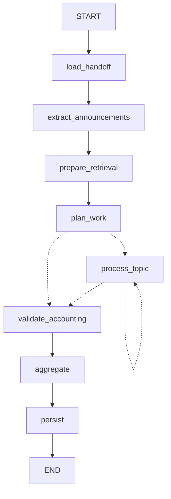

# Agent 3 — Plan

**Status (2026-10-30):** milestones 2-7 implemented; the Milestone 1 audit is not written up as such (the Milestone 7
scenario coverage matrix covers the nine demo cases). Agent 3 consumes the Agent 2 taxonomy handoff (schema 8 / handoff v2 projection) plus last-24h
announcements and produces reviewable AdviceCards (research, final severity, recommendations); the dashboard shows
them and records team-lead decisions.

How each part has been validated (levels: **live** = real model calls; **scripted** = prepared judgments replayed
offline; **placeholder** = a scripted stand-in that judges nothing; **offline** = deterministic code and tests, no
model; **test fixture** = hand-written, labelled data):

| Part | Validation | Where |
| --- | --- | --- |
| Contracts, rubric binding, Markdown ingestion (M2) | offline | `scripts/validate_agent3_inputs.py`, tests |
| Shared retrieval (M3) | offline (local embeddings; tuned set + holdout) | `scripts/evaluate_retrieval.py` |
| Advisor pilot v4-v5 (M4) | live, 6 topics + negative control | `agent3_acceptance_v1`, `agent3_closeout_v1` |
| Advisor v6 prompts | live, audio + Submit only | `agent3_readability_v1` |
| Advisor v6.1 prompts | live, audio + Submit only; its possessive-plural and record-authorship fixes, and the ToT fallback, are offline only | `agent3_overnight_smoke_v1` |
| Advisor v6.2 prompts (absence wording) | live, the nine demo scenarios once (30 requests, $1.56); ToT fallback still offline only | `agent3_final_eval_v1` |
| Overnight workflow (M5), full handoff (87 work items) | scripted for the 6 pilot topics, placeholder for the other 81; no full live run | `agent3_overnight_offline_v2` |
| Overnight workflow, live | 2 topics (audio, Submit), 8 requests | `agent3_overnight_smoke_v1` |
| Dashboard + TL decision loop (M6) | offline: backend tests and browser tests on the saved runs, plus a labelled test-fixture run | `tests/test_dashboard.py`, `web/tests/` |
| TL decision -> later snapshot -> overnight retrieval (M7) | offline (scripted judgments; real embeddings in the demo) | `agent3_feedback_loop_offline_v1`, `tests/test_agent3_feedback_loop.py` |
| Demo scenario matrix (M7) | live for all nine (final eval); scripted for the six pilot topics; three were placeholder-only before | `agent3_scenario_coverage_v1` |
| Repair pass: prompts v7 (intervention need, summary distinctions, open-question definition), retrieval expansion | live once on six cases (16 requests, $0.97); NO_INTERVENTION_NEED path and partitive fix offline only | `agent3_repair_eval_v1`, `agent3_repair_comparison_v1` |
| Repair pass 2: prompts v8, ToT v3 selection, temporal decision fixes | offline only (prepared judgments; temporal golden set 14/15) | `tests/test_agent3_tot_v3.py`, `agent3_temporal_golden_v1` |
| Repair pass 3: enacted-decision eligibility, close-call routing, grounding source consistency (prompts v9, grounding v5) | offline (golden 14/15, T02 lacks enactment evidence); live once on four cases (8 requests, $0.46): audio action resolved, NO_ACTION kept; action choice, replacement and grounding-found conflicts unobserved live | `agent3_temporal_golden_v2`, `agent3_policy_eval_v1` |
| Reliability and evaluation cleanup: policy-aligned temporal golden set, sentence-level summary judgment (draft v9, prompts v10), Retriever closes its Chroma client | offline only: temporal-golden-v1 still 14/15; temporal-golden-policy-v1 17/17 (different benchmark); summary fix needs a new live judgment; Chroma second-open 6/120 -> 0/120 | `temporal_golden_policy_v1.json`, `agent3_temporal_policy_v1`, `tests/test_agent3_summary_sentences.py` |

Open evaluation cases (not used for tuning) are in `data/evaluation/agent3_open_evaluation_cases.json`; the first is
the audio trial-outcome follow-up retrieval miss from the live smoke run (investigated in Milestone 7).

| # | Milestone | Work | Technologies / details | Done when |
| --- | --- | --- | --- | --- |
| 1 | Audit data against demo scenarios | Compare instructions, FAQs, historical decisions and last-24h announcements against the relevant Slack threads. Check authority, scope, chronology, contradictions and intentional gaps. | Manual review + simple scripts over the knowledge store and Slack fixtures. Map to the 8–9 demo cases: TL confirmation, FAQ edge case, temporal conflict, language routing, escalation, already-announced re-ask, QA misalignment, observation-only, upstream flags. | Coverage matrix (supported / partial / missing / contradicted) per demo case, plus proposed data edits. **No data changes yet.** |
| 2 | Apply approved edits, finalize contracts | Make agreed corrections to mock knowledge. Confirm Agent 2 handoff schema, announcement extraction format, AdviceCard fields, review records, severity rubric (with required evidence triggers), confidence bands (≥0.85 / 0.60–0.84 / <0.60). | Pydantic models: AdviceCard, DecisionRecord, AnnouncementRecord. Severity rubric loader. Explicit `card_line` enum and `needs_review_reason` values. | Validated source snapshot and explicit contracts (AdviceCard, Decision, Announcement, ModelReviewItem). Each edit has a reason and identified downstream impact. |
| 3 | Shared retrieval | Ingest guidelines, FAQ, historical decisions. Dense + BM25 hybrid, MMR re-ranking, metadata filters (project_id, date, tags, status). Read-only for Agent 3. Preserve citations, versions, authority, scope. | Chroma (or FAISS), three collections. MMR λ ≈ 0.6–0.7. Chunking: section-level for instructions/FAQ; whole-record for decisions. | Relevant sources returned, out-of-scope sources filtered, missing evidence stays visible. |
| 4 | Small Agent 3 pilot | CrewAI agent for 4–6 cases: current guidance, history, conflict, insufficient evidence, NO_ACTION/observation. Bounded research, severity assessment, grounding check, temporal priority verifier, card-line routing, shallow manual Tree-of-Thought. | Tools: guideline / FAQ / decision retrievers, temporal verifier, severity assessor, grounding checker. Manual ToT (plain Python or one structured call) only on conflict, low-confidence or open-confirmation paths: 2–3 candidate actions scored on grounding / temporal consistency / severity fit; pick best or surface both if close. Finite call budget. | Reviewable AdviceCards with traceable evidence, correct `card_line`, confidence scores, visible ToT options on flagged cases. No unbounded loops. |
| 5 | Overnight workflow | Agent 2 handoff + last-24h announcement extraction → Agent 3 research (conditional ToT) → guardrail routing → output. One topic failure does not stop the rest. | LangGraph: load handoff → extract announcements → per-topic CrewAI node → optional ToT node → guardrail/routing node → aggregate. Error isolation, non-blocking. | Complete run with no lost members or inherited review obligations. ToT only on intended paths. Failures logged and skipped. |
| 6 | Dashboard + TL decision loop | Single-page morning brief: overview, briefing, topic summary, AdviceCards, Model Review Queue. Approve writes decision + shows draft. Structured resolution on Needs Review (incl. ToT options). Accept/Reject/Defer on Agent 1/2 flags. New TL decisions feed back into the decisions collection. | FastAPI + React (Vite, Tailwind, Framer Motion). Endpoints: briefing, cards, approve, resolve, model-review actions. | A TL decision is saved once and retrievable by a later run. ToT alternatives visible on Needs Review cards. Approval distinct from execution. |
| 7 | Validate, prepare demo | All demo scenarios plus negative cases, temporal ambiguity, repeated TL actions, at least one ToT-triggering case. Confirm ToT does not run on normal high-confidence paths. | Scenario runner against LangGraph flow + dashboard. Check expected vs actual `card_line`, sources, `needs_review_reason`, ToT presence/absence. | Reproducible demo, results summary, known limitations, final handoff. Intentionally open cases stay open; ToT only where specified. |

## Notes for implementation

- The plan says `mock_knowledge/`; in this repo the knowledge store is
  `data/knowledge/` (`instructions/`, `faq/`, `decisions/<project>/`). See
  [announcement-routing.md](announcement-routing.md) for the source format and the
  shared ingestion contract (`knowledge_sources.iter_documents` / `normalize_document`).
- Agent 3 input: `data/processed/agent2_handoff_v2_projection/` (schema 8 / `agent2-taxonomy-handoff-v2`, a
  zero-call projection of the v7 release; load with `advice_inputs.load_effective_view`), with severity
  `UNKNOWN`/`UNASSESSED` deferred to Agent 3. The frozen v7 release (handoff v1,
  `topic_effective.load_effective_output`) is unchanged.
- Must carry every obligation: in the projection, 41 inherited Agent 1 obligations on discussions, 8 on
  announcement-route members and 3 naming cautions (49 + 3 in the v7 release). Needs Review items appear even
  without a recommendation.
- Severity rubric: `data/knowledge/severity_rubric.py` (`severity-rubric-v3-semantic-signals`, TL-owned).
  Open: per-project rubrics (`get_rubric_for_project` returns the shared default) and the severity level for
  rule-confusion topics (a TL rubric decision).
- Dependencies: Chroma (M3), LangGraph 1.2.18 (M5), FastAPI 0.162.0 (M6); BM25 is in-house
  (`retrieval/bm25.py`). The dashboard frontend (`web/`, React 18 / Vite 5 / Tailwind 3 / Framer Motion 11,
  Playwright for UI tests) has its own pinned `package.json` and `package-lock.json`.

## Milestone 2 (implemented)

Verify offline (zero calls, writes nothing unless `--report` names a new file):

```sh
uv run --locked python scripts/validate_agent3_inputs.py
```

| Module | Purpose |
| --- | --- |
| `src/threadsense/severity_rubric.py` | Loads `data/knowledge/severity_rubric.py` through its own `get_rubric_for_project`; records version plus a content hash of the parsed definitions (independent of line endings); checks contract compatibility and cited signal text. No classification. |
| `src/threadsense/agents/advice_contracts.py` | `agent3-advice-card-v1`, `agent3-decision-record-v1`, `agent3-announcement-record-v1` (wraps `SourceRecord`), `agent3-model-review-item-v1`, plus evidence, occurrence and severity models. |
| `src/threadsense/knowledge_markdown.py` | Markdown front matter (safe YAML, timestamps kept as strings) → `SourceRecord`. Used by `knowledge_sources.iter_documents` for `.md` paths. |
| `src/threadsense/knowledge_corpus.py` | Discovery limited to `instructions/`, `faq/`, `decisions/` Markdown and the documented `manual/`/`extracted/` JSON locations; reference, supersession, overlap and conflict report. |
| `src/threadsense/agents/advice_inputs.py` | Agent 2 export/registry accounting, one `ModelReviewItem` per obligation, structural occurrence counts, historical `DecisionRecord` mapping. |

**Guardrails in `AdviceCard` validation** (structural only): confidence `< 0.60` needs
`LOW_CONFIDENCE`; band `MODERATE` for `[0.60, 0.85)`, `HIGH` from `0.85`; assessed
`HIGH` needs `HIGH_SEVERITY`; inherited flags, recorded temporal conflicts, grounding
failures and open confirmations each need their reason. Any reason forces
`NEEDS_REVIEW`. `RECOMMENDED_ACTION` needs an operational action, cited sources and
`checks.grounding == PASSED`. `checks.grounding` defaults to `NOT_RUN` (not run, not
failed): such a card stays a draft or uses `NEEDS_REVIEW` with `GROUNDING_NOT_RUN`;
`GROUNDING_FAILURE` is accepted only when the check recorded `FAILED`. Validation never
performs semantic grounding.
Unassessed severity is `UNKNOWN`, provisional, with Agent 2's placeholder kept as lineage.

**Mapping decisions.**
- `instructions` → `guideline`. Authoring `record_kind`s (`advice_review`, `follow_up`,
  `expert_referral`, `expert_review`, `escalation_receipt`) → `decision`;
  `channel_announcement` → `announcement`. The full front matter is kept in
  `source_metadata.authoring`; unknown kinds fail rather than defaulting.
- IDs: canonical `record_id` = source identity (manual key or Slack channel/thread/message),
  `version_id` = content hash; authoring `document_id@version` kept separately. A second
  content for the same authoring identity is rejected. File paths never enter IDs.
- Supersession: section-level references stay in `source_metadata.supersession` with
  `granularity: section`; only whole-document references would populate
  `SourceRecord.supersedes` (none exist).
- Manual records: `effective_at` from front matter, `created_at` null, `last_updated`
  kept as authoring metadata. Slack records: `created_at` from the exact `ts`; identity,
  author, text and snapshot hashes verified (text: UTF-8 sha256; snapshot: sha256 of
  UTF-8 JSON with sorted keys and `(",", ":")` separators, inferred from the data since
  it was not documented). Retrieval text is the Slack message; the archive note and
  raw snapshot stay metadata. "Referenced records" link lists are excluded from text.
- `DecisionRecord` is built only for TL decisions (advice reviews, referrals, expert
  review, escalation); follow-ups and posts remain sources. Status strings map through
  explicit tables in `advice_inputs.py` and keep `source_status`.
- `card_line` values (`RECOMMENDED_ACTION` / `NEEDS_REVIEW` / `OBSERVATION`) and the
  action vocabulary (taken from the decision records) are this milestone's proposal.

**Closeout (2026-10-29).**
- Rubric: `RUBRIC_VERSION` is now `severity-rubric-v3-semantic-signals`; definitions,
  examples and signals are unchanged (content hash `eccaa31a…` is the same as before).
  The LOW comment now says limited impact may be inferred from context, but missing
  evidence alone does not establish LOW. Every project currently uses the shared default
  rubric: the loader reports `rubric_scope: SHARED_DEFAULT`, and assessed severities must
  record it. `UNKNOWN` (rubric level) and Agent 2's placeholder stay separated by
  `assessment_status`.
- Knowledge: the headset check approval/completion and onboarding office-hours post moved
  from `decisions/multilingual_eval/` to `decisions/audio_multimodal/` (their declared
  project). Bytes, record IDs and version IDs are unchanged. The validator reports any
  declared-project/folder mismatch and overrides neither value.
- Demo snapshot: `data/fixtures/slack_generated_demo/` (from
  `ThreadSense_MockData_Update_2026-10-28.zip`; package notes in
  `docs/threadsense_demo_update/`, never indexed) = 201 threads / 517 messages
  (178 discussion, 23 announcement) at cutoff `2026-10-02T12:00:00Z`. It adds only
  `C_AUDIO_ANNOUNCEMENTS` `1790892000.000901` (2026-10-01 22:00 UTC), before the later
  playback questions `1790896012.001900` and `1790903186.000110`. The original
  `data/fixtures/slack_generated/` (200 / 516) is unchanged and matches the package's
  recorded baseline hashes. The new announcement is not an Agent 1 member; it enters
  through announcement extraction, not the Agent 2 handoff.
- Current handoff: `data/processed/agent2_handoff_v2_projection/`, written by
  `scripts/project_agent2_handoff.py --write` with zero calls. It is a projection of the
  v7 release, not a fresh taxonomy run (`projection_manifest.json` records provenance).
  Announcement members are routed out (22 members, 8 obligations, in
  `routing_manifest.json`). 73 groups with unchanged discussion membership are
  re-exported from their saved v7 responses under schema 8 / handoff v2. 8 groups lost
  announcement members, so their saved responses cannot be reused without altering model
  output; their 17 members stay `UNASSIGNED` with a projection-gap review reason.
  9 announcement-only groups have no discussion members. Totals: 81 groups, 79 topics,
  161 assigned + 17 unassigned discussion members, 41 + 8 = 49 obligations, 39 effective
  review groups. The 3 naming cautions carried over by exact match (same group, members and
  response bytes) in `carried_review_supplement.json`, which `advice_inputs.load_effective_view`
  applies after checking its hash; the review registry is unchanged.
- Remaining: a taxonomy for the 8 partial groups needs either a new Agent 2 run on those
  payloads or an approved rule for projecting saved responses. The registry still lists
  `agent2_remaining_v6`, archived on 2026-10-28 (not applied to any inspected run).
  Record payloads embed the absolute grouping path, as the v7 release did, so projection
  hashes depend on checkout location.

## Milestone 3 (implemented): shared hybrid retrieval

```powershell
uv run --locked python scripts/build_retrieval_index.py            # offline; add --allow-download once if the model is not cached
uv run --locked python scripts/build_retrieval_index.py --rebuild  # after corpus/config changes (refused otherwise)
uv run --locked python scripts/evaluate_retrieval.py               # BM25 / dense / RRF / RRF+MMR on data/evaluation/agent3_retrieval_cases.json
```

Package `src/threadsense/retrieval/`: `corpus.py` (sources), `chunking.py`, `bm25.py`,
`embeddings.py`, `index.py` (build), `search.py` (read-only `Retriever`), `evaluate.py`.
Index: `.index/retrieval/` (git-ignored): persistent Chroma collections `guidelines`,
`faq`, `decisions` (incl. announcements), plus `chunks.json`, `documents.json` and
`manifest.json` in the same build.

- **Sources.** The 40 authored documents through `knowledge_corpus.discover` +
  `iter_documents`, plus current-day announcements through `fixture_routes` +
  `extract_announcement` on the demo snapshot at cutoff `2026-10-02T12:00:00Z`
  (23 extracted, 22 with inherited Agent 1 metadata, 8 of them review-flagged). Counts,
  duplicates and Slack overlaps are derived at build time (currently 63 documents, none
  removed). Archive Slack posts in the knowledge store stay authored history.
- **Embeddings.** `sentence-transformers/all-MiniLM-L6-v2` at revision
  `b9db1e8a0d3a51769172ba8546f282a73f066e47` (the grouping model), CPU, normalized,
  cosine, 384 dimensions, 256-token limit, identical encoding for queries and documents,
  loaded with `local_files_only` unless `--allow-download`.
- **Chunks** (`knowledge-chunks-v2`): guideline/FAQ sections with the document title;
  decisions/announcements whole when they fit, otherwise consecutive sections under a
  header repeating record kind and decision/execution/outcome state; oversized units split
  at paragraph/line/sentence/word boundaries; each chunk is checked against the token
  limit and nothing is truncated. v2 (Milestone 4 setup) splits an oversized FAQ section
  at question/answer units, and an answer continuation repeats its exact question; lines
  repeated for context (continued heading or question) are listed in each chunk's
  `repeated_context`, so the preservation check can tell them from duplicated source text.
  This fixed v1's orphaned continuation (the SC-PII-2026-09-10 paragraph without its
  question). Currently 112 chunks (guidelines 29, FAQ 16, decisions 67); 21 documents split. Chunk IDs hash chunking version + document/version +
  position. Each chunk keeps citation, flat filter metadata, review lineage and
  section-level supersession; full normalized metadata stays in `documents.json`.
- **Query.** `Retriever.search(query, project, batch=, batch_scope='project'|'strict',
  as_of=, include_shared=, collections=, document_types=, statuses=, record_kinds=, tags=,
  event_series_ids=, date_from=, date_to=, include_undated=, version_mode='current'|'history',
  top_k=8, candidate_k=30, rrf_k=60, mmr_lambda=0.9, mode='hybrid'|'dense'|'bm25',
  use_mmr=True)`. Filters and version applicability pick the eligible chunks first; both
  paths rank only those. Results carry text, citation, metadata, `batch_relation`,
  `date_status`, `expired_as_of`, supersession, `version` (lineage, state, applicability,
  other revisions, replaced sections), component ranks/scores and final rank; responses add
  `version_diagnostics` and `withheld_by_version`. Scores are not confidence or grounding.
- **Version-aware eligibility** (`retrieval/versions.py`). A lineage is one authoring
  `document_id` within project and scope (sources without authoring IDs use their
  version-independent `record_id`); never titles or embeddings. Revisions are ordered by
  source date only (`effective_at`, else Slack `created_at`), never by version strings,
  hashes, file or ingestion times. Reference time is `as_of`, else the index cutoff.
  Guideline/FAQ revisions need `approved`/`tl_approved` (or `partially_superseded`, whose
  unreplaced sections still apply); decision records need no approval status. States:
  `CURRENT`, `SUPERSEDED_REVISION`, `NOT_YET_EFFECTIVE`, `NOT_APPROVED`, `OTHER_BATCH_SCOPE`
  (only when an in-scope revision exists), `UNRESOLVED`. Section supersession declared by
  either side applies only to the named section, and only when the superseding source is
  indexed, approved and effective; otherwise it is reported as `UNVERIFIED_SUPERSESSION`.
  `current` (default) withholds superseded revisions and applicable superseded sections
  before ranking and lists them in `withheld_by_version`; `history` keeps every revision
  with its `applicability` marked. Tied or missing revision dates and ambiguous batch scope
  keep all candidates as `UNRESOLVED` with a diagnostic; retrieval never picks a winner or
  sets grounding. Conflicting contents for one authoring version still fail ingestion.
  On the current corpus every lineage has one revision; the only withheld chunk is
  `safety-qn-help-page@1.0#Contact details`.
- **Dense search** is exact cosine over the embeddings stored in Chroma; Chroma's HNSW
  `collection.query` is not used. In ChromaDB 1.5.9 that query failed intermittently
  ("Error creating hnsw segment reader: Nothing found on disk") after several collections
  were read. The cause is unidentified and the issue is not fixed; it is avoided. Exact
  search over 113 vectors is cheap and has no approximation error. The build verifies that
  every stored embedding is readable from a fresh process before publishing its manifest.
- **RRF** (k=60) combines dense and BM25 ranks; raw scores are never added. **MMR**
  re-ranks the fused pool with relevance min-max scaled to [0, 1] and redundancy = max
  cosine to already selected chunks (clipped to [0, 1]); ties fall back to fused order.
  Default lambda 0.9 (decided 2026-10-29); `use_mmr=False` gives RRF only, the evaluation
  baseline. Identical text collapses into one displayed result only when scope, dates,
  authority and decision/execution/outcome state also match; collapsed sources stay in
  `duplicate_sources` with citations and metadata (the current corpus has no identical
  chunk texts).
- **Evaluation (real embeddings, top 5).** Main set (`agent3_retrieval_cases.json`, 9
  answerable + 1 unsupported; the fictional-PII case explicitly uses `version_mode=history`
  because it targets the stale branch):

  | Variant | Mean recall | Full recall | Misleading near-matches | Date violations |
  | --- | --- | --- | --- | --- |
  | BM25 | 0.80 | 6/9 | 5 | 0 |
  | Dense | 0.93 | 7/9 | 3 | 0 |
  | RRF | 1.00 | 9/9 | 3 | 0 |
  | RRF + MMR 0.9 (default) | 1.00 | 9/9 | 4 | 0 |
  | RRF + MMR 0.65 (previous) | 0.52 | 4/9 | 7 | 0 |

  MMR 0.9 adds one near-match (the JSON audit-manifest decision in the JSON-vs-prose case)
  and moves the 22:00 playback announcement from rank 2 to 3 and from 3 to 4. Holdout
  (`agent3_retrieval_holdout.json`, two paraphrases labelled before running): BM25 0.83,
  dense 0.67, RRF 0.83, RRF + MMR 0.9 1.00; no near-matches. The holdout is too small to
  separate the variants. The unsupported payroll query still returns nearest neighbours,
  so result presence never implies an answer.
- **Redundancy-sensitive pairs (top 8, default settings).** Status note vs later handling
  announcement (cosine 0.89): ranks 3 and 6 with MMR, 4 and 5 with RRF, so a top-5 request
  can lose the announcement. Approval vs outcome pairs (playback trial, tie calibration,
  documentation sync, audit-export fix, headset check; cosine 0.71-0.80): both kept with
  MMR and RRF. Old help-page rule vs scoped replacement: both kept in history mode; in
  current mode the old section is withheld by design and remains discoverable through
  `withheld_by_version`, the clarification's `supersedes` link and history mode.
- **Git.** `data/processed/agent2_handoff_v2_projection/` (14 MB on disk; 242 files) is
  already tracked byte-exact (`-text`); keep it tracked as the recorded Agent 3 input. Its
  7 MB `effective_output.json` is derivable, but removing frozen files would change the
  recorded evidence, so leave it.

## Milestone 4 (implemented): bounded Advisor pilot

```powershell
uv run --locked python scripts/run_agent3_pilot.py                    # zero calls: freshness, topics, initial retrieval, request sizes, live configuration
uv run --locked python scripts/run_agent3_pilot.py --scripted tests/fixtures/agent3_pilot_scripted_judgments.json --write <new-dir>
uv run --locked python scripts/run_agent3_pilot.py --run --write <new-dir>   # PAID; not yet run (see "Live run" below)
```

Modules (`src/threadsense/agents/`): `advisor_contracts.py` (model I/O: `AdvisorDraft` v2,
`GroundingJudgment` v2, `ToTComparison` v1), `advisor_evidence.py` (freshness check, evidence
ledger, agent-facing serialization, `ResearchTools`, `Budget`), `advisor_checks.py`
(deterministic checks, final statements, authorization, card routing), `advisor_tot.py`
(conditional shallow ToT), `advisor_pilot.py` (orchestration, scripted and CrewAI clients,
request guard, outputs). AdviceCard v1 is unchanged; the pilot result record wraps it with the
trace, ledger, statement verdicts, withheld statements and alternatives.

**Retrieval setup (done first).**
- FAQ question context: chunking v2 above. Index rebuilt; real-embedding evaluation
  unchanged (main set RRF 1.00 / 9 full / 3 near-matches, RRF+MMR 0.9 1.00 / 9 / 4;
  holdout RRF 0.83, RRF+MMR 1.00). No retrieval regression; labels, settings and holdout
  untouched.
- Evidence the model receives (`evidence_item`): citation identity (document/version/chunk
  IDs, authoring ID, sections, source), `use`, applicability (state, replacement with its
  effective date, unverified supersession, supersedes links, other revisions), dates, scope,
  authority, recorded states and upstream review flags. `use` is `CURRENT_GUIDANCE`
  (guideline/FAQ), `ANNOUNCEMENT`, `PRIOR_DECISION`, `HISTORY_ONLY`, `UNRESOLVED_VERSION`;
  members are `MEMBER_REPORT`. Historical, unresolved, prior-decision and announcement
  excerpts start with a status line, so the status cannot be read apart from the text.
  Every payload also lists `withheld_by_version` and `version_diagnostics`. Tests parse the
  exact text the model receives (`task_description`), not the sidecar.
- Freshness: `open_retriever` runs `Retriever.staleness()` once before research and refuses
  a stale or incompatible index with the rebuild command; queries never re-check.

**Selected topics** (`data/evaluation/agent3_pilot_scenarios.json`, IDs and Agent 2 names
only; no expected sources or answers): audio playback `cluster_6b59d1…` "LT audio player
playback failure"; JSON vs prose `cluster_fb1dce…`; fictional PII `cluster_9378eb…`;
Korean register `cluster_3b950a…`; submit failure `routed_440e64c…`; repeated ending
`cluster_b7e523…`; plus the payroll negative control. The response-preference Submit threads
are a projection gap (no Agent 2 topic), so that card covers the group's 4 unassigned
members with `topic_id: null`, a mechanical label and a `projection_gap` inherited flag;
no taxonomy is invented. The payroll question has no handoff members and stays cardless (an
external negative control); a real handoff member is always on a card, even when its draft is
UNSUPPORTED or missing.

**Per-topic flow.** As-of is the index cutoff (`2026-10-02T12:00:00Z`) for every call,
including history mode.
1. Initial retrieval: current mode, all source types, top 5, RRF+MMR λ 0.9. The query is the
   topic name plus the earliest member's Agent 1 central question.
2. If the project has withheld (superseded) material, one history-mode supersession check
   with the same query (generic rule; on this corpus only safety triggers it).
3. Draft call. The model names gaps and optional follow-up queries; assesses each
   announcement it relies on (relevant? directive? verbatim directing sentence); gives each
   member a resolution state from that member's own messages; names documentation targets.
4. Up to 3 follow-up retrievals executed by `ResearchTools` (the model never calls tools
   itself), then at most one revision call.
5. Deterministic checks: structure (`structural_issues`, `action_issues`), severity binding
   to the unchanged rubric, temporal priority.
6. Conditional ToT (one call), only on conflict, low-confidence or open-confirmation paths and
   only when no structural check failed.
7. **One final semantic grounding call** over every statement that can reach the card or a
   reviewer (below), then authorization and deterministic card routing. Nothing after this
   call can add or change a statement.

**Final grounding and authorization (hardening pass, 2026-10-29).** Before this pass the
grounding call judged only the draft's claims and action, and ToT ran afterwards; the summary,
severity rationale, affected reporters and ToT alternatives were never judged, and resolution
came from Agent 1. Now `statements()` builds one list:

| Statement | Cites | Blocking |
| --- | --- | --- |
| `claim:<id>` (incident fact, guidance, history, inference) | the claim's evidence | if material |
| `summary` | all material claims' evidence | yes |
| `action` (text, scope and documentation targets) | support claims' evidence + targets | yes |
| `announcement:<id>` (relevant directive, quoted) | the announcement | yes |
| `resolution:<member>` (state other than UNKNOWN) | that member's messages (+ current sources) | yes |
| `severity:rationale`, `severity:signal:<LEVEL>[i]` | signals, reporters, incident facts | yes, when binding succeeded |
| `reporter:<author>` | the reporter's own message | yes |
| `alternative:<candidate>` (valid ToT candidates) | the candidate's evidence | no (never card content) |

The judgment returns one verdict per statement ID. Dependencies are applied deterministically
(`_effective`): a guidance claim resting only on announcements needs a SUPPORTED announcement
statement; an action needs every support claim SUPPORTED. No statement borrows another's
verdict. Grounding is PASSED only when every blocking statement is SUPPORTED; statements citing
nothing are never sent (NO_EVIDENCE). `authorize()` then builds the card only from SUPPORTED
statements: card reasoning is composed from supported claims (the model's free-text reasoning
stays in the result record), an unsupported summary is replaced by a withheld notice, an
unsupported action is not carried, an unsupported severity rationale or signal leaves severity
UNASSESSED, unsupported reporters are dropped from the lower-bound count, and an unsupported
member resolution becomes UNKNOWN. Every withheld statement stays in `diagnostics`
(`WITHHELD_STATEMENT` / `ALTERNATIVE_NOT_GROUNDED`) with its text and verdict; the card's
GROUNDING_FAILURE reason names it by ID only. A ToT candidate is preferred only if it is valid
and its own statement is SUPPORTED.

**Announcement applicability.** The 31 announcements carry no metadata separating a directive
from a routine note (all are `TEAM_LEAD` announcements; the 22:00 playback directive has the
same empty status as "Reminder to use headphones"). So no announcement is current handling by
type. An announcement becomes current handling for a topic only when the draft assesses it as
relevant and directive with a verbatim directing sentence (deterministic quote check) **and** the
final grounding judges that `announcement:` statement SUPPORTED. Recorded supersession resolves
a conflict only in favour of current guidance or a verified announcement. Identity, dates,
authority and scope are kept either way.

**Documentation targets.** `UPDATE_DOCUMENTATION`/`UPDATE_FAQ` must name targets
(`evidence_id`, section, `ADD`/`CORRECT`/`REMOVE`). Deterministic checks: the target is a
retrieved source of the right type; a named section is in the cited chunk; `CORRECT`/`REMOVE` of
current guidance is flagged `ACTION_TARGET_ALREADY_CURRENT` unless the draft reports a conflict
involving it. The card's scope note lists the targets and their state (e.g. "CORRECT
safety-qn-help-page@1.0 section 'Contact details' (superseded section, stale copy)").

**Resolution.** Agent 1 resolution labels travel as attributed inputs (with Agent 1's
verification status) and are never evidence. Each member's state must cite that member's own
thread (current sources may add support; history may not). The topic state is computed from
grounded member states: all equal → that state; known states differ → MIXED; any member without
a supported state → UNKNOWN. One resolved member never resolves the topic. The card reasoning
shows the grounded per-member counts and the attributed Agent 1 counts, including how many were
unverified.

**Budgets and request limits.** 4 model calls per topic (draft, revision, ToT, final
grounding), 28 per run; 6 retrieval calls per topic, 42 per run. Draft, revision and ToT run
only if a call stays reserved for the final grounding (`SKIPPED_RESERVED_FOR_GROUNDING`).
Request boundary, measured offline at the httpx transport (`tests/test_agent3_request_boundary.py`):

| Reply to one stage | Earlier Agent/Crew client | Now |
| --- | --- | --- |
| valid JSON | 1 request | 1 |
| non-final-answer text | 2 (CrewAI forced-final-answer call) | 1 (stage FAILED) |
| HTTP 500 / connection error | 3 (OpenAI SDK `max_retries=2`) | 1 |
| HTTP 429 | 9 (SDK retries × CrewAI's fixed 3-attempt rate-limit retry) | 1 sent, retry refused unsent |

The live client calls `crewai.LLM.call` directly (no Agent/Crew executor, no tools,
`max_retries=0`, `response_format=json_object`, temperature 0, `max_tokens` 4096, timeout
120 s) inside `RequestGuard`, which counts requests at the transport and refuses any second
request in a stage before it is sent. A reply that arrives without a request through the
guarded transport stops the run (`BoundaryNotObserved`). `QUIET_ENV` disables CrewAI telemetry
and LiteLLM's remote price-map download. An end-to-end test runs the whole pilot through the
live client against a fake provider: requests = stage calls ≤ 28, and cards match the scripted
run.

**Deterministic vs semantic.**

| Check | How |
| --- | --- |
| Citation IDs exist; incident facts cite member messages only; guidance cites current guidance or an established announcement, never a historical/unresolved item; history cites retrieved records; quotes verbatim (status lines excluded); announcement assessments quote verbatim; resolution cites the member's own thread | Deterministic (`structural_issues`); any failure = grounding FAILED without a semantic call (and no ToT) |
| Operational action supported by a guidance or prior-decision claim; documentation targets real, of the right type and not already current | Deterministic (`action_issues`) |
| Each statement supported by the excerpts it cites | Final semantic grounding call; PASSED only if every blocking statement is SUPPORTED after dependencies. Citation existence alone never passes; a missing judgment is NOT_RUN and nothing is authorized |
| Temporal priority | Deterministic: a model-reported conflict is RESOLVED only when recorded supersession links the historical item to the one current item (current guidance or a verified announcement); otherwise DETECTED. Unresolved versions or unverified supersession cited → DETECTED. Future and draft revisions never compete |
| Severity | Semantic proposal, deterministic binding (rubric text by level/index, member-message evidence per signal, reporters from their own messages, recurrence from retrieved records), then semantic grounding of rationale, signals and reporters. Any failure leaves severity UNASSESSED with an OTHER reason |
| Resolution | Semantic per-member proposal from thread messages, grounded per member; deterministic topic aggregation |
| Card line | Deterministic: contract review codes + GROUNDING_NOT_RUN + OTHER (insufficient/unsupported evidence, severity not established, stage failures) → NEEDS_REVIEW; otherwise an authorized operational action → RECOMMENDED_ACTION; else OBSERVATION |
| ToT | Triggered only by TEMPORAL_CONFLICT, confidence < 0.60 or OPEN confirmation; one call, 2–3 candidates, before the final grounding. Invalid candidates (unknown evidence) are not presented; valid ones are judged as their own statements. Never changes the card action or review reasons |

**Offline pilot output** (`data/experiments/agent3_pilot_offline_v2/`, `SCRIPTED_MOCK`;
`agent3_pilot_offline_v1/` is the pre-hardening run, kept for comparison): manifest,
per-scenario results (retrieval trace, evidence ledger, model-call log with raw responses,
drafts, follow-ups, statement verdicts, withheld statements, temporal, severity, resolution,
ToT, card, review items, coverage, budget), `cards.json`, `review_items.json`, `report.md`.
The prepared responses (`tests/fixtures/agent3_pilot_scripted_judgments.json`, regenerated by
`tests/fixtures/make_agent3_pilot_scripted_judgments.py` when evidence IDs move) exercise the
checks; they are not model output. Consumed: 18/28 model calls, 11/42 retrievals.

| Topic | Card; action | Grounding | Severity | Resolution (grounded vs Agent 1) | ToT | Notes |
| --- | --- | --- | --- | --- | --- | --- |
| audio_playback | NEEDS_REVIEW (HIGH, flags); UPDATE_FAQ, ADD to FAQ "Playback and tool issues" | PASSED | HIGH: 4 affected reporters; recurrence FOUND (batch-05 trial) | MIXED (2 partial: TL interim handling; 2 unresolved) vs Agent 1 3 UNRESOLVED + 1 PARTIALLY_RESOLVED (2 unverified) | — | 22:00 announcement verified as handling |
| json_vs_prose | NEEDS_REVIEW (open confirmation, flag); NO_ACTION (hold for TL) | PASSED | MEDIUM[0] | UNRESOLVED | A SUPPORTED (preferred); B (rejected JSON-first rule) UNSUPPORTED; C PARTIALLY_SUPPORTED | |
| fictional_pii | NEEDS_REVIEW (flag); UPDATE_DOCUMENTATION, CORRECT help page v1.0 "Contact details" only | PASSED | MEDIUM[1] | UNRESOLVED vs Agent 1 2 PARTIALLY_RESOLVED | — | Clarification and batch-08 post verified; conflict RESOLVED_BY_RECORDED_SUPERSESSION; instructions v1.4 and FAQ v1.1 stated as already updated |
| korean_register | NEEDS_REVIEW (flag); ROUTE_TO_LANGUAGE_SPECIALIST | PASSED | MEDIUM[0] | UNRESOLVED | — | Batch-10 precedent kept as scoped history |
| submit_failure | NEEDS_REVIEW (HIGH, GROUNDING_FAILURE, projection gap + flags); ESCALATE_ENGINEERING (ask whether reports match the open handoff) | FAILED: `claim:c5` ("share the cause…") withheld | HIGH: 5 reporters | UNRESOLVED | — | c5 text only in diagnostics, never on the card |
| repeated_ending | NEEDS_REVIEW (low confidence, insufficient evidence, flags); NO_ACTION | PASSED | MEDIUM[0] | UNRESOLVED | A and B SUPPORTED (close call); C ("confirmed loop", no evidence) not presented | No cause asserted |
| payroll control | no card | — | — | — | — | UNSUPPORTED although 5 nearest neighbours were retrieved |

**Tests.**
- `tests/test_agent3_advisor.py` (28, test-double index): each test's docstring says DETERMINISTIC or MOCKED SEMANTIC. Covers, among others: final grounding covering every card statement and running last; a ToT candidate whose unsupported claim cannot borrow the draft's verdicts; the routine-reminder negative case; documentation targets; member-level resolution. One test removes the upstream obligations from a copy of one record to reach RECOMMENDED_ACTION and OBSERVATION.
- `tests/test_agent3_request_boundary.py` (7, fake provider, network refused): one request per stage for each reply type; budget equals requests; an unobserved reply stops the run.
- `tests/test_agent3_pilot_integration.py` (3, real embeddings, offline):
  - the full scripted pilot, which also detects scripted evidence IDs drifting from the index;
  - recovery of the 22:00 announcement when the real top five for the member question
    "Was the previous playback workaround approved and did it work?" omit it;
  - the whole pilot through the live client against a fake provider (request accounting).
- The recovery test with the test encoder uses "Did the earlier reload trial restore playback?", for the same reason.

**Live run (prepared, not run).**

```powershell
$env:PYTHONIOENCODING = 'utf-8'
uv run --locked python scripts/run_agent3_pilot.py                                  # zero calls: check the printed live_configuration
uv run --locked python scripts/run_agent3_pilot.py --run --write data/experiments/agent3_pilot_live_v1
```

- Model: `THREADSENSE_MODEL` (currently `openai/gpt-4o-mini`), key `OPENAI_API_KEY` from `.env`.
- Limits: ≤ 4 calls per topic, ≤ 28 per run, 1 HTTP request per call (≤ 28 requests), no
  retries, ≤ 4,096 completion tokens per call, 120 s timeout.
- Size (measured on the scripted path, o200k tokenizer): draft requests 8–12k input tokens,
  revision up to 17k, grounding up to 9k, ToT up to 10k; 18 requests ≈ 186k input tokens. A
  live run that uses every call stays under 28 × 17k ≈ 480k input and 28 × 4,096 ≈ 115k
  output tokens.
- A failed stage is recorded, not retried; the topic still gets a card. Results are labelled
  `LIVE_MODEL`.

**Live evaluation v1 (2026-10-29, `data/experiments/agent3_pilot_live_v1/`, `LIVE_MODEL`).** One run, no
prompt or model changes, failures kept. `gpt-4o-mini` (returned `gpt-4o-mini-2024-07-18`); 15 stage calls =
15 HTTP requests, none blocked or retried; all HTTP 200, `finish_reason: stop`, all schema-valid;
120,207 input / 10,437 output tokens; 110.6 s model time, 136 s wall. The request guard now also
records provider usage, returned model and latency per request (instrumentation only).
Findings, checked against the cited passages:
- **No research loop.** No draft named a follow-up gap, so 0 follow-ups and 0 revisions; relevant
  records retrieved in the first pass (Korean batch-10 precedent, Submit engineering handoff, repeated-ending
  observation review, rejected JSON-first rule not retrieved at all) were not cited.
- **No actions.** No draft proposed an action; every draft (including the payroll control) set
  `open_confirmation` OPEN, even where current guidance answers the question (audio: no QN solely
  because playback fails). ToT therefore ran on 4 of 6 topics; it surfaced grounded options (audio
  POST_ALIGNMENT, Submit ESCALATE_ENGINEERING) that never reach the card.
- **Structural checks caught real defects.** PII: a paraphrased FAQ quote and a TL Slack message cited
  as GUIDANCE; Korean: a paraphrased FAQ quote; repeated ending: an affected reporter (U017) cited
  with U013's message; JSON: MEDIUM with no rubric signal. In PII and Korean one bad quote voided the
  whole draft (nothing authorized), withholding accurate claims too.
- **Grounding judge is lenient.** (Corrected 2026-10-29: the names in claims, e.g. "Yuki" for U019 and
  "Leo" for U007, were the right authors per the user directory; the defect was that v1 evidence carried
  author IDs only, so neither the judge nor any check could verify names. Directory names and a
  deterministic author check were added.) It passed audio HIGH[0] although the cited tutor messages
  do not state the work cannot be evaluated (the uncited TL reply does); passed a ToT option to
  "update documentation" on the strength of an instruction that does not call for it; and
  rationales often restate the statement. Resolution: the model may cite part of a thread, and the
  judge sees only what is cited (audio member 894091 marked UNRESOLVED and passed, though the
  uncited TL reply gives the same interim handling as member e76f89, whose PARTIALLY_RESOLVED was
  withheld).
- **Cards stay safe but thin.** All six are NEEDS_REVIEW with no action; useful content is the
  grounded incident summary, member threads and inherited flags; severity survives on audio and
  Submit (HIGH) only. The payroll control stayed UNSUPPORTED with no card.

**Correction pass (2026-10-29; pilot v3, draft contract v3).** Responses to live v1, with tests in
`tests/test_agent3_corrections.py` (recorded live-v1 failures replayed from
`tests/fixtures/agent3_live_v1_failures.json`) and `tests/test_agent3_request_boundary.py`:
- Open confirmation needs a specific `open_question` and the evidence that leaves it open; it is
  judged as an `open_question` statement and its flag is never cleared. A NEEDS_REVIEW card can carry
  a supported action; approval by a team lead is not an open question.
- The draft fills `coverage` (current guidance, announcements, prior decisions/outcomes, member
  questions); MISSING ties to a follow-up gap. Unassessed or unresearched needs become an OTHER reason.
- Validation is per statement: a quote marked VERBATIM must match; PARAPHRASE is judged semantically;
  a structural failure rejects only that statement and its dependents (an action resting on it), and
  everything else still goes to the judge. A mis-attributed reporter is dropped, not fatal.
- The judge sees every message of every member thread (directory names, roles, reactions) and every
  retrieved source. Names in claims must belong to a cited message's author; CAUSE claims need a
  record or a team lead/engineer message. Recommendations are judged on premises, applicability and
  rationale, not literal prescription (the deterministic "applicable source" rule was removed).
- A clearly preferred, valid ToT candidate becomes the action when the draft has none (`adopt`), then
  goes through final grounding; flags are untouched.
- Live client: per-arm settings (reasoning models get no temperature, `max_completion_tokens`,
  `reasoning_effort`, `service_tier`), a `CostLedger` reserving each request's maximum cost before
  sending (unknown usage charged in full), a 20,000-token input cap checked before sending, and
  RESOURCE / SCHEMA / PROVIDER failure classes. Verified offline against the installed LiteLLM 1.105.0.

**Model comparison v1 (2026-10-29, `data/experiments/agent3_model_comparison_v1/`).** A small
configuration comparison, not a benchmark: 3 cases × 2 arms, one run, no tuning or reruns.
`scripts/run_agent3_model_comparison.py` (zero calls by default). Same prompts (v3 fingerprints in
`experiment.json`), schemas, index `4da16f09…`, corpus `c72edb46…`, rubric and initial retrieval
(verified identical).

| | gpt-4o-mini (temp 0, 4,096 out) | gpt-6.1-sol (medium reasoning, standard tier, 16,384 out) |
| --- | --- | --- |
| Requests | 6 (draft + grounding ×3) | 9 (draft, revision or ToT, grounding ×3) |
| Input / output / reasoning tokens | 57,803 / 4,996 / 0 | 102,026 / 18,621 / 925 |
| Model time | 44 s | 222 s |
| Cost (settled at reported usage) | $0.0117 | $0.3902 |
| Schema / resource failures | 0 / 0 | 0 / 0 |
| Follow-up research | none | 1 (audio: recovered batch-05 trial approval and outcome) |
| Actions proposed / reaching a card | 0 / 0 | 3 / 1 (audio POST_ALIGNMENT) |
| Open confirmation | never set | 2, both specific and judged supported |

Experiment total: 15 requests (cap 24), $0.4019 of $3.00, every HTTP 200 / `finish_reason: stop`.

Reviewed against the cited passages (neither model's grounding verdict is the reference):
- **Baseline:** no actions, no follow-ups; JSON-vs-prose omitted coverage; audio marked prior decisions
  NOT_APPLICABLE although members ask about the earlier workaround; repeated ending proposed MEDIUM
  with no signal. Its judge passed "QN" glossed as "quality notification" (the lexicon defines QN as
  Quarantine).
- **Sol:** claims checked against sources were accurate (names, trial figures, calibration outcome
  2→7 of 8 pairs). Audio: correct four reporters, MIXED resolution matching the threads (both team-lead
  interim-handling threads PARTIALLY_RESOLVED), useful supported action on a NEEDS_REVIEW card. It
  wrongly treated an example-collection note as a directive; the judge rejected it.
- **Supported actions wrongly withheld (pipeline):** in JSON vs prose and repeated ending Sol's
  POST_ALIGNMENT was rejected only because one premise was a team-lead Slack instruction labelled
  GUIDANCE (correctly rejected); the all-premises dependency rule then dropped the action although
  its FAQ/instruction premises were supported.
- **Severity voided in 5 of 6 cases:** both models cited member "happening again" messages as historical
  recurrence; the deterministic rule (records only) is right about the evidence but voids the whole
  assessment instead of setting recurrence to NOT_CHECKED.
- **ToT:** ran on Sol's two open-confirmation cases; never adopted (the drafts already had actions);
  repeated-ending options were all PARTIALLY_SUPPORTED, so none was presented as grounded.

**Completion pass (2026-10-29; pilot v4, draft v4, grounding judgment v3).**
- Action sufficiency: the blanket "every premise must pass" rule is gone. The ACTION statement shows
  each premise with its status (SENT or the rejection code); the judge returns `action_sufficiency`
  (SUFFICIENT/INSUFFICIENT plus the essential premise IDs). The action stands only if SUFFICIENT, the
  essential IDs are premises of this action, and every one of them passed after dependencies.
- Role labels: GUIDANCE resting only on thread messages that include a team lead's is relabelled to the
  scoped `THREAD_INSTRUCTION` kind (recorded as ROLE_LABEL_CORRECTED) and judged for in-thread
  applicability; tutor text labelled guidance still fails.
- Recurrence: historical recurrence (FOUND) must cite retrieved records and is judged as its own
  statement; members' "happening again" messages are reported recurrence. Severity is rebound to the
  unchanged rubric from what passed: unsupported recurrence, signals and reporters are removed, an
  unsupported rationale is replaced by the supported signals' wording, and a level that loses its
  support is UNASSESSED (never lowered or defaulted).
- CrewAI: each stage runs as a Task for a role-specific Agent (researcher, alternatives analyst,
  grounding verifier) in a one-task Crew (max_iter 1, max_retry_limit 0, no tools, memory or planning).
  Verified offline at the transport: one request per stage; CrewAI's forced-final-answer and
  rate-limit retries are refused unsent; Sol requests carry no `stop`; CrewAI 1.15's
  `cache_breakpoint` message marker (left in by its LiteLLM path) is stripped by a subclass; the
  20,000-token input cap is checked on the exact request body; a 4xx configuration rejection or an
  exhausted budget halts further requests while every topic still gets its card.
- Offline replay of the six comparison outputs (`scripts/replay_agent3_comparison.py`,
  `data/experiments/agent3_comparison_replay_v1/`): gpt-4o-mini 21 recorded verdicts reused, 6 PENDING;
  Sol 42 reused, 27 PENDING (severity statements never judged in the original run, action sufficiency,
  two relabelled thread instructions). Pending judgments are never invented and leave content off the card.

**Acceptance pilot (2026-10-29, `data/experiments/agent3_acceptance_v1/`, gpt-6.1-sol, medium reasoning,
standard tier).** One run, no tuning or reruns. `scripts/run_agent3_acceptance.py`.
21 requests (cap 28), all HTTP 200 / `finish_reason: stop`, schema-valid, none blocked; no resource or
configuration failure. 261,299 input / 54,336 output (3,761 reasoning) tokens; largest input 19,118;
650 s model time, 677 s wall. $1.0660 of $6.00 (settled at reported usage; per scenario $0.12–0.26,
payroll control $0.03).

Reviewed against the cited sources (the pipeline's verdicts are not the reference):

| Scenario | Action on card | Severity | Resolution | Notes |
| --- | --- | --- | --- | --- |
| audio_playback | none (withheld) | HIGH[3], 4 correct reporters, recurrence FOUND (batch-05 trial records) | MIXED | Follow-up recovered the trial approval/outcome. Action withheld because the judge named Omar's report essential and that claim was falsely rejected by the name check |
| json_vs_prose | POST_ALIGNMENT | MEDIUM[0]; U018 (a question, not affected) correctly dropped | UNKNOWN | Optional premise rejected, action stood on the remaining premises |
| fictional_pii | UPDATE_DOCUMENTATION: correct only help page v1.0 "Contact details" | HIGH[3] | MIXED | Example-collection note correctly rejected as a directive; a false TEMPORAL_CONFLICT (see below) |
| korean_register | ROUTE_TO_LANGUAGE_SPECIALIST | HIGH[3], recurrence FOUND (batch-10 record) | UNKNOWN | |
| submit_failure | none (withheld) | HIGH[0]+[3], 5 reporters | UNRESOLVED | No "same cause" claim; the open question asks whether the reports match the earlier incident. Escalation withheld (essential premise rested on a rejected announcement) |
| repeated_ending | POST_ALIGNMENT | HIGH[3], 7 reporters | UNKNOWN | No cause asserted |
| payroll control | no card | — | — | UNSUPPORTED |

Pipeline defects found (not fixed in this pass; the run used the code as is):
- **Name check too strict:** 3 claims rejected for naming the owner of a cited message's thread ("In
  Omar's thread, Alex asks…"). All names were correct. Rule should also accept participants of the cited
  messages' threads.
- **Dependency timing:** the judge sees a premise as SENT even when its own announcement verdict will
  void it (Submit C13), so its sufficiency can name a premise that later fails.
- **Temporal rule too strict:** a superseded section against two agreeing current sources is reported
  as an unexplained conflict (`len(current) == 1`).
- **Severity level choice:** HIGH[3] ("multiple distinct people reporting a comparable problem") was
  used for rule-confusion topics (PII, Korean) where MEDIUM[0] ("recurring confusion about the same
  rule") fits more closely; the rubric's wording allows both, and the judge passed both.
- **ToT:** ran on all six topics (five open questions, one conflict); never adopted, as every draft had
  an action. Where the draft action was withheld (audio, Submit) the grounded preferred option exists only
  in the result record.

**Closeout patch (2026-10-30; pilot v5, draft v5, grounding judgment v4, AdviceCard v2).** Replaces the
name-specific presentation work above.
- Presentation: generated prose (summary, claims, rationales, actions, ToT candidates) refers to people by
  role, never by name; models see canonical IDs, roles and thread starters, not display names. Claims carry
  canonical-ID `attributions` (AUTHOR wrote the cited message, THREAD_STARTER started its thread,
  PARTICIPANT posted in it, for participation claims only), checked against the ledger and the user
  directory. A directory name still found in prose is checked the same way (code `NAME_RELATION_INVALID`
  if the relation fails) and then rejected as `PERSONAL_NAME_IN_PROSE`: the card uses roles and nothing is
  rewritten. Role wording ("the team lead instructs") must match a cited author's role; plural wording needs
  that many distinct cited authors (or topic reporters when no member message is cited). Quotations are
  not checked or changed. The final grounding judges the role-based text and the attributions. Card v2
  lists related threads with a short label and the stored permalink, or the thread ID (the fixtures store
  no permalinks). A guard reports any name left in card text (for example an Agent 2 topic title).
- Dependency order: premises are shown to the judge as `PENDING_YOUR_VERDICT` with `depends_on` (the
  announcement a guidance premise rests on), never as final; the rules order announcement applicability →
  final premise status → sufficiency; essential premises are validated against the final supported set
  (`ESSENTIAL_PREMISE_VOIDED_BY_DEPENDENCY` when the judge supported a premise its dependency voided).
- ToT fallback: the judge also returns `alternative_sufficiency` for each operational alternative. When the
  draft action does not reach the card, the model's preferred candidate replaces it only if it was not a close
  call, is valid with no issue (presentation checks included), its exact text was judged SUPPORTED, and its
  sufficiency check passed. Review reasons are unchanged.
- Temporal: one current source still explains a superseded section by record; several applicable current
  sources do so only if a non-blocking `SOURCE_AGREEMENT` statement is judged SUPPORTED. Uncertain
  applicability (unresolved/unverified revisions, upstream review, an unverified announcement) or a real
  disagreement stays DETECTED.
- Regressions (`tests/test_agent3_corrections.py`, recorded items in
  `tests/fixtures/agent3_acceptance_v1_cases.json`): the three observed false name rejections (the
  relations hold), wrongly attributed participants, the Submit dependency inconsistency (recorded Sol
  judgment → `ESSENTIAL_PREMISE_VOIDED_BY_DEPENDENCY`), a valid ToT fallback and four refusals, agreeing
  versus disagreeing or uncertain current sources. 764 offline tests pass.

Zero-call replay of the acceptance responses (`data/experiments/agent3_acceptance_replay_v1/`): 115
recorded verdicts reused, 19 pending (18 action/alternative verdicts, whose premises are now shown
differently, and one source agreement). All 30 recorded statements that name people are valid relations by
canonical ID (no `NAME_RELATION_INVALID`); as v5 prose they are rejected as names. The replay cannot verify
v5, so one live run followed.

**Closeout live run (2026-10-30, `data/experiments/agent3_closeout_v1/`, same Sol arm, six topic scenarios,
`scripts/run_agent3_closeout.py`, $3 ledger).** One run, no tuning or reruns. 18 requests sent (all HTTP 200,
`finish_reason: stop`, schema-valid); 2 refused unsent by the input cap (audio revision 20,477 tokens,
Submit revision 20,887). 230,556 input / 48,599 output (4,731 reasoning) tokens; 662 s model time;
$0.9471. Reviewed against the threads:
- No personal name in any draft or card; 57 attributions, none rejected; every role and count statement was
  correct (for example "two QA tutors and three tutors" for Submit's five reporters; repeated ending notes one
  tutor posting in two threads).
- Actions on the card: audio POST_ALIGNMENT (withheld in acceptance), JSON vs prose POST_ALIGNMENT, PII
  UPDATE_DOCUMENTATION (Contact details only), Korean ROUTE_TO_LANGUAGE_SPECIALIST, repeated ending
  POST_ALIGNMENT. Submit: withheld; the judge itself applied the dependency order (the action's use of the
  announcement thread rests on c7, whose announcement fails) and found it INSUFFICIENT; the ToT fallback was
  correctly refused (preferred candidate PARTIALLY_SUPPORTED).
- PII: the superseded help-page section against the FAQ and the verified clarification is now resolved by
  judged agreement; the status-note conflict (no superseded material) stays DETECTED.
- Severity: audio HIGH[0]+[3], Submit HIGH[0]+[3], repeated ending HIGH[3]; JSON vs prose MEDIUM[0] (U018
  dropped again); PII MEDIUM[1] and Korean MEDIUM[0] (HIGH[3] in acceptance). The rubric is unchanged, so the
  level choice for rule-confusion topics varies between runs; the wording remains a team-lead decision.

Remaining defects after the closeout:
- **Input cap blocks revisions:** v5 payloads (attributions, thread starters, longer rules) pushed the audio
  and Submit revisions over 20,000 tokens. Their follow-up evidence was retrieved but never used; audio's open
  question ("did the trial establish anything?") was judged unsupported because the trial outcome it asks
  about was in that evidence. Needs a decision: raise the cap or slim the revision payload.
- **ToT fallback not exercised live** (the one candidate it needed was correctly refused); covered offline only.
- **Prose checks are heuristic:** directory-name, role-verb and plural patterns (English, double quotes only);
  the final grounding remains the semantic check.
- **Severity level choice** for rule-confusion topics (above); per-member resolution withheld for one member
  in three scenarios (judged PARTIALLY_SUPPORTED); Korean ToT candidates overstated applicability.

**Readability and state pass (2026-10-30; pilot v6, draft v6, ToT v2, AdviceCard v3, prompts v6 then v6.1).**
- Card v3 answers what happened (`summary`), what the team lead should do (`recommended_action.label`, a fixed
  familiar label such as "Post a reminder" or "Report a technical issue to engineering"; `instruction`, one
  sentence), why (`rationale`) and what still needs review (`review_notes`, plain language). `draft_text` is the
  copyable draft, separate from the instruction. Enums, claim and evidence IDs, essential premises
  (`essential_premise_ids`), documentation targets (`targets`, by title and section) and processing errors are
  structured fields; `needs_review_reasons` keeps the internal codes. The final grounding judges exactly the
  displayed action text (label, instruction, draft, scope, changes), a separate non-blocking ACTION_RATIONALE and
  REVIEW_NOTE; an unsupported rationale or note is withheld without dropping the action.
- Display-text checks: no raw evidence/claim/user/member IDs, enum names or premise lists (`RAW_ID_IN_PROSE`); a
  double-quoted passage of five or more words must match a cited source exactly (`QUOTE_NOT_IN_SOURCE`). Quotations
  stay exempt from role rules and are never changed. A guard reports any ID or name left in card text.
- Prompts: a writing guide (writing targets, not limits: summary 1-2 sentences, one-sentence instruction, 1-2
  sentence rationale, announcement about 60-120 words) and two fictional STYLE ONLY, NOT EVIDENCE examples
  (an image-captioning reminder, a video-timestamp escalation) in the draft and revision rules.
  `PROMPT_VERSION` and fingerprints of the guide and examples are recorded in every manifest.
- Truncation trace: stored card text was complete; the cuts in the shared sample came from the display script.
  Real cuts were in storage (review-reason details at 300/900 characters, inherited Agent 1 review text at 600,
  thread labels at 70) and in the model input (Agent 1 rationale/review reason at 400/600); serialization cut
  nothing and every live response ended with `stop`. All of these are removed. A thread label quotes the opening
  message's first sentence only if it is complete and at most 100 characters; `opening_text` stores the full message.
- State: review reasons come from the final validated results. An open question the final grounding did not
  support is no longer an OPEN_CONFIRMATION reason (it stays a withheld statement; the check reads NONE). Coverage
  distinguishes not researched, follow-up not run, nothing new found, still missing after revision, and records
  retrieved but not incorporated because the revision did not run. Replay reproduces a recorded stage failure with
  its recorded class.
- Input cap 24,000 tokens (reservation $0.212 per Sol request; acceptance worst case $5.93 of $6, other limits
  unchanged). The rules were sent twice per request (task text and JSON body); now once.

Offline first: zero-call replay of the closeout responses (`data/experiments/agent3_closeout_replay_v1/`): 128
verdicts reused, 22 pending (changed display text). Every recorded v5 summary carried bracketed evidence IDs and
is rejected as `RAW_ID_IN_PROSE`; audio's unsupported open question is no longer a review reason; audio's coverage
reads "follow-up retrieved 3 item(s) but they were not incorporated (revision FAILED (RESOURCE))".

Live (`data/experiments/agent3_readability_v1/`, `scripts/run_agent3_readability.py`, audio and Submit, prompts v6,
same Sol arm): 6 requests (cap 8), all HTTP 200 / `stop`; 85,907 input / 19,596 output (1,160 reasoning) tokens;
228 s model time; $0.3678 of $2.00. Audio's revision ran (19,009 input tokens) and used the trial records.
- Both cards now carry an action: audio "Post a reminder" (103-word draft) and Submit "Report a technical issue to
  engineering" (115-word draft listing the four threads by task, no shared cause asserted); Submit was withheld in
  the acceptance and closeout runs. No name or internal ID in either card; summaries are two sentences; reporter
  counts and roles match the threads. Submit keeps its supported open question; audio has none.
- Found and fixed offline after the run (not rerun live): (1) "In two tutors' threads, the team lead says ..." was
  rejected because the plural check counted the cited authors (one team lead); a possessive plural now counts the
  threads' starters. This also withheld audio's HIGH[0] signal (severity rested on HIGH[3]). (2) A record
  attributed to the team lead as AUTHOR was rejected; AUTHOR now holds for a record whose authority actor is that
  user. (3) Audio's review note about open upstream flags was judged unsupported because the judge did not see the
  flags; grounding now receives `open_review_flags` (prompts v6.1). The zero-call replay
  (`data/experiments/agent3_readability_replay_v1/`) shows the three statements no longer rejected and pending a
  judgment the run did not make.

Remaining after this pass: the three fixes above are verified only offline; the ToT fallback is still not exercised
live; prose and display checks are pattern-based; the severity level choice for rule-confusion topics remains a
team-lead rubric decision.

**Needs a real model evaluation (not shown by these tests):**
- whether the Advisor names the right gaps and follow-up queries unprompted;
- whether it keeps incident facts and guidance apart and cites precisely;
- whether it avoids inventing causes, approvals or counts;
- its announcement assessments (relevance and directive content) and documentation targets;
- its per-member resolution states;
- its severity proposals against the rubric, and affected-reporter identification;
- whether its open-confirmation and conflict judgments are right;
- statement-level grounding accuracy, including false PASS/FAIL rates on the larger statement set;
- the quality and diversity of ToT candidates;
- JSON validity rates with one attempt (each invalid output costs a stage);
- whether 4 calls per topic is enough.

**Remaining limitations.**
- Every pilot topic carries upstream obligations, so every card is NEEDS_REVIEW; RECOMMENDED_ACTION and OBSERVATION routing is covered only by tests.
- Initial-query construction is a fixed rule; in the real index the playback announcement already ranks in the top 5, so recovery runs only in tests.
- ToT triggers are computed before the final grounding (from the draft and the pre-grounding temporal check). The card's temporal result is recomputed after grounding with verified announcements only.
- Resolution has no state for "answered by current guidance but not in the thread"; such members are UNRESOLVED with that basis.
- On HTTP 429, CrewAI's rate-limit wrapper still waits its backoff (1–8 s, or Retry-After) before the guard refuses the retry. `RequestGuard` patches the httpx transport class for the duration of one call, so the client is single-threaded.
- Group members outside the selected topic are reported as outside this card. They are not dropped, but this pilot does not process them.

**Test reliability (investigated 2026-10-29).**
- ChromaDB "Nothing found on disk": reproduced with `tests/repro_chroma_reopen.py` (isolated temp
  directories outside the repo). Cause: `build_index` released its client with `del`, which
  leaves the Chroma system cached per path; the in-process `Retriever` then reused that cached
  system and intermittently failed to read the HNSW segment. The subprocess readability check is
  not the cause: a single-process variant failed too. Unclosed: 10 failures in 320 build→open
  cycles; closed: 0 in 260. Fix: `client.close()` after the build (regression test
  `test_build_releases_its_chroma_client`). No sleeps or retries.
- Agent 1 `test_200_mixed_mocked_outcomes_continue_after_flagged_and_failed_middle_records`: the
  full-suite failure's traceback was not captured, so its cause is not known. Repeated alone with
  full logs (`.cache/test-logs/agent1-*.log`): with `--basetemp` inside the repo it failed 3 of 20
  runs, each with `PermissionError [WinError 5]` from `os.replace` overwriting
  `verified_v1/content_review_report.json` (`scripts/run_agent1_verification.py:50`; the runner
  rewrites four report files after each of 200 records, about 800 replaces per test, and closes every
  handle it opens). With `--basetemp` outside the repo: 0 of 20. That points to another process briefly
  holding the freshly written file in the repo tree, but the comparison is not conclusive (one-sided
  Fisher p about 0.12) and the process was not identified. The runner is fingerprinted, so it is
  unchanged; use a `--basetemp` outside the repo.

## Milestone 5 (implemented 2026-10-30): overnight workflow

`src/threadsense/agents/overnight.py` (`agent3-overnight-v1`), runner `scripts/run_agent3_overnight.py`, tests
`tests/test_agent3_overnight.py`. LangGraph 1.2.18 (added with `uv add`, `pyproject.toml` + `uv.lock`).

**Validation baseline (recorded in every run manifest).** Prompts v6 are live-validated
(`agent3_readability_v1`); v6.1 (open review flags in grounding, plus three deterministic fixes) was offline-only
until the smoke run below. Replay reuses only unchanged judgments, and a pending judgment never counts as
grounding PASSED (the accounting step checks every card). Two invariants confirmed and tested:
- **Approving authority is not authorship.** A manual record's `authority.actor_id` is its approver; AUTHOR holds
  for a retrieved record only when it is a Slack message record (actor = the message author). This corrects the
  readability-pass fix, which had accepted the team lead as author of the September 28 handoff record.
- **Explicitly attributed quotations are matched regardless of length** ("the team lead wrote: ...",
  "the FAQ calls it ..."); unattributed quotations are matched from five words.

**Graph** (sequential; heavy objects stay in a runtime object, graph state is a cursor and stop reason):



- `load_handoff`: `load_effective_view` plus `accounting_issues` (refuses an invalid handoff) and the routing
  manifest's announcement-route members.
- `extract_announcements`: the run window's announcements through `source_ingestion.fixture_routes` and
  `extraction_report` (zero calls, canonical source IDs, validated but not stored). Discussion threads are only
  counted; nothing goes to Agent 1.
- `prepare_retrieval`: opens the snapshot once (freshness check) and refuses a run cutoff different from the
  snapshot cutoff. Each window announcement is checked in the snapshot by canonical document ID or thread.
- `plan_work`: one work item per Agent 2 topic and one per projection-gap group (its unassigned members under the
  existing "no Agent 2 topic" label; no taxonomy invented). `--only` scopes a run; the rest are OUT_OF_SCOPE.
  Freezes the run manifest.
- `process_topic`: `advisor_pilot.advise` unchanged: research, conditional ToT, final grounding and routing stay
  inside it; the graph makes no model call. Before a topic: room for two requests (draft and grounding) in the run
  request ceiling and the cost ledger, else this and later topics are UNPROCESSED_BUDGET. A topic that raises is
  TOPIC_FAILED (PIPELINE, SCENARIO or PERSISTENCE) with members and review items kept. Stage failures keep the
  Advisor's classes (PROVIDER, SCHEMA, RESOURCE, CONFIGURATION, REQUEST_CEILING); no retries.
- `validate_accounting`: a disposition for every discussion member, unassigned member, inherited obligation,
  announcement-route member and obligation and naming caution, from the inputs; the Model Review Queue (all upstream
  obligations, linked to cards by ID, separate from the cards).
- `aggregate` / `persist`: `morning_brief.json` and `morning_brief.md` from validated card fields only (no
  generation call), `cards.json`, `review_queue.json`, `accounting.json`, `diagnostics.json` (withheld statements,
  structural issues, stage failures), `topics/<work>.json`, `graph.mmd`.

**Persistence and resume** (run artifacts; LangGraph's own checkpointer is not used, so no second store):
`run_manifest.json` freezes the cutoff, window, handoff/routing/announcement/index/rubric/prompt fingerprints,
client and limits; a resume with any change refuses. `progress/run_state.json` holds the budget counters and cost
ledger, saved before each request and after each settlement. A reservation still open at interruption is charged
in full on resume. Completed topics are reused without requests. A topic interrupted mid-run
(`progress/in_flight/`) is INTERRUPTED_UNCERTAIN and resent only with `--resume DIR --release WORK_ID`. A failed
save of the run state stops the run (PERSISTENCE) rather than send unrecorded requests.

**Commands.**
```sh
uv run --locked python scripts/run_agent3_overnight.py --cutoff 2026-10-02T12:00:00Z            # zero calls: plan, worst case, graph
uv run --locked python scripts/run_agent3_overnight.py --cutoff 2026-10-02T12:00:00Z --scripted --write <new-dir>
uv run --locked python scripts/run_agent3_overnight.py --cutoff 2026-10-02T12:00:00Z --run --write <new-dir> \
    --only audio_playback --only submit_failure --max-requests 8 --max-cost 2                      # PAID
uv run --locked python scripts/run_agent3_overnight.py --resume <dir> [--release WORK_ID]
```

**Offline full handoff** (`data/experiments/agent3_overnight_offline_v2/`, SCRIPTED_MOCK: prepared pilot
judgments for the 6 pilot topics, a placeholder that judges nothing for the other 81). Status COMPLETE,
accounting COMPLETE, 0 issues, 25 s, 260 scripted calls, 0 HTTP requests. Counts derived from the inputs:
- 87 work items (79 topics, 8 projection-gap groups), 87 cards (all NEEDS_REVIEW);
- 178 discussion members (161 assigned, 17 unassigned), all on cards;
- 22 announcement-route members with 8 obligations;
- 41 inherited Agent 1 obligations and 3 naming cautions: 52 Model Review Queue items;
- 23 window announcements, 23 in the snapshot.

The first offline run (`agent3_overnight_offline_v1`) found a real defect and showed the isolation working: a
projection-gap group whose first member asks no question (12 handoff members have no central question) failed on a
None retrieval query, was recorded TOPIC_FAILED with its members, and the other 86 completed. The initial query
now falls back to the earliest question, then the earliest summary, then the topic label.

Exercised in tests (HashEncoder index, scripted): one topic raising (COMPLETE_WITH_FAILURES); a 5-request ceiling
(third topic UNPROCESSED_BUDGET, the second topic's ToT skipped to keep its grounding call); interruption during
grounding and resume (first topic reused with no call, interrupted topic not resent, budget not reset, explicit
release); changed budget, scope or cutoff refused; an open reservation charged on resume; an unsaved run state
stopping the run.

**Live smoke** (`data/experiments/agent3_overnight_smoke_v1/`, gpt-6.1-sol, prompts v6.1, audio and Submit,
`--max-requests 8 --max-cost 2`): 8 requests, all HTTP 200 / `stop`, 0 blocked; 123,186 input / 27,918 output
(1,484 reasoning) tokens; $0.5256. Both revisions ran (18,434 and 19,489 input tokens). Accounting COMPLETE for all
178 members (8 on the two cards, 170 out of scope), 52 review items.
- Audio: "Report a technical issue to engineering" (the readability run chose "Post a reminder"; the model chose
  differently). HIGH[3], 4 reporters, MIXED. No names or IDs in card text. Its review note about the open flags was
  judged SUPPORTED: the v6.1 `open_review_flags` fix works live. The follow-up retrieved the trial approval but not
  the trial-outcome record (a different query than earlier runs), so the card says the outcome is not established
  in the available records, and its coverage note says nothing further was found. Accurate for what was retrieved,
  but a recall miss.
- Submit: "Report a technical issue to engineering", HIGH[0]+[3], 5 reporters, open question about the earlier
  incident kept. The announcement-as-handling statement was again correctly withheld.
- The possessive-plural and record-authorship cases did not occur, so those checks are verified offline only.
- Its topic results use the nested file path of the first version (`topics/topic__<group>/topic_<n>.json`);
  later runs write flat names, and a resume still finds the nested ones.

**Full live run estimate** (87 work items, same arm). Observed per topic: $0.16–0.18 mean, $0.26 max; 3.0–3.3
requests; about 110 s model time. Expect about $14–16 (upper bound about $23 at the observed maximum), about 260–290
requests, about 2.5–3 hours sequential. Worst-case reservation: 348 requests × $0.212 = $73.72, so set
`--max-cost` (for example $25–30) as the binding limit; topics beyond it are recorded UNPROCESSED_BUDGET. The pilot
topics are among the larger ones; the other topics are unmeasured.

**Limitations.**
- Sequential only; LangGraph checkpointing is not used (durable state is the run directory).
- Announcements are extracted and checked against the snapshot, but the snapshot is built separately
  (`build_retrieval_index.py`); the run refuses a mismatched cutoff rather than rebuilding.
- Follow-up retrieval recall depends on the model's query (audio's outcome record was missed once).
- Prose and display checks are pattern-based; the ToT fallback is still not exercised live; severity level choice
  for rule-confusion topics remains a TL rubric decision.
- Run-state saves inside the VS Code-watched repo can hit the Windows `WinError 5` lock; such a run stops as
  PERSISTENCE (resume it, or write runs outside the repo).

## Milestone 6 (implemented 2026-10-30): morning-brief dashboard and TL decision loop

Backend `src/threadsense/dashboard/` (FastAPI 0.162.0): `runs.py` (read-only run catalog, evidence and thread
views), `decisions.py` (decision contracts and the SQLite store), `decision_sources.py` (export through the
existing ingestion path, later snapshots), `app.py` (API). Frontend `web/` (React 18, Vite 5, Tailwind 3, Framer
Motion 11). Runners `scripts/run_dashboard.py`, `scripts/build_decision_snapshot.py`. Tests `tests/test_dashboard.py`
(backend) and `web/tests/dashboard.spec.js` (Playwright, system Chrome). Labelled fixture run
`tests/fixtures/dashboard_runs/dashboard_states_fixture_v1/` (builder `tests/fixtures/make_dashboard_fixture_run.py`).
No model calls, no Slack posting, no endpoint that executes anything.

**The page.** Run selector (each overnight run directory separately; never merged), project filter, acting-as
team lead (fixture users with role TEAM_LEAD; no authentication, localhost only), run banner with mode
(LIVE / SCRIPTED / TEST_FIXTURE), status, cutoff and window, and a note when two directories share a run ID
(`offline_v1`/`offline_v2`). Overview tiles: cards by line, failed, unprocessed, out of scope, model-review items;
the saved briefing (the run's `morning_brief.md` header) and a topic summary (every work item with its outcome).
Incomplete work is listed with its failure class. Cards are grouped Recommended actions / Observations / Needs
review; each card shows its saved text unchanged: summary, action label, instruction, why, copyable draft, scope
note, review notes, supported alternatives (ToT candidates the final grounding call judged SUPPORTED and
SUFFICIENT, with no recorded prose or display issue, other than the card's action), related threads, cited sources. A per-card badge names the semantic
source: Live model, Scripted (prepared judgments), Scripted placeholder (nothing judged), Test fixture. IDs, checks,
reasons and diagnostics are in an expandable technical section. The Model Review Queue is a separate tab.

**Evidence.** The source view reads the run's saved evidence ledger: saved text, source date and basis, effective
and valid-until dates, scope and batch relation, applicability (state, revision state, replaced by), authority,
recorded decision states, citation IDs. Superseded sections, superseded revisions and expired records carry a
visible label in the card list, the full evidence list and the detail view. Thread views come from the Slack
fixture (internal view; fixtures store no permalinks, so none is shown or invented) and mark each message that is
in the saved evidence and whether it still matches it. A stored permalink would be linked. Only threads referenced
by the run can be opened. Deep links (`#run=...&panel=...`) reopen the same view.

**Decisions (persistence extension).** One authoritative store: a SQLite file (default
`.state/dashboard/tl_decisions.sqlite3`, ignored by git; `--decision-db` to choose). SQLite was chosen over JSON
files because it gives atomic transactions, a unique idempotency key and serialized writers, and it does not use
the `os.replace` pattern that hits the Windows `WinError 5` lock in this watched repo. Rows are append-only
(`card_decisions`, `review_actions`); a separate `indexing` table holds retrieval status. Two new contracts wrap
the unchanged v1 records (DecisionRecord and ModelReviewItem are not edited):
- `dashboard-tl-decision-v1` (TLDecisionEntry): the DecisionRecord plus run/card binding (run directory, run ID,
  run mode, `cards.json` hash), the resolution kind, text provenance, TL note, request key and hash, sequence and
  superseded entry. Fixed flags: approval is not execution; a disposition is not resolution evidence; a severity
  override is not a rubric change.
- `dashboard-model-review-action-v1` (ModelReviewEntry): one ReviewAction for one ModelReviewItem of one run.

| Card line | Decision | DecisionRecord |
| --- | --- | --- |
| Recommended action | Approve (draft unchanged or edited) | APPROVED / APPROVED_WITH_EDITS, the card's action type |
| Needs review | Confirm FAQ update | APPROVED(_WITH_EDITS), UPDATE_FAQ |
| Needs review | Confirm announcement | APPROVED(_WITH_EDITS), POST_ALIGNMENT |
| Needs review | Route to an expert (engineering / language specialist) | APPROVED(_WITH_EDITS), ESCALATE_ENGINEERING / ROUTE_TO_LANGUAGE_SPECIALIST |
| Needs review | Override severity (reason required) | OVERRIDDEN, severity_override {proposed, tl_selected, reason} |
| Needs review | Dismiss (reason required) | REJECTED, no action |
| Observation | none | - |

Every decision records execution NOT_EXECUTED and outcome NOT_OBSERVED. Text provenance is explicit:
MODEL_GROUNDED (the card's validated draft, or a supported alternative's draft, unchanged), TL_EDITED (the TL
changed that draft; the original is kept), TL_WRITTEN (no matching draft existed), NONE. The UI labels each before
and after saving. Copying a draft only writes to the clipboard ("Nothing was posted").

A decided card leaves the active worklist and is listed under Resolved with its card, review reasons and evidence
unchanged; "Record a new decision" appends a superseding entry. Model-review actions are run-scoped: ACCEPT
resolves the flag for that run, REJECT records a negative example (`/api/runs/<run>/negative-examples`, with the
upstream obligation verbatim), DEFER keeps it open; the item's history is `record_review_action` applied in order.
They never touch a card.

**Safe repeats.** Every POST needs an `Idempotency-Key`. In one `BEGIN IMMEDIATE` transaction the server looks up
the key: same request hash returns the stored response (HTTP 200, `replayed: true`); a different request is refused
(422 `IDEMPOTENCY_KEY_REUSED`, the first decision unchanged); otherwise the request's `expected_head` must equal
the card's (or item's) latest entry, else 409 `STALE` with the current head; then the entry, its indexing row and
the key are written and committed (WAL, `synchronous=FULL`), and only then does the response say
`persisted: true`. The UI reuses the key only to retry the identical request (lost response: "Not confirmed ...
Retry safely"), disables the button while saving, and shows success only on a persisted 2xx; a conflict shows the
newer decision and saves nothing.

**Retrieval loop.** Before a decision is committed it is rendered as a `mock-knowledge-markdown-v1` decision record
and parsed by the existing path (`knowledge_markdown` -> `SourceRecord` -> `normalize_document`);
`advice_inputs.decision_record_from_source` must reproduce the stored DecisionRecord exactly (except `source`), so
approval, execution and outcome states survive (one additive mapping: `tl_response.outcome: overridden`). One
lineage per (run, card): later decisions are later versions, so `version_mode='current'` shows only the latest.
Records are decisions (history), never guideline/FAQ, so an approved draft never becomes current policy. Indexing is
separate: `scripts/build_decision_snapshot.py --cutoff <later> --index-dir <new>` exports the store
(content-addressed, byte-identical on repeat) and builds a NEW snapshot with the knowledge store plus decisions
recorded at or before the cutoff (`retrieval.index.plan(..., decision_root=...)`; without it the build fingerprint
inputs are unchanged). Later decisions are reported as after the cutoff, never backdated. It refuses the active
index (`.index/retrieval`). Status per decision: PENDING -> INDEXED (snapshot, fingerprint) or FAILED (error); a
failed build leaves the decision intact and a later build indexes it once. Note: the later snapshot's current-day
announcement window is the 24 hours before its cutoff, so the October 1-2 fixture announcements are not in it.

**Commands.**
```sh
npm --prefix web ci && npm --prefix web run build                                   # once: frontend bundle (web/dist)
uv run --locked python scripts/run_dashboard.py                                     # http://127.0.0.1:8000
uv run --locked python scripts/run_dashboard.py --include-test-fixtures --decision-db D:/tsb/demo.sqlite3
npm --prefix web run dev                                                            # optional: Vite dev server on :5173, proxies /api
uv run --locked python scripts/build_decision_snapshot.py --cutoff <ISO> --index-dir .index/retrieval_tl_<date>          # plan only
uv run --locked python scripts/build_decision_snapshot.py --cutoff <ISO> --index-dir .index/retrieval_tl_<date> --build  # build
uv run --locked --extra dev python -m pytest tests/test_dashboard.py -q --basetemp D:/tsb/pytest-dashboard
npm --prefix web run test:ui                                                        # needs web/dist and system Chrome
```

**Verification (offline, 2026-10-30).** Backend `tests/test_dashboard.py`: 21 passed (run modes and shared run IDs;
card text unchanged; supported alternative; superseded labels; thread view without permalinks; approval saved once,
replay, key reuse refused, restart; 8 concurrent duplicates -> one row; stale -> 409, superseding entry; every
resolution kind including TL-edited, TL-written and supported-alternative text; 8 invalid requests refused with no
row; observations and missing keys refused; review actions run-scoped with cards and run files byte-identical;
Markdown round trip; later snapshot finds the decision with `tl_approved` / `not_executed` / `not_observed`, the
October 2 snapshot excludes it, failed indexing recorded then indexed once, a superseding decision is the only
current version; no decision source leaves the plan fingerprint unchanged; run artifacts and corpus unchanged).
Browser `web/tests/dashboard.spec.js`: 9 passed against the real server and system Chrome (approve -> refresh ->
restart = one decision, not executed, copy is not posting, no non-local request; double click and two concurrent
identical requests = one decision, key reuse with new content refused; lost response -> "Not confirmed" -> safe
retry, one decision; FAQ (edited), language specialist, announcement (TL-written), dismiss, supported alternative,
with run files unchanged; stale second tab -> conflict; Accept/Reject/Defer with cards unchanged; superseded labels
in list and detail, thread view and deep link; live/scripted/fixture banners, failed and unprocessed counts; a saved
decision indexed into a later real-embedding snapshot and found by retrieval with its exact states).

**Open evaluation case: audio trial-outcome follow-up miss** (`data/evaluation/agent3_open_evaluation_cases.json`).
In `agent3_overnight_smoke_v1` the audio card's follow-up query (written by the model) returned the trial approval
but not the trial-outcome record, so the card says the outcome is not established in the available records.
Replaying the same query and filters against the run's index (zero calls) puts the outcome record 6th, one place
outside `top_k` 5, behind the current instructions and two batch-06 announcements. Earlier live runs retrieved it
with different queries. Recorded only: no retrieval parameter, corpus or prompt change, and the smoke output is
unchanged.

**Limitations.**
- No authentication: the acting-as choice is trusted; serve on localhost only (the runner refuses other hosts).
- The live smoke run has two Needs Review cards only; Recommended Action, Observation and unprocessed-work states
  are exercised on the labelled test fixture, and some resolutions on scripted offline cards.
- Overnight runs do not yet read a decision-inclusive snapshot: `run_agent3_overnight.py` uses the active index,
  so a later run that should see TL decisions needs that wiring (Milestone 7) and a new snapshot at its cutoff.
- A later snapshot has no current-day fixture announcements unless the fixtures cover its window.
- Thread views read the demo fixture at request time and flag messages that differ from the saved evidence; they
  are not a frozen copy.
- Expert routing and FAQ/announcement confirmation record intent only; nothing is sent or edited.
- Supported alternatives are shown only when the final grounding judged them SUPPORTED and SUFFICIENT and the ToT
  candidate check recorded no prose or display issue; they are not part of the AdviceCard contract itself.

## Milestone 7 (implemented 2026-10-30): final integration and demo validation

**Run identity and isolation.** `run_id` is a hash of a run's inputs, so two directories can report the same one
(`offline_v1`/`offline_v2` share it and 86 card IDs). Decisions and review actions are now bound to the immutable run
instance: `run_ref = <directory>#<sha256 of run_manifest, morning_brief, cards, review_queue>` (contracts
`dashboard-tl-decision-v2` / `dashboard-model-review-action-v2` add `run_instance`, `namespace`,
`judgment_provenance`). Acting on one run never changes another, before or after a restart; replacing a directory's
files makes a new instance, and rows for the old instance are reported (`rows_for_other_instances`), not shown.
Namespaces: decisions on LIVE runs are `operational`; on scripted runs `demo`; on the hand-written fixture runs
`test`. Default snapshots ingest `operational` only (`--namespace demo|test` opts in). The authored demo corpus in
`data/knowledge` is synthetic and stays in every snapshot; only UI test data and scripted-run decisions are excluded.
Judgment provenance (LIVE_MODEL / SCRIPTED_PILOT / SCRIPTED_PLACEHOLDER / TEST_FIXTURE) is stored with each decision,
written to the exported record's front matter and tags (`namespace-*`, `judgment-*`), and visible in retrieval
metadata.

**Decision history.** Each TL decision is its own decision record; decisions on one card share an
`event_series_id` (`tl-card-...`). A newer disposition no longer withholds the earlier one as a superseded revision:
both stay retrievable as history with their own states and dates.

**Overnight feedback connection.** `run_agent3_overnight.py --index-dir <snapshot>` selects an immutable snapshot
(default `.index/retrieval`). The snapshot is checked against the sources recorded in its own manifest
(`retrieval.index.snapshot_sources`: knowledge root, fixtures, cutoff, decision namespaces), so a later snapshot is
not mistaken for stale. The run manifest records the snapshot path, build/corpus fingerprints, decision roots,
decisions included, prior announcements carried and the fixture fingerprint; a resume always uses the recorded
snapshot and refuses any change (a run that predates recorded snapshot paths cannot be resumed). The run cutoff must
still equal the snapshot cutoff. `build_decision_snapshot.py` refuses a cutoff in the future (a later save could
otherwise fall inside an "immutable" snapshot). When the handoff's discussions all precede the run window, the brief
says so ("replay of an earlier handoff ... not new Slack activity") and counts 0 discussion threads in the window.

**Historical announcements.** A snapshot now carries earlier announcements (all activity before its window) through
the same `extract_announcement` path, with the same canonical document and version IDs they had as current-day
records (no duplicates), dates, scope and supersession; messages created after the cutoff are excluded. Retrieval
marks them `origin: prior_announcement`. (Corrected in the repair pass: they keep the ANNOUNCEMENT use they had when
current; crossing the intake window is not expiry or supersession.) The active October 2 snapshot is unchanged
(every demo announcement is in its window; corpus fingerprint identical). An October 31 snapshot: 0 window
announcements, 23 prior announcements, same identities and versions as the October 2 current-day records.

**Thread views.** New runs record `fixture_sha256`. The dashboard compares it: VERIFIED_ORIGINAL, CHANGED_SINCE_RUN,
or NOT_RECORDED (runs before this milestone). Unless verified, messages not in the saved evidence are labelled
"current fixture content", separate from the run's evidence; saved messages are still compared one by one.

**Demonstration (offline, real embeddings, zero model calls):** `scripts/run_feedback_loop_demo.py --write
data/experiments/agent3_feedback_loop_offline_v1`. A TL decision (route the live smoke audio card to engineering,
U006) was saved at 2026-10-30T18:45:43Z (operational, LIVE_MODEL); a new snapshot
`.index/retrieval_feedback_20261030T184543Z` with that cutoff included it (0 window announcements, 23 prior); the
overnight graph (scripted, audio topic) retrieved it in its initial current-guidance search as
`[PRIOR RECORD (expert_referral; decision_status: tl_approved; execution_status: not_executed; outcome_status:
not_observed) - history, not a standing rule.]`. The brief labels the handoff as a replay. The same loop runs in
`tests/test_agent3_feedback_loop.py` (test-double encoder), including a refused resume on another snapshot.

**Scenario coverage matrix** (`data/evaluation/agent3_demo_scenarios.json`, evaluation only): the nine demo cases
(`docs/threadsense_demo_update/DEMO_COVERAGE.md`) mapped to real handoff topics, with member IDs and inherited
obligations taken from the handoff (checked by `tests/test_agent3_milestone7.py`), expected sources with their
relation (labels follow each source's recorded document type), acceptable action sets, required review reasons
(INHERITED_FLAG wherever the members carry inherited obligations: eight of nine topics, which therefore can never be
Recommended Action), behaviour notes and "must not" items. Severity is recorded, not scored: the level for
rule-confusion topics remains a pending TL rubric decision. Reporter: `scripts/report_scenario_coverage.py`; result
`data/experiments/agent3_scenario_coverage_v1/coverage.md` (all runs and levels).

| Scenario | Topic (work ID) | Acceptable actions | Final live (v6.2) | Earlier levels |
| --- | --- | --- | --- | --- |
| FAQ edge case | `topic:cluster_6b59d13144282285/topic_2` | escalate, reminder, FAQ | Report to engineering; 5/5 sources (trial outcome retrieved) | live x4, scripted |
| TL confirmation | `topic:cluster_fb1dce1eeeedc4cb/topic_1` | review session, reminder, FAQ, none | Reminder; open confirmation; summary withheld (attribution too specific); 2/3 sources | live x2, scripted |
| Instruction conflict | `topic:cluster_9378eb54bc546fcd/topic_1` | update documentation, reminder | Update documentation; TEMPORAL_CONFLICT; 2/3 sources | live x2, scripted |
| Language routing | `topic:cluster_3b950ad40b12ab58/topic_1` | language specialist, reminder | Language specialist; grounding PASSED; 3/3 | live x2, scripted |
| Technical escalation | `gap:routed_440e64c7fbdcc49f` | escalate | Report to engineering; summary withheld (control behaviour overgeneralized); 3/3 | live x4, scripted |
| Already announced | `topic:cluster_e6a79dfad226e738/topic_2` | reminder, escalate, none | Reminder; HIGH; 1/2 (instructions not retrieved); no claim about reading the announcement | placeholder only before |
| QA misalignment | `topic:cluster_f944891544b06f79/topic_2` | review session, reminder, none | Review session; TEMPORAL_CONFLICT; 2/4 | placeholder only before |
| Observation only | `topic:cluster_b7e5234380f9ea67/topic_1` | none, escalate | **Reminder (outside the set)**; cause stated unconfirmed | live x2 (also reminder), scripted |
| Inherited flags | `topic:cluster_db20d884110726af/topic_1` | language specialist, reminder, none | Language specialist; flags kept; grounding PASSED | placeholder only before |

All nine final cards are Needs Review with every required review reason; no inherited flag was removed. Unchanged
result, reported as found: observation-only chose "Post a reminder" again (as in acceptance and closeout), outside the
acceptable set written for it. ToT ran on all nine (each has a trigger, e.g. inherited flags or an open
confirmation); every card kept its own draft action, so the ToT fallback is still offline-only. No stage failed.

**Audio retrieval miss, offline investigation** (`data/evaluation/agent3_open_evaluation_cases.json`). Baseline kept:
the frozen query ranks the outcome record 6th. The retrieved approval does not reference its outcome (empty
`source_refs`); the outcome record cites the approval and shares its `event_series_id`. A bounded lookup over recorded
links only (`retrieval/related.py`: forward/backward `source_refs` and shared series, same filters, at most 2 added)
recovers the outcome for the frozen query. On the tuned cases and holdout recall is already 1.0 at top 5, so it gains
nothing there and adds 13 records on the tuned set (4 context, 2 labelled distractors, 7 unlabelled) and 2 context
records on the holdout (`data/experiments/agent3_related_lookup_eval_v1/report.json`). Not enabled in the Advisor.
Absence statements: prompts v6.2 add one writing-guide rule (say what this run retrieved; never claim that no record
exists anywhere), a display check `ABSENCE_OVERCLAIM` flags such claims, and the deterministic coverage note now reads
"this run's searches retrieved nothing further (that does not show no such record exists)". The final live run used
the new wording ("which the records retrieved for this run do not show") and raised no ABSENCE_OVERCLAIM.

**Final live evaluation** (`data/experiments/agent3_final_eval_v1/`, Sol, prompts v6.2, cutoff 2026-10-02, the active
snapshot, nine work items, `--max-requests 36 --max-cost 8`, zero retries, run once): status COMPLETE, accounting
COMPLETE; 30 HTTP requests (9 drafts, 3 revisions, 9 ToT, 9 grounding), 0 blocked, 0 failed; 375,338 input / 80,701
output (6,314 reasoning) tokens; **$1.5577** charged. Grounding PASSED on 4 cards, FAILED (statements withheld) on 5.

**Checks (2026-10-30, temp dirs on D:/tsb):** full suite 827 passed (one test pin updated for the v6.2 prompt version);
browser 10 passed; retrieval evaluation unchanged (tuned 1.0 recall, 4 distractor results, 0 violations; holdout 1.0).

**Final demonstration.**
```sh
npm --prefix web ci && npm --prefix web run build
uv run --locked python scripts/run_dashboard.py            # recorded live runs: agent3_final_eval_v1, agent3_overnight_smoke_v1
uv run --locked python scripts/run_dashboard.py --include-test-fixtures --decision-db D:/tsb/demo.sqlite3   # plus the labelled fixture run
uv run --locked python scripts/run_feedback_loop_demo.py --write data/experiments/<new dir>                   # decision -> later overnight retrieval
uv run --locked python scripts/report_scenario_coverage.py --run data/experiments/agent3_final_eval_v1 ...
```
The live dashboard shows recorded live outputs; scripted runs and the fixture run carry their own banners and badges.

**Limitations.** Eight of nine demo topics carry inherited flags and so can only be Needs Review; Recommended Action
and Observation lines appear only on the labelled fixture. Five of nine live cards withheld statements (two
summaries). Retrieval recall still depends on the model's follow-up queries; the recorded-link lookup is evaluated,
not enabled. The ToT fallback and the possessive-plural/record-authorship fixes remain offline-only. Severity for
rule-confusion topics is a pending TL rubric decision. No authentication on the dashboard; namespaces come from run
mode, not from a user role. A full live overnight run of all 87 work items has not been done (estimate in Milestone 5).

## Repair pass (2026-10-30): intervention need, retrieval misses, summaries, provenance

Baseline: the frozen Milestone 7 run `agent3_final_eval_v1` (unchanged). Labels, corpus, rubric and inherited
obligations unchanged. Prompts `agent3-advisor-prompts-v7`, draft contract `agent3-advisor-draft-v7`.

**1. Observation-only.** The saved threads were read in full: two of five threads ask "what is the correct handling";
the team lead or a QA tutor answered in every thread but one (the same comparison instruction, file versus player);
the earlier TL decision (`audio-repeat-observation-review`, deferred) keeps the report as an open observation and
says to reassess only if new evidence establishes a defect or material impact. The live reminders' stated reason was
"the questions and reports warrant a shared reminder" - the generic case. So the observation-only expectation holds
against POST_ALIGNMENT. Conflict reported, not resolved by relabelling: the dataset's per-thread blueprint expects
ESCALATE_ENGINEERING for all five threads; the matrix already accepts it, so the matrix is unchanged.
Repair: draft v7 requires an operational action to state `intervention_need` (UNRESOLVED_HANDLING_QUESTION,
GUIDANCE_GAP, APPLICABLE_PENDING_DECISION or OPERATIONAL_PROBLEM, with evidence); it is judged as statement
`action:need` in the same final grounding call (no extra call). An action stands only if the need is SUPPORTED;
otherwise the action verdict is NO_INTERVENTION_NEED, which withholds the action and blocks the ToT fallback but is
not a grounding failure: the card line still comes from the review reasons (an observation with inherited flags stays
Needs Review with no action). Prompts: infer the need from the threads and records, not keywords; answered questions
are not unresolved; repeated unanswered questions can be; existing guidance does not by itself mean NO_ACTION; "a
reminder might help" is not a need. Recorded v6 drafts replay under v6 rules (`LEGACY_LABELS`).

**2. Retrieval misses** (`scripts/diagnose_retrieval_misses.py`, exact recorded steps against the run's snapshot):
every missing source was RANKED_BELOW_CUTOFF (top_k 5) - audio trial outcome rank 6 (follow-up), already-announced
instructions rank 7, QA-misalignment instructions rank 6 and the RP status note rank 13; nothing was filtered out or
never searched; one source (the tie-calibration post) was retrieved but not cited. In both instruction misses the
expected section was the best-ranked guideline, crowded out by records of other types. Smallest general fix, in
`ResearchTools` (bounded, same project/scope/batch/date/version filters, distinguishable as `retrieved_as`):
- type coverage: the initial current-guidance search keeps the first guideline and FAQ chunk of the same ranking
  (read to depth 30) when none reached the top 5 (at most 2 per topic);
- related records: prior-decision research (history mode, decision records requested) adds decision records linked to
  a returned record by recorded `source_refs` in either direction or a shared `event_series_id` (at most 2 per topic).
Replays of recorded runs keep their original retrieval. Evaluation (`scripts/evaluate_retrieval_expansion.py`,
`data/experiments/agent3_retrieval_expansion_eval_v2/`; v1 used a type-only re-ranking that picked a different
section and was corrected once on the failure case, not on the holdout): recorded failures - 4 of 5 recovered (trial
outcome, both instruction sections), RP status note still missing; tuned cases - no relevant gain possible (recall
already 1.0), 3 records added in current mode (1 context, 2 unlabelled) and 7 in history mode (2 context, 5
unlabelled), 0 distractors, 0 must-exclude, about 490 and 2,070 added tokens over 10 searches each; holdout - no
gain, 2 context records in history mode. Ranked results are unchanged, so nothing is displaced. The existing retrieval
evaluation is unchanged.

**3. Summaries.** Both withheld summaries were correctly judged too broad (Submit: "stays disabled or does nothing"
attributed to all reporters; TL confirmation: both QA tutors said to ask about factual accuracy). Generation fix only:
the writing guide now separates what several reporters share from what only some report, a question from an affected
report, and a reported symptom from a confirmed finding. The judge is unchanged. One checker false positive found in
the live run was fixed with a regression: "one of the tutors also reports ..." was read as a plural claim
(`PARTITIVE` exemption; real plurals still checked).

**4. Provenance and applicability.** Decision contract v3 adds `decision_origin` (TL_DASHBOARD, DEMO_SCRIPT, TEST): a
simulated decision is demo/test data even on a live card and keeps the card's judgment provenance
(`create_app(decision_origin=...)`, `run_dashboard.py --decision-origin`; the feedback demo and UI tests use it).
`agent3_feedback_loop_offline_v1` recorded its simulated approval as operational (the defect); it is unchanged and
superseded by `agent3_feedback_loop_offline_v2` (demo namespace, demo-only snapshot). Correction to Milestone 7:
earlier announcements are no longer HISTORY_ONLY for crossing the 24-hour intake boundary; they keep the use they had
when current (ANNOUNCEMENT: handling only once shown relevant and directive), labelled "collected before this run's
24-hour window"; only recorded expiry or supersession makes them history. Approved, unexecuted TL decisions remain
PRIOR_DECISION history.

**5. ToT trigger audit.** Triggers are temporal conflict, low confidence and the draft's open confirmation; inherited
flags never trigger. In the baseline, 8 of 9 open questions triggered ToT; at least four were not team-lead
questions (a root cause, a pending file comparison, two pending expert assessments). The draft and judge rules now
define an open confirmation as a handling or policy question for the team lead (the judge criterion is stricter, not
looser).

**Comparison run** (`data/experiments/agent3_repair_eval_v1/`, Sol, prompts v7, same snapshot, six work items,
`--max-requests 24 --max-cost 4`, zero retries, once; comparison `data/experiments/agent3_repair_comparison_v1/`):
16 requests (baseline on the same six: 21), 228,290 input / 51,791 output tokens, **$0.9745** (baseline $1.1302);
accounting COMPLETE; no stage failure.

| Issue | Status | Evidence |
| --- | --- | --- |
| Observation-only reminder | Improved live | Draft proposed NO_ACTION; no action shown; Needs Review only for the inherited flag; summary keeps the observation |
| Intervention need in grounding | Fixed offline, exercised live | 5 needs stated and judged SUPPORTED live; no NO_INTERVENTION_NEED case occurred live (offline paired tests only) |
| Already-announced missing instructions | Improved live | 2/2 expected sources retrieved and cited (was 1/2) |
| QA-misalignment missing sources | Partly improved live | 3/4 retrieved (instructions recovered); RP status note (rank 13) unresolved |
| Audio trial outcome (smoke miss) | Fixed offline; retrieved live | 5/5 live, as in the baseline; the related-record path recovers it offline |
| Submit summary overgeneralized | Improved live | Summary shown ("including grey or disabled controls and a click that does nothing") |
| TL-confirmation summary attribution | Improved live | Summary shown |
| Unsupported content withheld | Preserved | Withheld statements: Submit 1, audio 3, TL 1, already-announced 1 |
| Review obligations | Preserved | Inherited flags kept on every card; all six Needs Review |
| ToT on non-team-lead questions | Improved live | ToT ran on 1 of 6 (was 6 of 6) |
| TL-confirmation open question | Changed; judge rejected it | Open question judged UNSUPPORTED as a case-specific preference judgment; ToT still ran on the draft's trigger |
| QA-misalignment temporal conflict | Changed, unverified | Draft declared no source conflict (baseline: two unexplained conflicts); not shown to be a lost legitimate trigger or a fixed false one |
| Audio action withheld | Regressed live; cause fixed offline | A checker false positive ("one of the tutors ... reports") rejected a premise; fixed with a regression, not re-run live |

Checks before the paid run: focused tests, browser 10 passed, retrieval evaluation unchanged, full suite (two
integration failures from a fixture-builder bug, fixed and re-run). Final full suite after the partitive fix: 841
passed (temp dirs on D:/tsb).

## Repair pass 2 (2026-10-30): ToT expansion, interpretation checks, temporal golden set

Offline only (no paid calls). Prompts `agent3-advisor-prompts-v8`, draft `agent3-advisor-draft-v8`, ToT
`agent3-tot-comparison-v3`; recorded v6/v7 drafts and v2 comparisons replay under their original rules
(`LEGACY_LABELS`, version-allowed labels kept).

**ToT (inside the Advisor; one comparison call, four-request topic ceiling, reserved grounding call unchanged).**
New trigger ACTION_CHOICE: the draft's `action_choice` names at least two different action types, the unresolved
tradeoff and cited evidence (and includes the draft's own action); it is judged as a non-blocking `tot:action_choice`
statement for the record and never becomes a review reason. Imagined alternatives, inherited flags or unknown causes
do not trigger. Comparison v3: the incumbent (the draft action, verbatim; otherwise flagged `INCUMBENT_NOT_VERBATIM`),
NO_ACTION when plausible, per-candidate intervention need, need strength, temporal/scope consistency, proportionality,
unresolved assumptions, and a decision (KEEP_INCUMBENT, REPLACE_INCUMBENT, CLOSE_CALL). `select`: a clearly preferred,
valid, issue-free candidate sharing evidence with the draft's claims replaces even an operational incumbent before
the final grounding (exact text, evidence, premises and need move together); the grounding judges the selected
action and every remaining valid candidate, the displaced incumbent included; a close call keeps the incumbent;
operational candidates resting only on historical sources (`HISTORICAL_ONLY_SUPPORT`) or stating no need are never
selected; the fallback does not resend a selected candidate that was withheld. Selection never changes review reasons;
NO_ACTION does not by itself make an Observation card.

**Interpretation checks.**
- TL confirmation: the need was supported (repeated handling questions, one thread unanswered) while the open question
  failed because the FAQ already answers the procedure (score separately; no universal tie-break; give the team lead
  the prompt and both responses when the pair does not settle it) and the team lead's requested input was still
  missing. Not a policy gap. Prompt clarified: a confirmation guidance assigns to the team lead counts once its inputs
  exist.
- QA misalignment: the baseline's two "source conflicts" were QA tutors disagreeing with each other (member evidence),
  not sources; the removed conflict was false, not hidden by retrieval (the missing RP status note is an
  example-collection note). Semantic conflicts do come only from the draft; fix: member-only conflicts are recorded as
  MEMBER_DISAGREEMENT and never become a temporal conflict.
- Already announced: reminder -> escalation; both acceptable and both follow the 22:00 announcement's directive;
  labels unchanged. Gap found and fixed: the intervention-need statement now gets the role/count/name prose checks.
- Audio: replay (`scripts/replay_overnight_topic.py`, zero calls, identical evidence context): 27 verdicts reused; the
  formerly rejected claim and the action are PENDING (never judged), so the card still shows no action. Needs one live
  grounding call to settle.
- Observation-only blueprint discrepancy (ESCALATE_ENGINEERING per thread) remains visible; labels unchanged.

**Temporal golden set** (`data/evaluation/temporal_golden.json`, 15 cases, labels written before the evaluator;
`scripts/evaluate_temporal.py` builds each controlled bundle into a throwaway snapshot through production ingestion,
indexing and version eligibility, retrieves it complete, applies PREPARED semantic judgments, and calls
`temporal_check` and the new production `temporal_decision`, which exposes the baseline decision from existing
signals without its own date comparison). Report: `data/experiments/agent3_temporal_golden_v1/report.json`.

| Metric | First run | Final |
| --- | --- | --- |
| Joint accuracy | 10/15 | 14/15 |
| Decisive-baseline accuracy | 7/12 | 11/12 |
| Correct abstention | 3/3 | 3/3 |
| False overrides | 0/15 | 0/15 |
| Update-target accuracy | 14/15 | 14/15 |
| Input-order dependent cases | none | none |
| Always-abstain policy (joint / decisive) | 3/15 / 0/12 | 3/15 / 0/12 |

Changes between runs: two production fixes (records out of the running by recorded state - expired, superseded,
other-batch decision, unexecuted decision, unapproved or not-yet-effective revision - no longer make an unexplained
conflict; an executed in-scope decision still does), the evaluator now runs the Advisor's history-mode supersession
check as production does, `temporal_decision` no longer counts an unapproved revision as overridden, and one
correction to prepared inputs (T02, T09 cite only the section that addresses the question; recorded in the file).
One intermediate run had a false override (T09) caused by that harness defect. Remaining mismatch, T02: an approved,
executed, effective TL decision record that declares it supersedes a guidance section is never current
(PRIOR_DECISION), although version selection honours its supersession; production abstains with review (safe, no
override). Whether executed TL decisions become current handling is a policy decision.

**Checks.** Full suite 866 passed (an intermediate run caught a regression in the non-competing rule - two current
sources in conflict were settled - fixed with a regression test); browser 10 passed; retrieval evaluation unchanged.

**Live verification still needed (smallest set):** audio (pending premise and action after the partitive fix);
observation-only and QA misalignment under prompts v8 (action choice, ToT selection on real drafts); TL confirmation
(open-confirmation wording); one topic whose draft states an action choice, to see a live v3 comparison and selection.

## Repair pass 3 (2026-10-31): enacted-decision eligibility, close-call routing, source consistency, live check

Prompts `agent3-advisor-prompts-v9`, grounding `agent3-grounding-judgment-v5` (recorded v4 judgments replay with the
assessment NOT_ASSESSED, never as "no conflict"; `LEGACY_LABELS` gains GroundingJudgment v4). Corpus, rubric, golden
labels, scenario labels and obligations unchanged; active index unchanged (eligibility is computed at query time).

**1. Enacted policy decisions** (`retrieval/versions.py` `VersionIndex.enactment`, used by supersession, ledger use,
temporal checks, grounding and ToT alike). A decision supports current handling (ledger use `ENACTED_DECISION`, its
document type and recorded states unchanged) only with: explicit TL approval by an authorized role; in-scope batch;
effective at as_of; a recorded policy change (declares the guidance it supersedes, or `policy_enacted`); enactment (a
later current announcement posted by a team lead or a current guideline that links it through source_refs - named as
the governing source - or `policy_enacted`); no expiry, supersession or withdrawal. Approval alone, approved-but-
unexecuted records, generic states (posted, executed, completed) and completed operational actions are not enactment.
A decision that declares supersession without enactment no longer supersedes: the guidance stays current, flagged
`SUPERSEDING_DECISION_NOT_ENACTED` (reviewable). Withdrawal is separate: a latest revision with status `withdrawn`, or a
supersedes entry `withdrawn: true`, makes the guidance history (WITHDRAWN / SECTION_WITHDRAWN) with no earlier revision
coming back; the baseline abstains with "guidance withdrawn without replacement". Audit of the real corpus: none of 24
decision records is enacted; three approvals linked by later posted announcements (documentation sync, tie
calibration, audit manifest) are operational (`NOT_A_POLICY_CHANGE`), which is why the policy-change condition exists.

**T02** (inspected): approved, effective, in scope, declares it supersedes the guide's Contact details section, but its
only execution record is `posted` on an advice review and no announcement or guideline links it. Enactment evidence is
missing, so it still abstains (now: guide current, supersession unverified). Label unchanged; not satisfied by
inventing evidence. Variants (tests) decide it once a linked posted TL announcement or `policy_enacted` is recorded.

**Temporal golden set v2** (`data/experiments/agent3_temporal_golden_v2/report.json`, change notes `changes.json`
separating production fixes, harness changes and the clarified policy; v1 report kept): joint 14/15, decisive 11/12,
abstention 3/3, false overrides 0/15, update targets 14/15, no input-order dependence; always-abstain 3/15 / 0/12.

**2. Close calls after grounding** (`advisor_tot.choice_after_grounding`): when the comparison was a close call and at
least two materially different options (different action types) remain viable after final grounding (the card action;
candidates with SUPPORTED text and a passing sufficiency check; NO_ACTION needs neither need nor premises), the choice
is UNRESOLVED: Needs Review (`OTHER`, "Unresolved action choice ..."), the incumbent kept but not preferred, the
dashboard heads both as closely matched options. A close call that grounding narrows to one option, same-type wordings
and clear comparisons are not review reasons; ACTION_CHOICE alone never is. Tested on an unflagged record (no inherited
flag, HIGH severity or other reason).

**3. Source consistency in the final grounding** (no extra call): the judge compares the governing sources (current
guidance, enacted decisions, announcements) on its own and checks each declared conflict. Reported conflicts pass the
same eligibility rules (member messages, unverified announcements, superseded/expired/withdrawn or out-of-running
records are not current-source conflicts); a current-source conflict reaches routing as `SOURCE_CONFLICT_FOUND_IN_GROUNDING`
(origin FINAL_GROUNDING, `considered_by_tot: false`, card note says the comparison did not consider it); a declared
conflict the judge finds agreeing is `RESOLVED_BY_SOURCE_AGREEMENT`; recorded supersession still settles by record.

**Checks.** Focused suites; new `tests/test_agent3_enactment.py` (17, production ingestion) and
`tests/test_agent3_policy_routing.py` (17); full suite 900 tests: 897 passed, 3 failed - two request-boundary tests
whose minimal fake grounding reply was no longer a valid v5 judgment (test reply updated, both pass) and one
intermittent Chroma "Nothing found on disk" (passes on rerun); browser 10 passed; retrieval evaluation unchanged.

**Live verification** (`data/experiments/agent3_policy_eval_v1/`, Sol arm, `--max-requests 16 --max-cost 4`, zero
retries, run once; four cases): 8 requests (4 drafts, 4 groundings), 0 blocked, 0 failed, 105,965 input / 24,900
output tokens, **$0.4609**; accounting COMPLETE; all 4 cards Needs Review (inherited flags on every card); 0
uncarried obligations (review queue 41 + 8 + 3).

| Check | Result |
| --- | --- |
| Audio pending premise and action | Resolved live: the partitive claim ("One of the tutors also reports ...") and the escalation SUPPORTED with sufficient premises and need; action shown. Card also HIGH and one announcement statement PARTIALLY_SUPPORTED (a status note treated as directive) |
| Justified NO_ACTION (observation-only) | Preserved: NO_ACTION, grounding PASSED, only the inherited-flag reason |
| Confirmation / conflict reasons | QA misalignment: no declared conflict; the judge found the two current sources agree and excluded the batch-14 announcement and prior records; no temporal reason. TL confirmation: no open confirmation (missing inputs stated in the review note), action and need SUPPORTED; summary PARTIALLY_SUPPORTED (attribution across starters) |
| Natural action-choice triggering | Not observed: no draft stated an action choice; ToT ran on none of the four |
| Candidate selection / replacement / close call | Unobserved live (no comparison ran); offline tests only |
| Grounding-found source conflict | Unobserved live (all four assessments AGREE); offline paired tests only |
| Enacted decision | None in the corpus by design; offline only |
| Inherited obligations | All carried |

## Reliability and evaluation cleanup (2026-10-31): T02 policy alignment, summary attribution, Chroma reopen

No paid calls. Frozen experiments, corpus, rubric, scenario labels and `temporal_golden.json` unchanged.

**1. T02 and the policy-aligned golden set (dataset/policy change, not a production improvement).** temporal-golden-v1
and its 14/15 reports are unchanged; rerun as a control with the current code: identical (T02 the only mismatch).
Exact mismatch: T02's label (DECIDED with D, RESOLVED_BY_RECORD, update target G Contact details) needs D to be
enacted, and T02 records no enactment (`posted` on an advice review, outcome not_observed, nothing linking it).
New benchmark `data/evaluation/temporal_golden_policy_v1.json` (17 cases: the other 14 identical, guarded by
`tests/test_temporal_golden_policy.py`; labels written from the policy before it was run): T02N (T02 as recorded,
negative), T02A (the linked-announcement variant; also declares the guide-versus-announcement difference) and T02E
(the `policy_enacted` variant), with expected baselines, review states, update targets and policy labels (evidence use,
governing source, enactment gaps). Stated policy: an older guideline under an unverified replacement stays eligible
evidence (current, flagged) but is **not** a provisional decided baseline; the case abstains for team-lead
confirmation (label rule UNRESOLVED: approvals and supersession cannot decide) and has no update target. Report
`data/experiments/agent3_temporal_policy_v1/` (`changes.json` separates dataset/policy, harness and production):
joint 17/17, decisive 13/13, abstention 4/4, false overrides 0/17, update targets 17/17, policy fields 3/3, no order
dependence; always-abstain 4/17 / 0/13. Not comparable to the 14/15 (different cases). Harness: `evaluate_temporal.py
--golden`, policy-field scoring, golden hash in the report.

**2. TL-summary attribution.** Recorded failures (three, two live runs): `agent3_policy_eval_v1` and
`agent3_final_eval_v1` JSON-versus-prose ("Two QA tutors and a tutor ask how to weigh requested format against
factual accuracy"), and `agent3_final_eval_v1` Submit ("Two QA tutors and three tutors report that Submit stays
disabled or does nothing"). Checked against the messages: U019 ("A follows format, B is more accurate") and U018
("Can accuracy outweigh ignoring the user's requested output structure?") ask about accuracy; U007 ("asked for a JSON
object; B explains it beautifully in prose") asks about format versus presentation - factual correctness appears only
in a later reply by U014. The judge was right: the summary turned individual questions into one shared pattern and
gave the most specific member's wording to every author, while claim c1 kept the questions apart (SUPPORTED). The
Submit case is the same pattern (U002: "does not let me submit the pair", no control behavior). Cause: the summary was
one free-text statement with no link to the claims it condenses (judged against every material claim's evidence,
without attributions), and one unsupported sentence withheld the whole summary (the second, supported sentence was
lost). Fix (prompts v10, draft v9): `summary_sentences`, each naming the claims it condenses (its evidence and
attributions; plural wording is counted against those authors only) and the earlier sentences it refers back to; each
is a statement (`summary:s1`, ...) in the existing final grounding call; the card shows SUPPORTED sentences whose
claims and earlier sentences are shown, never rewritten; any withheld sentence still fails grounding and routes to
review. Writing guide: a sentence that groups several people states only what each of them asked or reported. Drafts
without sentences (recorded v8, scripted fixtures, placeholders) keep one whole-summary statement. Replay reuses a
verdict only for unchanged kind, text, evidence, attributions, dependencies and context: the recorded draft replays
PARTIALLY_SUPPORTED; the same words as sentences are unjudged. Regressions `tests/test_agent3_summary_sentences.py`
(15). Whether the model now writes better group sentences is unverified: it needs a new live judgment.

**3. Chroma recurrence.** First-run failure (full suite 2026-10-31, `--basetemp D:/tsb/pytest-full1`, outside the
repo): `tests/test_agent3_advisor.py::test_stale_or_incompatible_index_is_refused_once_before_research`,
`InternalError: Error executing plan: Internal error: Error creating hnsw segment reader: Nothing found on disk` at
`Retriever.__init__` `collection.get` via `open_retriever` (the captured log kept the frames from `open_retriever`
down). The kept temp directory shows the FAQ edit applied and the manifest unchanged: the **second** `open_retriever`
of the same path failed while the first retriever was alive, after the first open had flushed the HNSW files
(written 0.13-0.18 s after the build's recorded built_at). Not the 2026-10-29 build->open failure (that path closes its client):
a second `PersistentClient` on a path shares the live client's cached Chroma system, and reading through it
intermittently fails. Reproducer variants `second_open` / `second_open_closed` (`tests/repro_chroma_reopen.py`):
second_open 3/40 and 6/120 failed; first client closed first 0/40 and 0/120; all failures on the second open. Fix: `Retriever` reads
the embeddings and closes its client in `finally` before the constructor returns or raises (it never used Chroma
afterwards), so no system outlives an open, including on refusal paths; no retry, sleep or cache clearing. After the
fix: second_open 0/120. Lifecycle tests `tests/test_retrieval_client_lifetime.py` (3).

**Checks.** Focused retrieval, Agent 3 and dashboard suites first run 292 passed; full suite first run 920 passed, 0 failed (no reruns); browser 10 passed. No browser-visible change (the card still receives one summary string).

**Live summary verification** (`data/experiments/agent3_summary_eval_v1/`, run once; prompts v10, draft v9, Sol medium,
default tier, 24k input / 16,384 output, `--max-requests 8 --max-cost 2`, zero retries; work items and members identical
to `agent3_final_eval_v1` / `agent3_policy_eval_v1` / `agent3_overnight_smoke_v1`): 4 requests (2 drafts, 2
groundings), 60,497 input / 12,719 output tokens, **$0.2482**; Submit revision not sent (InputLimitExceeded 24,405 >
24,000, RESOURCE, not charged); accounting COMPLETE, review queue 52 (41 + 8 + 3), ToT not triggered.
JSON-versus-prose: both sentences SUPPORTED and shown unchanged; the group sentence uses wording that covers all three
askers ("requested format and other response strengths"); the reminder action SUPPORTED and shown. Submit: s1 (five
reporters, symptoms listed as alternatives rather than given to everyone) SUPPORTED and shown; s2 (team lead's four
diagnostic requests + earlier handoff) PARTIALLY_SUPPORTED and withheld - its prose is accurate, but it condenses claim
c7, rejected for an invalid AUTHOR attribution on a retrieved record, which the sentence inherited; the supported c5
content was lost with it. Partial-summary retention observed live. New result: the Submit action (engineering report)
was withheld this time (PARTIALLY_SUPPORTED, INSUFFICIENT: it routes collection into an announcement thread judged not
to direct handling); earlier runs showed ESCALATE_ENGINEERING.

## Submit repair (2026-10-31): revision payload, record authorship, action destinations, summary coupling

Prompts `agent3-advisor-prompts-v11`, evidence view `agent3-evidence-view-v2` (both fingerprinted; `sent_schemas` digests
added). No new stage; grounding unchanged in strength; corpus, rubric, labels, obligations and active index unchanged.

**Payload.** The refused Submit revision was rebuilt offline (`scripts/measure_revision_request.py`: recorded draft,
same snapshot and follow-ups, captured at the HTTP transport, RequestGuard's count): 24,405 tokens exactly as refused
-> **20,344** (headroom 3,656; cap unchanged). Report `data/experiments/agent3_revision_payload_v1/report.json`. By part
(before -> after): retrieved evidence 8,296 -> 5,691 (excerpt text 1,641 unchanged; internal storage hashes, nulls,
empty fields and duplicate copies removed from the model view), output schema 3,745 -> 3,055 (generated titles only),
member threads 2,834 -> 2,419 (channel/message IDs already in evidence_id; text unchanged), rules 2,459 -> 2,199
(revision omits the STYLE ONLY examples; new rules added), prior draft 4,332 -> 4,241 (nulls); rubric, Agent 1
interpretations/review flags, follow-ups and topic unchanged. The same compact view reaches draft, ToT and grounding;
the ledger keeps every field for the checks.

**Authorship.** Agent-facing `authority.actor` meant "message author" for Slack records and "approver/recorder" for
manual ones (corpus audit: 6/6 Slack actor = author; 34/34 manual records name no author). Items now carry
`authority.actor_relation` (MESSAGE_AUTHOR / RECORD_AUTHORITY) and `authorship` (verified author, or
NO_AUTHOR_RECORDED); draft and grounding rules say an approver is not an author. The AUTHOR rule is unchanged.

**Destinations.** Rules keep an action's recommendation, destination and premises apart: a named destination needs its
own supporting premise; an example-collection note is not an intake route; an unspecified destination is allowed and
not a sufficiency failure. Actions are still shown as generated or withheld whole.

**Summary coupling.** Writing guide: facts with different evidence (reports; current handling or the team lead's
requests; earlier records) get their own sentences, up to 3.

**Replay.** A recorded verdict is reused only if, besides unchanged statement content and context, the run's grounding
rules, evidence view and sent grounding schema equal the current ones (from its manifest); earlier runs therefore replay
PENDING under v11.

**Checks.** `tests/test_agent3_submit_repairs.py` (12); full suite first run 930 passed, 1 failed (an old assertion
that the revision includes the style examples - the intended change; updated, file 57/57); browser 10 passed.

**Live Submit** (`data/experiments/agent3_submit_repair_v1/`, Sol medium, default tier, 24k / 16,384, `--max-requests 4
--max-cost 1`, run once): 2 requests (draft 13,789 and grounding 14,185 provider input tokens), 27,974 input / 7,413
output tokens, **$0.1301**; no follow-ups, so no revision was requested (live revision behaviour unobserved; the
reconstructed request is the evidence it fits); ToT not triggered; accounting COMPLETE, review queue 52. All three
summary sentences SUPPORTED and shown unchanged (reports; the team lead's requests in all four threads; the earlier
handoff "records" - no authorship claimed, history in its own sentence). The action left its destination unspecified
(scope note: the announcement thread collects examples, not an intake route) but was withheld again
(PARTIALLY_SUPPORTED, INSUFFICIENT): its task mappings and the error/time request come from the engineer's messages,
whose claim was rejected because the draft labelled an engineer's request a THREAD_INSTRUCTION (team lead only) - the
same mislabel as the previous run. Remaining failure, not fixed in this pass.

## Request classification (2026-10-31): participant requests versus team-lead instructions

Prompts `agent3-advisor-prompts-v12`, evidence view `agent3-evidence-view-v3`. The claim that withheld the Submit action in
`agent3_submit_repair_v1` (c5) was a category-only error: its prose ("An engineer requests the LT error state and time
for tasks RP-3412 and RP-5337 ...") and attributions (U016, ENGINEER, author of both cited messages) were correct; only
its kind said THREAD_INSTRUCTION, which needs a team lead's own message. No new kind: a request or question by anyone
but a team lead is an INCIDENT_FACT naming the requester (reported, no authority); member messages carry
`instruction_authority` (THREAD_SCOPE for a team lead, else NONE); one sentence each in the draft and grounding rules.
Before grounding, `normalize` relabels THREAD_INSTRUCTION -> INCIDENT_FACT (recorded `REQUEST_KIND_CORRECTED`, text
unchanged) only when every cited message is by a non-team-lead, the attributions name exactly those authors, the prose
names the requester by their role, passes every prose check and contains no team-lead mention or authority wording;
wrong actors, asserted authority, wrong attributions, unnamed requesters and claims citing a team lead keep the existing
rule. Action-premise validation never required a claim kind; the judge still decides sufficiency. Tests
`tests/test_agent3_request_kinds.py` (13). Full suite first run 944 passed. Reconstructed Submit revision under v12:
20,511 tokens (headroom 3,489).

**Live Submit** (`data/experiments/agent3_request_kind_v1/`, Sol, `--max-requests 4 --max-cost 1`, run once): 3 requests
(draft 13,956, revision 20,258, grounding 17,007 provider input tokens; the revision ran live and fit), 51,221 input /
11,920 output tokens, **$0.2216**; ToT not triggered; accounting COMPLETE, review queue 52. The engineer's request was
drafted as INCIDENT_FACT by the model (no normalization needed) and SUPPORTED. Summary 3/3 SUPPORTED and shown
unchanged. The action (escalate; destination explicitly unspecified) was withheld again: PARTIALLY_SUPPORTED /
INSUFFICIENT because its premises also listed c11, a correct description of the example-collection announcement filed as
GUIDANCE, whose announcement dependency is unsupported (dependency-voided); the scope note's announcement clause rests on
it. The instruction and draft text are supported by c1-c8. Remaining failure, not fixed: describing a non-governing
announcement as GUIDANCE and listing it as an action premise.

## Source facts and action dependencies (2026-10-31)

Prompts `agent3-advisor-prompts-v13`, draft `agent3-advisor-draft-v10`. In `agent3_request_kind_v1`, c11 ("The team lead's
same-batch Submit announcement directs people to keep examples in its thread ...; it does not name that thread as an
engineering intake route") only described the announcement, but was filed as GUIDANCE, so it was voided when the
announcement was not verified as governing handling; the judge left it out of the essential premises yet ruled the action
insufficient because the scope note leaned on it. Survey of saved live runs: Submit carried a failed announcement-dependent
GUIDANCE premise in acceptance_v1 (essential, ESSENTIAL_PREMISE_NOT_PASSED), closeout_v1, summary_eval_v1 and
request_kind_v1; other topics' failed optional premises were already tolerated when the judge found the action sufficient.
Changes: SOURCE_FACT claims (retrieved sources only; describes with status and dates; grants no handling, procedure or
destination; never voided by announcement applicability; a historical source described as current is rejected); an
announcement governs only what it directs (an example-collection request governs where examples go, not escalation);
`ActionProposal.context_claim_ids` for claims only the rationale draws on (judged with the separately shown rationale,
not premises); scope_note holds only conditions the action depends on; the judge is told a listed premise the exact text
does not rely on is not essential. No automatic reclassification of rejected GUIDANCE. Tests
`tests/test_agent3_source_facts.py` (11). Full suite first run 955 passed. Reconstructed Submit revision: 20,695 tokens.

**Live Submit** (`data/experiments/agent3_source_fact_v1/`, Sol, `--max-requests 4 --max-cost 1`, run once): 2 requests
(draft 14,134, grounding 14,864 provider input tokens), 28,998 input / 8,083 output tokens, **$0.1388**; no follow-ups
or revision; ToT not triggered; accounting COMPLETE, review queue 52. The announcement description was drafted as
SOURCE_FACT (c9), SUPPORTED, used only as rationale context; the announcement handling was SUPPORTED as governing example
collection only. Summary 3/3 SUPPORTED and shown unchanged; the engineer's request stayed INCIDENT_FACT (SUPPORTED). The
action (collect the requested diagnostics, then report to engineering; destination unnamed) was withheld:
PARTIALLY_SUPPORTED / INSUFFICIENT with all six listed premises SUPPORTED and essential - the judge treated "report to
engineering" itself as a destination needing an established route (the intervention need and review note were judged
PARTIALLY_SUPPORTED for the same reason; the rationale was SUPPORTED). New failure caused by the v11 grounding wording: it
says a named destination needs a premise but, unlike the draft rules, does not say the recommendation's recipient
("escalate to engineering") is not a destination. Not changed in this pass (no rerun).

## Recipient and route rule (2026-11-01, prompts v14)

agent3_source_fact_v1 withheld "report to engineering" because the v13 grounding rules required a premise establishing a
route for any destination, while the draft rules allowed an unspecified one. v14 sends one rule (`ROUTING_RULE`) verbatim
in the draft, revision and grounding instructions: a proposed functional recipient (engineering, a specialist) is
justified by supported incident evidence showing a problem that needs its expertise, without evidence of an intake
route, and naming the recipient justifies nothing by itself; a concrete route, or a claim that a route is designated,
official or mandatory, needs its own premise; the recommendation stays advisory and unknown routes stay unspecified. The
grounding text adds that ACTION, ALTERNATIVE, INTERVENTION_NEED, ACTION_RATIONALE and REVIEW_NOTE judge a recipient on
the incident evidence, never on an intake route on record. No schema, claim kind, stage or deterministic check changed;
replay does not reuse v13 grounding verdicts (rules digest changed). Tests `tests/test_agent3_recipient_routing.py` (7:
recorded rejection, rule in rendered draft and grounding requests, supported escalation shown, unsupported official
intake channel rejected as a premise or as insufficiency, an escalation the judge rejects is withheld). Full suite first
run 962 passed. Reconstructed Submit revision about 20,780 tokens.

**Live Submit** (`data/experiments/agent3_recipient_routing_v1/`, Sol, `--max-requests 4 --max-cost 1`, run once): 2
requests (28,704 input / 7,942 output tokens), **$0.1368**; no follow-ups, revision or ToT; accounting COMPLETE, review
queue 52. Every statement SUPPORTED; action ESCALATE_ENGINEERING SUFFICIENT (essential c1-c7; "No concrete engineering
route is asserted") and displayed: "Collect the requested diagnostic details for these reports and report the
submission problem to engineering." The announcement description (c11, SOURCE_FACT, context only) SUPPORTED with the
announcement governing example collection only. Summary 2/2 shown. Card line NEEDS_REVIEW (HIGH severity, inherited
flags). Independent check: the instruction, draft, scope note and rationale match the member messages, the team lead's
requests, the engineer's RP-3412/RP-5337 requests and the project instructions; no route or shared cause is asserted.

## Refinement milestone: actionable cards and an adaptive-research experiment (2026-11-04, offline)

Baseline `d976eff` (v14). Zero paid calls; frozen evidence, saved runs and existing staging unchanged; nothing committed.

**Dashboard: "What should I do?" and "What do I need to check?"** The overview shows the complete instruction (no
clamp) with **Copy draft** beside it; alternative drafts are collapsed. Each alternative states its relation to the
card's action only as far as the saved comparison records it (`runs.alternatives` `relation`: INCUMBENT for comparison
v3, SAME_ACTION_TYPE, DIFFERENT_ACTION); the playback card's first option is "same kind of action, judged separately",
not "the same recommendation". A **What to review** panel replaces the reason chips and the Review notes tab: one entry
per final review reason (`dashboard/review.py`, view `dashboard-review-view-v1`), categorised MANDATORY (high severity:
required even when the recommendation is supported), DISPUTED (withheld by the final check), MISSING, INHERITED,
CONFLICT, DECISION, with the field or thread it concerns, what to check and links to the saved evidence, related
threads and Model Review Queue items (a queue link opens the queue focused on that item). Withheld statements are named
by field and verdict with the judge's recorded reason labelled as an assessment; the rejected wording is never
returned. Details a run did not save are reported as unavailable. The advisor's own review note is shown once,
identified by its grounding statement (`review_note`, SUPPORTED). Run, prompt version and model are on every card and in
the run banner (`provenance` from the manifest). Backend: `Run.review`, `Run.provenance`; brief and card APIs add `review`.

**Stiff Submit example, traced.** Card (`agent3_recipient_routing_v1`) -> saved brief -> dashboard: two independent
problems. (1) Duplication: `assemble_card` adds a plain-language note per review reason ("Severity is high under the team
rubric.", "3 earlier review flags are still open ...") after the model's `review_note`, which already said the flags
were open; both renderers then printed every note beside the reason chips. Fixed in the renderer (the review panel shows
each reason once and the advisor's note once; stored cards and briefs unchanged) and at the source for new prose. (2)
The draft lists reports as "A QA tutor and a tutor report ...; another tutor reports ... Another QA tutor reports ...;
another tutor reports ...". **Prompts v15** (writing guide only): `review_note` covers only a check the card does not
already list (the card adds high severity, open upstream flags and their count, withheld statements and the open
question); a draft covering several reports groups them by shared symptom with counts and roles, only where the cited
messages state that symptom, keeping each task reference with its report. Grounding rules, evidence view and schemas
unchanged (grounding inputs identical to the v14 run, so recorded verdicts still replay); the final grounding still
judges the exact displayed text; no post-grounding call. Reconstructed Submit revision request 20,918 tokens (v14
measurement 20,344-20,780; limit 24,000). v15 is not validated live.

**Adaptive (react) research, opt-in** (`agents/advisor_research.py`; `advise(research_mode='react')`, default `batch`;
not wired to any runner). One query at a time: after each observation the revision step either finalizes or names ONE
targeted query for an open gap (`REACT_REVISION_RULES`), at most 2 follow-ups. Stops: NO_GAP, GAP_FILLED,
CONTROLLER_STOP, REPEATED_QUERY, NO_NEW_EVIDENCE (no revision is sent), RETRIEVAL_BUDGET, FOLLOW_UP_LIMIT,
REQUEST_CEILING. Before a revision may ask for a second search, the remaining requests must cover a second revision,
the comparison if triggered and the grounding; otherwise the revision runs in final mode and the trace records that a
fifth request would have been needed. Each step logs gap, query, returned ids, expansion additions, new evidence and the
query terms traceable to the previous observation; the topic result records recovered versus used evidence and model
requests separately from local searches.

**Offline comparison** (`scripts/run_agent3_react_comparison.py`, `data/experiments/agent3_react_comparison_v1/`; real
local retrieval on the active snapshot; prepared drafts; controller decisions by `scripted_decision`, a deterministic
stand-in over recorded fields; no revision generated, so "used" is not measured):

| Case | Arm | Follow-up searches | Expected evidence recovered | Unnecessary searches | Stop | Model requests (est.) |
|---|---|---|---|---|---|---|
| Audio trial outcome | batch (production) | 1 | yes (outcome, via recorded-link expansion) | 0 | all run | 3 |
| Audio trial outcome | react | 1 | yes | 0 | GAP_FILLED | 3 |
| Audio trial outcome | batch, expansion off (the frozen miss) | 1 | no | 1 | all run | 3 |
| Audio trial outcome | react, expansion off | 2 | yes (second query written from the approval) | 0 | FOLLOW_UP_LIMIT | 4 |
| Audio trial outcome | react, expansion off, comparison triggered as in the live v6.2 run | 1 | no | 1 | REQUEST_CEILING (fifth request needed) | 4 |
| Control (initial evidence answers) | batch / react | 0 | n/a | 0 | NO_GAP | 2 |
| Gap the corpus cannot answer | batch | 1 | n/a | 1 | all run | 4 |
| Gap the corpus cannot answer | react | 1 | n/a | 1 | REQUEST_CEILING | 4 |
| Gap the corpus cannot answer | react, ceiling raised to 5 | 2 | n/a | 2 | FOLLOW_UP_LIMIT | 5 |

Findings: the existing recorded-link expansion already recovers the audio outcome on the frozen query, so react adds
nothing there in production. React's sequencing is shown only when the first observation holds the approval alone
(expansion off): the next query uses the approval's title, ID, authoring and date and recovers the outcome, within four
requests only if the comparison is not triggered; with the live run's OPEN_CONFIRMATION trigger it needs a fifth
request. On an unanswerable gap react spends the same or more for nothing. Not enabled; a live check would be needed to
test a model's own stop/continue decisions and whether recovered evidence is used.

Tests: `tests/test_dashboard_review.py` (6), `tests/test_agent3_adaptive_research.py` (13, including the paired test
on real retrieval), Playwright `a team lead finds the complete action, the specific review reasons and their evidence
without opening Technical`; three tests updated for the v15 version pin.

## Prompts v15 writing evaluation (2026-11-04, live, small)

Not a controlled benchmark: one run per topic, different prompt versions in the baselines, model variance uncontrolled.
`data/experiments/agent3_writing_eval_v15_v1/` (Sol `openai/gpt-6.1-sol`, medium reasoning, default tier, 24,000 input /
16,384 output tokens per request, timeout 120 s, zero retries; `--max-requests 8 --max-cost 2`, worst-case reservation
$1.69; run once). Same snapshot (`4da16f090eb5`), cutoff 2026-10-02T12:00:00Z, handoff and members as the baselines:
Submit `gap:routed_440e64c7fbdcc49f` (4 members; baseline `agent3_recipient_routing_v1`, v14) and tie decisions
`topic:cluster_f944891544b06f79/topic_2` (3 members; baseline `agent3_policy_eval_v1`, v9). Retrieval expansion on in all
three; ReAct off. Result: 4 requests (draft + grounding per topic; no revision or ToT), 54,151 input / 15,089 output
tokens, $0.2592; accounting COMPLETE.

Submit: grounding PASSED, nothing withheld, action displayed. The draft now groups reports as bullets with task references
attributed correctly (RP-3412 / RP-5337 named by the engineer in the two grey-button threads; RP-1577; RP-3325; the
"every field" tutor's reference "not supplied"); the review note names a specific missing check instead of restating
flags. Losses: the summary's first sentence is vaguer ("problems submitting tasks" instead of the grey/disabled versus
no-op range, which moved to the instruction); the scope note exposes routing-rule language ("No concrete engineering
intake route is established here"); the general diagnostic list folds the engineer's error request into the team lead's
set. Tie decisions: grounding FAILED only on the affected-reporter statement for the tutor (same as the baseline); text
otherwise displayed. Severity moved MEDIUM -> HIGH (signal HIGH[3], three reporters) with no guidance change: model
variance that adds a mandatory review. The draft states the QA tutor's "meaningful quality advantage" wording as "the
current criterion" and drops the FAQ's hedges ("usually", "can be appropriate"), as the v9 draft also did; it refers to
"the team lead's request" in a message the team lead would post. Severity support text keeps internal phrasing ("supplied
batch context", "not three separate people inferred from the topic's member entries"); severity wording is not covered
by the v15 writing guide.

Dashboard: projection-gap work items display "Threads awaiting a topic" (`runs.display_title`, from the saved
work_item kind); the saved label and group ID are under Technical.

## Policy wording in copyable drafts (2026-11-04, offline, prompts v16)

Source audit of the v15 tie draft (frozen `agent3_writing_eval_v15_v1`): "choose a tie when neither response has a
meaningful quality advantage" and "cosmetic phrasing alone does not justify a preference" are quoted from the current
project instructions (`response-preference-instructions@1.1`, "Ties"; CURRENT_GUIDANCE, team lead authority, project
scope), cited by claim c9 and listed as an essential premise; the judge marked c9 SUPPORTED and the action SUFFICIENT,
and compared the FAQ ("usually does not", "can be appropriate") with the instructions as AGREE. All three phrases are
supported as written. **Correction:** the v15 evaluation above said the draft promoted a QA tutor's wording and dropped
FAQ hedges; the wording is the instructions' own, so that finding was wrong. No final-grounding change is justified.

Prompts v16 (writing guide only; grounding inputs identical to the v15 run): team lead-posted drafts in the team lead's
voice, addressed to recipients, no third-person references to the team lead or team lead-only steps; policy wording only
when it helps recipients act, at the strength and scope of its governing source (listed among the premises), participant
explanations attributed rather than stated as rules; requests kept with the threads and tasks where they were made; no
commentary on an unnamed delivery route the action does not depend on. Reconstructed Submit revision request 21,136
tokens (limit 24,000). Offline tests `tests/test_agent3_policy_wording.py` (7; frozen ledger; deterministic checks real,
semantic verdicts prepared). Not run live.

## Prompts v17 writing evaluation (2026-11-04, live, small)

v16 already covered team-lead voice, request attachment, policy only when it helps (at source strength) and evidence for
a named destination (ROUTING_RULE); it lacked plain wording for severity.rationale and signal support and the requested
familiar substitutes, so v17 adds one writing-guide sentence (grounding unchanged; reconstructed Submit revision 21,243
tokens). The tie rule remains supported by current instructions v1.1 ("Ties"), as the source audit recorded.
`data/experiments/agent3_writing_eval_v17_v1/`: same two work items, members, snapshot `4da16f090eb5`, expansion on,
ReAct off, Sol medium/default, 24,000 / 16,384 tokens, `--max-requests 8 --max-cost 2` (reservation $1.69), run once.
4 requests (draft + grounding per topic), 54,653 input / 14,391 output tokens, $0.2532; accounting COMPLETE.

Tie: grounding PASSED, nothing withheld (v15 withheld one affected-reporter statement). Draft in the team lead's voice,
addressed to recipients, no destination named, policy reduced to "whether a preference has a meaningful user-facing
benefit" (consistent with instructions and FAQ); roles and counts correct (QA tutors U014 and U019; the tutor's
next-day report). No overstated hedge was written, so none was rejected. Remaining: severity HIGH (signal HIGH[3]) as in
v15 (v9 MEDIUM); "tie threshold" kept from the team lead's own wording; the summary omits the tutor's report (it is in
the draft); "wait for the inputs" repeated in instruction, scope note and review note. Submit: grounding PASSED; bullets
kept, task references correct (the "every field" tutor placed in the RP-3325 thread); route commentary gone from the scope
note; summary again names the symptom range. Residual: the rationale mentions "the browser-zoom review" without context. (Corrected 2026-11-04: "I am
collecting task IDs, required-field states, errors and exact button behavior" is a proposed step in the team lead's
voice, not a claim that the team lead requested errors; it follows the current instructions ("If Submit fails,
capture the task ID, required-field state, error and exact button behavior"), cited by premise c7, while the team
lead's thread request (c5) and the engineer's task-specific request (c6) stay separate. Not a defect.)

## Needs Review routing audit (2026-11-04, zero calls, saved results)

Nine demo scenarios (`data/evaluation/agent3_demo_scenarios.json`), each from its latest saved live run (different runs and
prompt versions; not one evaluation): faq_edge_case `agent3_policy_eval_v1` (v9); tl_confirmation `agent3_summary_eval_v1`
(v10); instruction_conflict, language_routing, upstream_flags `agent3_final_eval_v1` (v6.2); technical_escalation,
qa_misalignment `agent3_writing_eval_v17_v1` (v17); already_announced `agent3_repair_eval_v1` (v7); observation_only
`agent3_policy_eval_v1` (v9). All nine are NEEDS_REVIEW, and all nine would stay there on HIGH_SEVERITY or INHERITED_FLAG
alone (`advice_contracts.required_review_codes`): inherited flags on 8, HIGH severity on 4, already_announced on HIGH alone.
A supported action is displayed on 8 (observation_only has none). Confidence 0.83-0.95 on every card, including the three
with grounding FAILED; LOW_CONFIDENCE (< 0.60) never fired.

Confidence: `AdvisorDraft.confidence` is a model-supplied float with no field description; the only instruction is
"Severity, confidence, resolution and evidence sufficiency are separate judgments". It is not judged by the final
grounding, not recomputed after statements or the action are withheld, and copied to the card unchanged. Uses:
LOW_CONFIDENCE reason (< 0.60; literal in `assemble_card`, constant `LOW_CONFIDENCE_BELOW` elsewhere), ToT trigger, and
the LOW/MODERATE/HIGH band (0.60 / 0.85). What it measures (recommendation, evidence completeness, or the draft overall)
is undefined. Thresholds unchanged.

Correction (projection gap, confirmed in the saved Submit record `agent3_writing_eval_v17_v1`): the projection gap is not
a separate routing reason. The card has one INHERITED_FLAG reason covering three flags (two Agent 1, one Agent 2
`projection_gap`). The projection gap is also not an upstream review obligation: each run's Model Review Queue holds 52
items (41 Agent 1 discussion + 8 announcement-route + 3 content cautions) and none is a projection gap; the gap is carried
only by the card flag and `accounting.json` `projection_gaps` (8). The card's wording "Upstream obligations remain open:
... projection_gap x1" and "3 earlier review flags" therefore overstates it as an obligation.

## Flag-dependence routing rule, shadow evaluation (2026-11-04, zero calls, saved results)

Proposed rule: an inherited flag keeps the card in Needs Review when it **affects** the card (the disputed
interpretation could change a displayed claim, action, severity, resolution or a decision-relevant omission) or its
effect is **unknown**. An **independent** flag stays visible on the card and its obligation stays in the Model Review
Queue. Everything else is unchanged (HIGH severity, projection gaps, grounding, other reasons); a Recommended Action is
still advisory and needs TL approval. Classified from the Agent 1 record's `review_findings` (disputed fields and
evidence), the card's claims, member resolutions and action, and the cited source text. Script outside the repo
(`D:/tsb/shadow/shadow.py`); production routing and saved runs untouched (68 files hash-identical before and after).

| Scenario | Run (prompts) | Flags | Current -> proposed | Remaining reasons |
|---|---|---|---|---|
| faq_edge_case | policy_eval_v1 (v9) | failed-workaround summary: Independent; QN / resolution dispute: Affects | NR -> NR | HIGH, flag, grounding |
| tl_confirmation | summary_eval_v1 (v10) | tutor-advice resolution dispute: Independent | NR -> **Recommended** | none |
| instruction_conflict | final_eval_v1 (v6.2) | audit unavailable, no specific dispute: Unknown | NR -> NR | flag, source conflict, grounding |
| language_routing | final_eval_v1 (v6.2) | tutor-advice resolution dispute: Affects | NR -> NR | flag, open confirmation |
| technical_escalation | writing_eval_v17_v1 (v17) | two central-question / authority disputes: Independent; projection gap: preserved | NR -> NR | HIGH, flag (projection gap) |
| already_announced | repair_eval_v1 (v7) | none | NR -> NR | HIGH, grounding |
| qa_misalignment | writing_eval_v17_v1 (v17) | central question: Independent; QA tutor's answer as resolution: Affects | NR -> NR | HIGH, flag |
| observation_only | policy_eval_v1 (v9) | reporter reading: Affects; title caution: Affects | NR -> NR | flag |
| upstream_flags | final_eval_v1 (v6.2) | resolution dispute: Affects; audit unavailable: Unknown | NR -> NR | flag, open confirmation |

JSON-versus-prose (moves). The only finding on the flagged thread is RESOLUTION: an independent check judged a tutor's
reply ("score the formatting failure separately") a partial answer; Agent 1 said UNRESOLVED. Neither reading decides the
preference question. The card cites no claim from the tutor's message; every element of the action (score separately,
check whether the structure was mandatory, provide the prompt and both responses for TL confirmation) is in the current
FAQ text (`response-preference-faq@1.1`, CURRENT_GUIDANCE); the card-level resolution is MIXED under either reading
(other members UNRESOLVED and PARTIALLY_RESOLVED); the intervention need ("preference questions remain unanswered") holds
under both; the member basis mentions the tutor's suggestion, so nothing decision-relevant is omitted. Caveat: this is a
v10 card, and the classification needed the Agent 1 record, not the card's flag text.

Repeated ending (stays). The content-review caution disputes the title "Repeated final line in exported audio", which the
card displays. The Agent 1 finding questions whether a tutor's reply ("the actual recording speaks it twice") is a
personal observation; the card counts it among the "five tutors" reporting and in "two tutors report the audio repeats an
ending the transcript does not". Both are displayed. Affects.

Contrasting cases: disputed tutor advice relied on (tie, `member_42af...`: card RESOLVED_IN_THREAD on a QA tutor's answer
and the scope note "preserve the earlier answers") -> Affects; supported independently by current guidance
(JSON-versus-prose) -> Independent; older record with insufficient detail (fictional phone `member_b26b...`, Japanese
`member_3123...`: only "evidence audit unavailable" with every field disputed) -> Unknown.

Accounting: every flag stays on its card; each non-gap flag has its queue item in its run (52 items per run unchanged);
projection gaps checked against `accounting.json` (COMPLETE, 8). No decision store exists in this checkout and the shadow
writes none.

Findings. (1) One card of nine moves, the JSON-versus-prose card. (2) The card's flag text is Agent 1's `review_reason`;
on four flagged members it describes the failed revision ("audit unavailable", "cited authority evidence") while the
specific dispute is only in the Agent 1 record's `review_findings` (e.g. the Submit thread's flag reads "summary:3 ...
quotations are required" but the finding is the central question and the team lead's authority). Classifying from the
card alone would have produced Unknown or the wrong reason. (3) Classification here was manual reading; the saved data
has no claim-level link from a disputed field to the card statements that use it. (4) Resolution disputes are the
common Affects case (5 of 13 flags), because member-level resolution feeds the displayed card resolution.

## Flag provenance and card dependencies (2026-11-04, zero calls)

Prerequisite for the flag-dependence routing rule; production routing is unchanged.

- Contracts (`agents/advice_contracts.py`, new; existing contracts unchanged): `FlagProvenance` v1
  (`agent3-flag-provenance-v1`: origin, stable `obligation_key`, the run's own `queue_item_id`, `findings`
  (`UpstreamFinding`: category, nature SUBSTANTIVE / PROCESS_FAILURE, disputed fields, message IDs, verbatim explanation,
  `SourceArtifact` path/pointer/sha256), `attempt_errors` (REVISION_FAILED, NON_EFFECTIVE_ATTEMPT), `recovery`
  RECOVERED / NOT_NARROWED / UNAVAILABLE / NOT_APPLICABLE, and `card_detail_is` FINDING / ATTEMPT_ERROR / GROUPING_NOTE /
  UNMATCHED) and `CardDependencies` v1 (`DependencyLink` per element: DIRECT, DERIVED, SAME_THREAD, INVARIANT,
  NOT_ESTABLISHED; `ResolutionInput` per member with the states that would change the topic state).
- `agents/flag_provenance.py` (derived view for every run, old or new; the AdviceCard v3 bytes and InheritedFlag stay
  as saved). `FlagSource` opens the handoff the run recorded (`fingerprints.handoff` path, canonical and routing hashes)
  and refuses a changed one. Agent 1: the verification artifact at the recorded `agent1_lineage_base` +
  `verification_file`, checked as `handoff_inputs.load_handoff` checks it (inside `records/`, `result_sha256`, kept
  interpretation equals the handoff record). Findings are the kept attempt's pass findings plus Agent 1 content reviews;
  the failed revision (`revision_error`) and the other attempt's check are attempt errors. Content cautions come from the
  handoff's `content_review_obligations` with their supplement provenance. A missing or changed artifact is UNAVAILABLE;
  nothing is guessed.
- Dependencies reuse the saved records: grounding statements (text a card may show and its evidence), summary-sentence
  and action premise/context claim links, member states with `advisor_checks.topic_resolution`, severity, the title
  (naming cautions), the first retrieval query (disputed central question). DIRECT and DERIVED are references, not
  effects; SAME_THREAD (cites the thread, not a named message) is not a dependence; INVARIANT is only the exact topic
  aggregation; a check that failed without naming fields makes every link NOT_ESTABLISHED. Draft input is always
  NOT_ESTABLISHED (runs do not save the request). Code never records independence.
- Projection gaps: "Topic grouping needs review" (`GROUPING_LABEL`), category TOPIC_GROUPING, no queue item, no finding;
  routing and accounting unchanged (52 queue items per run, `projection_gaps` 8). New cards' INHERITED_FLAG note and
  detail describe the gap apart from Agent 1/2 flags; the dashboard review view (v3) and checks do the same, and each
  flag entry carries its upstream finding (`Run.flags`, `GET /api/runs/{run}/cards/{card}/flags`).
- Human assessments: `data/evaluation/agent3_flag_dependence_labels_v1.json` (`label_type: HUMAN_ASSESSMENT`).
  Report `scripts/report_flag_dependence.py` (read-only; `--write` to `data/experiments/agent3_flag_dependence_v1/`).

Result on the nine audited cards (each its own run and prompt version):

- The card's saved flag text is not the dispute on 8 of 12 Agent 1 flags: the failed revision (`REVISION_FAILED`, 5)
  or the discarded attempt's check (3, e.g. playback `member_943d...`: card says "evidence audit unavailable", the kept
  findings are QN expansion and resolution). Provenance recovers the finding on 10, NOT_NARROWED on 2 (fictional phone,
  Japanese closing-style), UNAVAILABLE on none.
- Every AFFECTS label (6) is supported by displayed references (e.g. repeated ending: title DIRECT; `claim:c1`,
  `reporter:U011` and the summary cite the disputed reply). Both UNKNOWN labels match NOT_NARROWED. The projection gap
  is TOPIC_GROUPING with no queue item.
- No INDEPENDENT label (5) can be confirmed by code; each rests on semantic judgment of displayed references.
  JSON-versus-prose: `action:need` cites the QA tutor's reply named by the finding, and the member resolution assesses
  the disputed field; code establishes only that the topic state (MIXED) is invariant. The central-question flags
  (Submit, tie) are referenced by most displayed statements because the finding lists the thread's messages as evidence
  for Agent 1's wording; whether citing a source message adopts Agent 1's wording is semantic.
- Proposed rule: from the human labels, the JSON-versus-prose card still moves (1 of 9); from code alone, nothing moves.
  A card is never promoted on a missing link.
- Still needed before adopting the rule: (1) a recorded judgment per displayed statement of whether it adopts the
  disputed reading (a field-level dependency, not message overlap), produced by a validated stage or a TL review action
  rather than inferred; (2) Agent 1 finding evidence that separates the messages a dispute is about from the messages it
  cites; (3) a saved draft request (or a hash of its Agent 1 interpretation block) so draft-input exposure is recorded;
  (4) a policy decision on whether member-level resolution disputes count when the topic state is invariant
  (playback `member_943d...`, tie `member_42af...`).

## Flag-impact assessment in the final grounding call (2026-11-04, offline shadow, zero calls)

Opt-in `advise(..., flag_impact=True)`; off by default, so production grounding requests are byte-identical and routing
does not read the result.

- Model I/O (`advisor_contracts.py`): `FlagImpactJudgment` (flag_id, impact AFFECTS / INDEPENDENT / UNKNOWN,
  element_ids, explanation, independence_basis) and `GroundingJudgmentV6` (v5 plus `flag_impacts`). Entries are parsed
  one by one, so a malformed or duplicated entry makes only that flag UNKNOWN and never fails the statement verdicts.
- The same reserved grounding request carries `flag_impacts`: per flag (stable `flag_id`, `flag_impact.flag_id`) the
  recovered finding, attempt errors labelled as not the dispute, and the CardDependencies references, plus
  `FLAG_IMPACT_RULES` after the grounding rules. Projection gaps are not sent. Four-request topic ceiling unchanged.
- Validation (`agents/flag_impact.validate`, deterministic): missing / duplicate / malformed judgment, unknown element ID,
  or unavailable finding -> UNKNOWN; INDEPENDENT also needs a narrowed finding, a basis, and every displayed statement
  referencing the dispute among its assessed elements; a disputed member resolution that the card counts in its thread
  status ("Thread status: partially resolved x1, unresolved x2" in the reasoning) is AFFECTS even when the topic state is
  invariant; a member state kept only in diagnostics may be INDEPENDENT only if the judgment assesses it. AFFECTS and
  UNKNOWN retain review; projection gaps keep GROUPING_RULE.
- Record (`advice_contracts.FlagImpactRecord` v1, saved as `flag_impact` in the topic result): assessments bound to
  `inputs_sha256` (flag inputs, statements, member threads and retrieved sources as sent), evidence, provenance and the
  assembled card text. `ReplayClient` reuses a recorded judgment only when those inputs and the flag-impact fingerprint
  (`prompt_fingerprints()['flag_impact']`) are unchanged. Older runs read as NOT_ASSESSED (`Run.flags`).
- Agent 1 context (every new run): `Stages` keeps the exact `agent1_interpretations` handed to drafting once per content
  hash (`result['agent1_context']`), and each draft/revision call records the hash and whether that text was in the HTTP
  body actually sent (`IN_HTTP_BODY`, from `RequestGuard.sent_text`), absent from it, or `NO_HTTP_REQUEST` (offline).
  CardDependencies now records DRAFT_INPUT as DIRECT when that context carried the flagged member.

Offline verification (tests/test_agent3_flag_impact.py; prepared judgments in
`tests/fixtures/agent3_flag_impact_prepared_judgments.json`, labelled PREPARED, not model output):

- JSON-versus-prose, INDEPENDENT with every reference assessed -> AFFECTS (the card counts the disputed UNRESOLVED state
  in its thread status; topic MIXED is invariant). Without `action:need` assessed -> UNKNOWN.
- Repeated ending: title caution and counted report -> AFFECTS. Audit-unavailable (fictional phone) -> UNKNOWN.
- Tie (v17): `member_42af` INDEPENDENT -> AFFECTS (displayed RESOLVED_IN_THREAD, topic MIXED invariant); the
  central-question flag is accepted as INDEPENDENT (all its references assessed, no resolution dispute); the card stays
  on HIGH and the other flag.
- Diagnostics only (`agent3_overnight_offline_v2`, scripted): `member_42af` shown UNKNOWN, state only in the draft ->
  INDEPENDENT when assessed, UNKNOWN when not; the other flag has no judgment -> UNKNOWN.
- Invalid element ID, malformed impact, duplicate entries, missing judgments, failed grounding -> UNKNOWN /
  NOT_ASSESSED. Changed statements, changed flag rules or an unrecorded judgment -> no replay reuse.
- End to end (Fake client): same stages and one grounding request with and without the option; the card is identical.

Request size (`scripts/measure_grounding_request.py`, exact HTTP body at a fake transport, RequestGuard count): 20
grounding requests replayed from 9 saved live runs, all within 24,000 (`agent3_final_eval_v1` and
`agent3_overnight_smoke_v1` replay to no grounding request under the current code, so 0 were measured there). Largest 20,627 (Submit gap,
`agent3_repair_eval_v1`; 17,304 without the flag context); largest flag context +3,669 (playback). Report
`data/experiments/agent3_grounding_request_flag_impact_v1/`.

Shadow routing (`scripts/report_flag_impact.py`, `data/experiments/agent3_flag_impact_shadow_v1/`): no saved run carries
an assessment (all NOT_ASSESSED, shadow line = current line); with prepared judgments no card moves either. The
JSON-versus-prose card, the one the human labels would move, is kept by the displayed member-resolution rule.
A live assessment run is the next evidence needed; it is paid and needs authorization.

## Flag-impact live shadow evaluation (2026-11-04, live, small)

One authorized run: `data/experiments/agent3_flag_impact_live_v1/` (`scripts/run_agent3_overnight.py --cutoff
2026-10-02T12:00:00Z --only <3 topics> --flag-impact --run --max-requests 12 --max-cost 3`). Sol, medium, default tier,
24,000 / 16,384 tokens, 120 s timeout, zero retries; prompts v17, flag rules `b7358774…`, sent schema V6 `9dc49364…`.
The runner gained `--flag-impact` (`Runtime(flag_impact=True)`, recorded in the manifest only when on; `freeze` now
compares the union of saved and current fingerprint keys, so a resume cannot drop the option). Preflight
(`preflight.json`): members, flag IDs and recovered findings match the saved examples; worst case 12 x $0.2118 = $2.54.

Result: 6 requests (draft + grounding per topic; no revision, no ToT), $0.374, 81,462 input / 21,109 output tokens;
grounding requests 12,081-15,431 tokens. Every statement SUPPORTED on all three cards; lines unchanged (all Needs
Review); queue 52; accounting COMPLETE.

| Topic | Flag | Model | Validated | Source check |
|---|---|---|---|---|
| JSON-versus-prose | RP-3824 member resolution (PARTIALLY_RESOLVED, counted; topic MIXED) | AFFECTS | AFFECTS | agree |
| Tie | central question (RP-9595) | INDEPENDENT | UNKNOWN (`action:context` rejected) | defensible for the finding; unsafe as a release while the flag's discarded attempt disputes the member's resolution |
| Tie | member resolution (RESOLVED_IN_THREAD, counted; topic MIXED) | AFFECTS | AFFECTS | agree; displayed state doubtful |
| Repeated ending | AUDIO-9012 member resolution | AFFECTS | AFFECTS | agree; also bears on reporter counts and HIGH signal (not listed) |
| Repeated ending | title caution ("exported audio") | AFFECTS | AFFECTS | agree; title unchanged, body text scoped |

Findings: (1) contract defect: `flag_impact.elements()` omits `action:context`, which dependencies send; (2) rule gap:
attempt errors with a resolution disagreement are not considered by the INDEPENDENT rule; (3) element lists of AFFECTS
judgments are incomplete. Keep the feature experimental; routing unchanged. Reviewer assessment: `evaluation.json`
(REVIEWER_ASSESSMENT, not human labels).

Correction (2026-11-04, reliability pass): finding (2) above misread the tie record. The discarded attempt was Agent 1's
original interpretation; the kept revision corrected both earlier findings (see below). The run is unpaired (no
flag-off control, saved cards from other prompt versions), so it establishes neither an improvement nor a regression
caused by flag assessment. Corrections: `data/experiments/agent3_flag_impact_reliability_v1/corrections.json`.

## Flag-impact reliability pass and closeout (2026-11-04, offline, zero calls)

Repairs (production routing unchanged; flag assessment stays opt-in):

1. One element catalogue. `flag_impact.catalogue()` = judged statements, every member's resolution, title /
   thread_status / topic_resolution, and every reference element_id the flag inputs send (`action:context`, the whole
   summary for a title caution, severity signals). prepare() builds references and catalogue together; validate()
   accepts exactly that catalogue. Across 64 flagged cards in seven saved runs no sent reference falls outside it;
   `claim:c99`, `action:premise:c1` and similar are still rejected.
2. Finding history. FlagProvenance v2 keeps each substantive finding of the discarded attempt as a PriorFinding:
   OPEN (it applies to the kept values, or the kept state still differs from the coverage state), CORRECTED (the kept
   revision changed structured fields, or set the state coverage named, and its check raised nothing on them),
   SUPERSEDED (the kept check re-raises the same fields, or the finding disputes values only the discarded revision
   held), UNCERTAIN (anything else, including rewritten prose that a later check silently accepted). Over the 41
   inherited obligations: 11 CORRECTED, 4 SUPERSEDED, 1 UNCERTAIN (member 8ce5853, playback: a TERMINOLOGY finding on
   rewritten prose; that thread's human content review found the revised summary still carried a disputed claim).
   Process failures, attempt errors and failed revisions stay AttemptErrors. Agent 1 code and outputs are untouched;
   positive content reviews still never clear a flag.
3. Explicit coverage. Flag inputs carry open findings (F1..: kept, then OPEN/UNCERTAIN prior) and resolved ones (R1..,
   context only). FlagImpactJudgmentV2 adds `finding_ids` (GroundingJudgmentV7). FlagImpactAssessment/Record v2 keep
   `reference_ids` and `unassessed_reference_ids` beside every judgment: AFFECTS lists are known effects, not
   exhaustive. INDEPENDENT now also needs every open finding accounted for, no UNCERTAIN finding, no record gap and
   every displayed DIRECT / DERIVED / NOT_ESTABLISHED reference assessed; a diagnostics-only member state must be
   assessed as `resolution:<member>` (topic invariance alone is not independence).
4. Resolution interpretation. Reviewed the live assessments that leaned on "a tutor answered, not the TL": the Advisor
   rule assigns states from the thread with no authority requirement, and the FAQ asks for TL confirmation only when the
   pair and guidance do not settle the preference. JSON-versus-prose PARTIALLY_RESOLVED is defensible on content
   (scoring approach answered, overall preference open); tie member 42af RESOLVED_IN_THREAD versus PARTIALLY_RESOLVED
   is unresolved. Policy unchanged.

Regression evidence (`report_flag_impact_reliability.py`, DIAGNOSTIC_REINTERPRETATION of the saved live responses, not
new live results): the four AFFECTS stay AFFECTS with their unnamed references recorded (repeated ending: reporter
count, HIGH signal and summary sentence for AUDIO-9012; the whole summary for the title caution); the tie
central-question INDEPENDENT stays UNKNOWN, now because the v1 response has no `finding_ids` (with F1 added by hand it
would validate; HIGH severity and the member-resolution flag keep the card in review). Reuse: recorded statement
verdicts remain reusable (grounding rules, evidence view and schema unchanged); every recorded flag judgment needs a new
judgment (flag rules and schema changed). Largest grounding request with v2 flag inputs: 20,820 / 24,000 (23 requests,
all fit; flag context up to +4,187).

Adoption decision: flag-impact stays experimental, opt-in (`advise(flag_impact=True)`, `run_agent3_overnight.py
--flag-impact`) and shadow only; routing ignores it. Before any automatic clearance: (a) a paired live evaluation (same
drafts with and without flag assessment) under v2 rules on a labelled set that includes INDEPENDENT-eligible flags; (b)
human labels for the flags, not reviewer assessments; (c) an agreed resolution policy for peer replies and for
RESOLVED_IN_THREAD without acceptance; (d) a decision on how much clearance an UNCERTAIN prior finding needs (human
adjudication route); (e) dashboard handling for released flags. Until then INHERITED_FLAG routing is unchanged.

## Flag-impact milestone closed (2026-11-04)

Final status: flag-impact assessment is optional (`advise(flag_impact=True)`, `run_agent3_overnight.py --flag-impact`),
shadow only, and cannot release a production review requirement; INHERITED_FLAG routing is unchanged. Completed:
provenance and card dependencies, the opt-in assessment in the reserved grounding request, one live shadow experiment
(`agent3_flag_impact_live_v1`, 3 topics, 6 requests, $0.37; unpaired, so no causal quality claim), and the offline
reliability repairs (`agent3_flag_impact_reliability_v1`). Historical finding classifications (PriorFinding OPEN /
CORRECTED / SUPERSEDED / UNCERTAIN) describe Agent 1's own record only; they never resolve, close or create a Model
Review Queue obligation (every run keeps its 52 items: 41 + 8 + 3). Committed as `4df65ef`.

## Representative end-to-end evaluation: preparation (2026-11-04, zero calls)

Baseline: commit `4df65ef` (branch dashboard_design), clean working tree when fingerprinted (combined fingerprint
`98aa45f5…`), prompts v17, production workflow with ReAct and flag-impact off. Selection and proposed expectations:
`data/evaluation/agent3_e2e_eval_v1.json` (PROPOSED_EVALUATOR_ASSESSMENT; owner approval fields blank).

Inventory (87 items, input properties only): 79 topics (47 unflagged, 32 flagged) and 8 projection gaps (all flagged by
construction). Selected: six non-demo topics, two per project with the anchors (English audio generated in Spanish;
tú/usted; language-day greetings; cosmetic ties; safety response-fetch failure; quoted harmful wording) and two anchors
(Submit projection gap; audio buffering after the playback reminder). Three flagged, five unflagged.

Preview (zero calls): 8 of 87 work items in scope (7 topics, 1 gap), snapshot `4da16f09…` and 23 window announcements
compatible, scripted run accounting COMPLETE (22 members on cards, 52 queue items), real dashboard path loads all eight
cards, draft requests 10,661-14,688 / 24,000. Live: 32 requests maximum, worst-case reservation 32 x $0.21184 = $6.78.
Proposed command (paid, not run): `run_agent3_overnight.py --cutoff 2026-10-02T12:00:00Z --only <8 work IDs> --run
--max-requests 32 --max-cost 7 --write data/experiments/agent3_e2e_eval_v1`.

Run once 2026-11-05 (`data/experiments/agent3_e2e_eval_v1/`: expectations frozen before the run, live output in `run/`,
evaluator inspection in `evaluation.json`): 17 requests, $0.93, accounting COMPLETE; 8/8 actions in the proposed sets,
no displayed unsupported claim; one unnecessary review (cosmetic ties: a correct severity rationale withheld for a
missing citation); missed evidence on buffering (batch-05 trial outcome not retrieved, as in the open evaluation case).

## Presentation pass: two levels and an explicit next step (2026-11-05, offline)

Problem: closed cards mixed situation, reporter breakdowns, policy and history in the summary, and a card with no action
box left the team lead guessing whether no action was needed or a recommendation was withheld.

Design (smallest compatible change):
- Draft v11 adds `detail_sentences` (up to 6): the opened card's "What happened" (symptoms with roles, counts and task
  references, requests made and what is missing, earlier records). Each condenses named claims and may refer back to
  summary (`summary_depends_on`) or earlier detail sentences (`depends_on`); it is judged as one DETAIL statement
  (`detail:dN`) in the existing final grounding call and shown only if SUPPORTED with every condensed claim and referenced
  sentence shown. DETAIL is non-blocking: its claims block on their own, so a withheld detail sentence is listed for
  review without changing which cards need review.
- A NO_ACTION proposal's reason is judged as `action:no_action` (NO_ACTION_RATIONALE, non-blocking).
- AdviceCard v4 adds `details` and `next_step` {status, rationale (judged text), explanation (fixed wording)}:
  ACTION_RECOMMENDED, NO_ACTION_NEEDED (a supported NO_ACTION reason or action), NO_INTERVENTION_PROPOSED (NO_ACTION whose
  reason was not validated), RECOMMENDATION_WITHHELD (an operational action that failed the checks), NO_RECOMMENDATION_
  AVAILABLE. An absent action is never read as NO_ACTION_NEEDED. Card line and review reasons are computed as before.
- Prompts v18: the writing guide gives each field one purpose (summary about 35-55 words: the situation and the open
  point; instruction about 15-25 words; rationale says why the step fits; a diagnostic request stated once) and replaces
  the earlier summary/rationale wording; the grounding rules gain DETAIL and NO_ACTION_RATIONALE, so verdicts recorded
  under earlier grounding rules are not reused in replay. No new model call or stage.
- Flag bindings: both new statements enter the element catalogue; dependency links map them to SUMMARY and
  ACTION_RATIONALE (CardDependencies v1 unchanged); `card_text` covers v4 fields (v3 digests unchanged).
- Dashboard: closed cards show the action box or the next-step line; opened cards show What happened, Why this next step
  (or the state's explanation), What to check, then the draft with its scope note beside it. v3 cards load unchanged;
  their state is derived read-only from the saved topic result (`Run.presentation`) and their saved reasoning is shown,
  collapsed and labelled as earlier wording. The recorded cosmetic-ties card reads "No intervention proposed": the draft
  chose NO_ACTION, whose reason was never judged; its failed severity assessment and Needs Review status stay.

Evidence: prepared fixture run `data/experiments/agent3_presentation_prepared_v1/` (recorded e2e drafts plus hand-written
detail sentences and hand-set verdicts; demonstrates the fields, not writing quality). Request size under v18 for Submit:
draft 15,338 and grounding 16,343 tokens (38 statements) of 24,000. A live check of v18 writing needs separate
authorization.


Live acceptance 2026-11-05 (`data/experiments/agent3_v18_acceptance_v1/`, prompts v18, same eight items and member
bindings, 16 requests, $0.86, no failures, accounting COMPLETE, 52 queue items): every card grounding PASSED; 8/8 actions
in the unchanged proposed sets (agreement with evaluator expectations, not validated ground truth); no blocking unsupported
content identified in the developer's inspection, but one potentially misleading historical phrase passed grounding (Submit
detail 6, "at its September 28 close", for an incident that remained open) and is recorded as a wording defect; NO_ACTION_NEEDED on greetings
and cosmetic ties (reasons judged SUPPORTED), NO_INTERVENTION_PROPOSED on English->Spanish (reason partly supported);
v4 decision saved and replayed once in a throwaway demo database. Safeguard tests: `tests/test_agent3_presentation_safeguards.py`.
After the run (offline): the flagged-thread status sentence is built from saved statement verdicts
(`dashboard.checks.checked_parts`), so a card without a supported recommendation no longer says one passed. Follow-ups (not
blockers): retrieval misses (buffering trial outcome, tie-tracking announcement); severity variation and the unresolved
rubric interpretation; awkward wording and repetition; experimental or not live-covered features. Test evidence: full suite
1,072 passed before the run; 9 safeguard tests added; closeout 82 focused tests, frontend build and 13 UI tests passed.
**Milestone closed for the local capstone/demo scope** (`data/experiments/agent3_v18_acceptance_v1/ACCEPTANCE.md`).

## Full live run with a shared cache and budget ledger (2026-11-05, live)

Execution layer `src/threadsense/execution/` (no change to fingerprinted agent code): a transport guard patches the
httpx sync path (CrewAI/LiteLLM, Agent 1 interpretation and Agent 3) and `verification_requests.send_once` (Agent 1
verification and Agent 2); async provider calls are refused, and REPLAY refuses non-loopback sockets. Each request body is
saved before sending, and its raw response is saved on receipt, in a content-addressed store (`objects/`, verified on
every read). The cache key is method, host, path and canonical body; headers and credentials are excluded. A SQLite
ledger (WAL, `BEGIN IMMEDIATE`) reserves the conservative maximum charge before each request, settles from reported
usage, and keeps uncertain requests charged. A key with an earlier unresolved attempt is never resent. Prices were
verified on 2026-11-05 (`execution/pricing.py`); an unknown model stops the run. Stage manifests record dependencies,
output tree hashes and request origins (FRESH_LIVE / REUSED_RUN / REUSED_PARENT). Runner `scripts/run_threadsense_full.py`
(preflight, live, resume, replay, branch, render). Tests: `tests/test_execution_layer.py` (17),
`tests/test_execution_pipeline.py` (7).

Run `data/experiments/threadsense_full_v1/` (ceiling $39, target $30 or less; ReAct and flag-impact off):
- Cost: 937 requests, $15.32, against a preflight estimate of $15.20.
- Agent 1: 178 interpreted, 177 accepted. 1 was rejected (AUTHORITY_INELIGIBLE) and recorded as unfinished. Of the 177,
  79 VERIFIED, 61 CORRECTED, 37 NEEDS_REVIEW.
- Grouping and Agent 2: 76 groups, 76 consolidated.
- Agent 3: 81 cards (61 Needs Review, 8 Recommended Action, 12 Observation), 37 queue items, accounting COMPLETE.

Sol reported nearly all its input as 30-minute cache writes with no reads, about $1.15 above the input rate. The
network-disabled replay `threadsense_full_v1_replay/` reused all 947 responses with 0 calls and reproduced all 89
compared artifacts semantically. Acceptance and limitations: `data/experiments/threadsense_full_v1/ACCEPTANCE.md`.

## Briefing eligibility and Observation routing repair (2026-11-05, offline)

Root cause: `advisor_checks.assemble_card` routed every card with no review reason and no shown action to OBSERVATION.
So a withheld recommendation, or a no-action choice whose reason failed grounding, appeared as an observation, and the
dashboard said "Observations need no decision". No stage judged briefing relevance, so greetings reached the brief.

briefing-routing-v1 (`agents/briefing_policy.py`, AdviceCard v5):
- OBSERVATION requires next step NO_ACTION_NEEDED, meaning a supported no-action reason.
- A withheld, unproven or unavailable next step stays in NEEDS_REVIEW with an explicit reason (RECOMMENDATION_WITHHELD,
  NO_ACTION_NOT_SUPPORTED, NO_RECOMMENDATION, plus OPEN_FOLLOW_UP when a judged-open thread remains). Its outstanding
  step is shown from SUPPORTED resolution statements, or from the fixed next-step explanation.
- Relevance comes from versioned labels bound to the card's members and saved messages
  (`data/evaluation/briefing_relevance_labels_v1.json`). It is a developer audit, unconfirmed by a team lead.
- Unlabelled or changed threads stay in the brief. A social or routine label moves a card to history only when it has a
  supported no-action reason and no review reason, flag, queue item, projection gap or outstanding step.
- Cards are never deleted, and obligations are never resolved by exclusion.

For runs from now on: `assemble_card` keeps a non-NO_ACTION_NEEDED card in review (reason OTHER, "Observation not
established").

Derived run `data/experiments/threadsense_full_v1_briefing_v1/` (`scripts/derive_briefing_repair.py`, zero calls):
- Parent unchanged; card text and verdicts identical; new card IDs, so no parent decision carries over.
- Lines: before 61 Needs Review / 8 Recommended Action / 12 Observation; after 66 / 8 / 7.
- In the brief: 79 (66 / 8 / 5). Two greetings are kept in history.
- 17 cards now state an outstanding or monitoring step.
- Accounting: 177 members and 37 queue items unchanged.
- Human judgment and possible targeted revisions are listed in `derivation.json` (`manual_review`,
  `revision_candidates`); the audit is in `AUDIT.md`.

Tests: `tests/test_briefing_policy.py`, `web/tests/briefing.spec.js`.

### Briefing repair closeout: briefing-routing-v2 (2026-11-06, offline)

Same parent run, no model call, no prompt change. v1 files (`briefing_relevance_labels_v1.json`,
`threadsense_full_v1_briefing_v1/`) are kept unchanged.

- Relevance filtering uses **audited, input-bound labels only** (`data/evaluation/briefing_relevance_labels_v2.json`,
  developer audit, not confirmed by a team lead). There is no automatic relevance classifier; an unlabelled card, or one
  whose saved messages changed, stays in the brief.
- New label values: `ROUTINE_ADMIN` (an administrative exchange can go to history while its thread is still open; the
  resolution state and MONITORING step stay on the card) and `ROUTINE_NOTICE` (history only when every notice's latest
  possible end is at or before the saved briefing cutoff; expiry is never read as completion).
- A label's `evidence_statement_ids` must be SUPPORTED statements in the saved result, or the label does not exclude.
- AdviceCard v5 was extended additively: two relevance values, `briefing.basis` and `briefing.evidence_statement_ids`,
  and an open MONITORING step allowed only on a ROUTINE_ADMIN history card. v1-derived cards still validate.
- Audit decisions:
  - Team avatar: ROUTINE_ADMIN, moved to history, still PARTIALLY_RESOLVED.
  - Queue coverage/closure: kept in the brief. No timezone is recorded, so ends are bounded over UTC-12:00 to UTC+14:00.
    The closure could still be open at 12:30Z (after the 12:00Z cutoff), and the coverage is for a later day.
  - Suggestive vs explicit: kept. The retrieved instructions state no boundary (claim c5, detail d2), which is a guidance gap.
  - Tie threshold: moved to history. Both answers are consistent with current guidance (claims c6, c7), and the
    tie-consistency issue stays on its own card.
- UI: the follow-up label is "Pending follow-up". Its text is shown once (in the card box). Processing notes (text
  source, kind, derivation details, why a card is in history) appear only in expanded details.
- Derived run `data/experiments/threadsense_full_v1_briefing_v2/`: lines 66 / 8 / 7. In the brief: 77 (66 / 8 / 3).
  History: 4 (2 social, avatar, tie). Accounting: 177 members and 37 queue items unchanged.
- Isolation regression `test_original_and_derived_runs_stay_isolated_across_loading_evidence_and_writes` covers card
  loading, evidence lookup, card decisions and review actions across the two runs that share a run ID.
