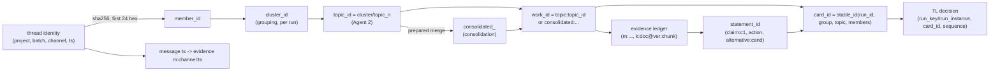

# ThreadSense schema and artifact map

Companion to [THREADSENSE_END_TO_END.md](THREADSENSE_END_TO_END.md). It is verified against checkout
`d212041` (2026-11-08) and was reconciled the same day: it now covers the two cost measures, the meaning of
accounting, and the grounding scope. Paths are repository-relative, and the line numbers are from this checkout.

## 1. Contracts and typed state

| Record | Source (path:line) | Version / literal | Identity fields | Notes |
|---|---|---|---|---|
| Canonical message / thread | `src/threadsense/models.py:29` `Message`, `:43` `Thread` | unversioned Pydantic | `thread_id` (Slack root `ts`), `project_id`, `batch_id`, `channel_id`; `message_id` = Slack `ts` | Built by `adapters/mock_slack.py:140` `get_threads`. The `thread_id` alone is not unique across channels |
| Routing identity | `src/threadsense/routing.py:17` `IDENTITY` | `announcement-routing-v1` (`:16`) | (`project_id`, `batch_id`, `channel_id`, `thread_id`) | `partition` (`:88`) puts every identity in exactly one route and refuses duplicates |
| Member ID | `src/threadsense/handoff_inputs.py:30` `member_id` | — | `'member_' + sha256(identity)[:24]` | Globally stable for the same four-part identity |
| Agent 1 interpretation | `src/threadsense/agents/contracts.py:13` `ThreadInterpretation` | runner record adds `input_sha256`, `run_config_sha256` | `thread_id` + the record's identity fields | Saved in `stages/agent1_interpret/agent1_interpretations_v1/interpretations.json` |
| Agent 1 relevance judgment | `src/threadsense/agents/thread_relevance.py:91` `ThreadRelevance` | `agent1-relevance-v1` (`:30`), stage `agent1-relevance-v2` (`:31`), verifier `agent1-relevance-verification-v1` (`:32`) | bound to the thread's `input_sha256` | Pipeline v2 only; **not run live**. Audited labels: `data/evaluation/agent1_thread_relevance_labels_v1.json` (`agent1-thread-relevance-labels-v1`) |
| Verification finding / result | `contracts.py:80` `VerificationFinding`; `verification_pipeline.py:42` `VerificationResult` | handoff version 1 (`verification_handoff.py:14`) | thread identity | Verified export: `stages/agent1_verify/agent1_verified_v2/interpretations.json` (`verification_status`, `review_required`, `review_findings`) |
| Cluster membership | `src/threadsense/legacy/grouping_v1.py:165` `group_records` (byte-frozen) | `clusters.json` `format_version: 3` | `cluster_id` (`cluster_<16 hex>`) | Scope is project and batch. Agglomerative, complete linkage, cosine, threshold 0.5 |
| Agent 2 topic (direct HTTP, one request per group; no CrewAI) | `src/threadsense/agents/topic_contracts.py:10` `TaxonomyTopic` | prompt `agent2-taxonomy-v7`, response schema 7, export schema 8 (`topic_taxonomy.py:11-13`) | `topic_id` = `<cluster_id>/topic_<n>` | Severity is UNKNOWN/UNASSESSED and deferred to Agent 3 |
| Merge judgment | `src/threadsense/agents/topic_merge.py:43` `MergeJudgment` | `agent2-consolidation-v1`, prompt `agent2-merge-v1` (`:23-24`) | `candidate_set_id` (`cand_<12 hex>`, `set_id` `:104`); consolidated topic `consolidated_<16 hex>` | Presentation run: `PreparedJudge` (`:162`) over `data/evaluation/agent2_consolidation_decisions_v1.json` (PREPARED_AUDIT) |
| Handoff to Agent 3 | `CardLineage.handoff_contract`, `advice_contracts.py:276` | `agent2-taxonomy-handoff-v1/v2/v3` | `agent2_export_sha256`, `candidate_group_id`, `topic_id`, `member_ids` | Loaded through `advice_inputs.load_effective_view` |
| Knowledge source record | `src/threadsense/knowledge_sources.py:39` `SourceRecord`, `:17` `SourceIdentity` | `knowledge-source-v1` | `record_id`, `version_id`, `content_sha256`; Slack (`channel_id`, `thread_id`, `message_id`) or `manual_key` | From Markdown (`knowledge_markdown.py`, `mock-knowledge-markdown-v1`) or extracted announcements |
| Retrieval chunk / index | `src/threadsense/retrieval/chunking.py:142`; `index.py:23` | `knowledge-chunks-v2`, `threadsense-retrieval-index-v1` | `chunk_id`; index `build_fingerprint` | `.index/retrieval/manifest.json`: 112 chunks, 63 documents |
| Evidence ledger entry | `src/threadsense/agents/advisor_evidence.py:145` `evidence_item`; IDs `:78` | evidence view `agent3-evidence-view-v3` (`:242`) | `m:<channel>:<message ts>` or `k:<document>@<version>:<chunk 8 hex>` | Unique within one topic result; `use` = CURRENT_GUIDANCE, ANNOUNCEMENT, HISTORY_ONLY, PRIOR_DECISION, MEMBER_REPORT … |
| Advisor draft | `src/threadsense/agents/advisor_contracts.py:235` `AdvisorDraft` | `agent3-advisor-draft-v11` (accepts v6-v10 for replay) | `claim_id`, `summary:sN`, `detail:dN` | Model output; cites evidence IDs only |
| ToT candidate / comparison | `advisor_contracts.py:412` `CandidateAction`, `:431` `ToTComparison` | `agent3-tot-comparison-v3` (v2 replays) | `candidate_id` (model-chosen, distinct within the comparison) | Controller `agent3-tot-controller-v2` (`advisor_tot.py`) |
| Grounding judgment | `advisor_contracts.py:361` `GroundingJudgment` (v5), `:389` V6, `:404` V7 | `agent3-grounding-judgment-v5..v7` (v4 replays) | `statement_id` (`claim:c1`, `summary:s1`, `action`, `action:need`, `alternative:<candidate>` …) | The saved `grounding` adds effective verdicts (`advisor_checks.py:824` `grounding_result`) |
| AdviceCard | `src/threadsense/agents/advice_contracts.py:325` v1 … `:484` v4, `:575` v5 | `agent3-advice-card-v1` … `v5` | `card_id` = `stable_id('card', {run, group, topic, members})` (`advisor_checks.py:1604`; `stable_id` `advice_contracts.py:48`) | Derived runs mint a new `card_id` and record `derivation.parent_card_id` (`scripts/derive_briefing_repair.py:99`) |
| Model review item | `advice_contracts.py:632` `ModelReviewItem` | `agent3-model-review-item-v1` | `item_id` `review_<32 hex>`, `obligation_id` or `member_ids` | Separate from cards; actions are append-only (`ReviewAction` `:619`) |
| Decision record (domain) | `advice_contracts.py:732` `DecisionRecord` | `agent3-decision-record-v1` | `decision_id`, `original_advice.advice_id` | Wrapped by the dashboard entry |
| TL decision entry | `src/threadsense/dashboard/decisions.py:121` `TLDecisionEntry` | `dashboard-tl-decision-v3` | `entry_id` `decision_<32 hex>`; `run_key`, `run_instance`, `card_id`, `sequence` | `approval_is_not_execution: True` is a fixed field |
| LangGraph state | `src/threadsense/agents/overnight.py:237` `GraphState` (TypedDict) | workflow `agent3-overnight-v1` (`:44`) | — | Only `cursor`, `total`, `stop_reason`, `stop_outcome`, `status`, `counts`. The real state lives in `Runtime` and on disk |
| Run manifest (overnight) | `overnight.py:367` `fingerprints`, `:405` `freeze` | — | `run_id` = `stable_id('agent3overnight', fingerprints)` | Resume must match exactly |
| Campaign manifest | `scripts/run_threadsense_full.py:148` `start`; `execution/pipeline.py:124` `configuration` | pipeline `threadsense-full-run-v1` / `-v2` | run directory | `configuration`, `checkout`, `resumes`, `rules_vs_parent` (replay and branch) |
| Presentation layer | `scripts/build_presentation.py` | `briefing-presentation-v1` | `run_key`, `run_instance` | Ignored unless its `run_instance` matches the run's files |

## 2. How identifiers relate

| ID | Unique within | Global? |
|---|---|---|
| `thread_id` (Slack `ts`) | one channel | no; combine it with the channel and batch identity |
| `member_id` | everywhere (hash of the full identity) | yes, for the same fixture identity |
| `cluster_id`, `topic_id` | one grouping run | no: a regrouping can mint different IDs |
| consolidated topic ID | one consolidation record | no |
| `work_id` | one overnight run | no |
| evidence ID | one topic's ledger (the `k:` form is stable for an unchanged index) | the `m:` form is stable; the `k:` form changes when chunking or the corpus changes |
| `statement_id` | one grounding judgment | no |
| `candidate_id` | one comparison | no; always addressed through `card_id` |
| `card_id` | one run (seeded by `run_id`); derived runs re-mint it | `run_id` is **not** unique: every derived run keeps `agent3overnight_bdc099a7…` |
| run instance | sha256 of `run_manifest.json`, `morning_brief.json`, `cards.json`, `review_queue.json` (`dashboard/runs.py:26` `INSTANCE_FILES`, `:87-89`) | yes. Decisions bind to `run_key#run_instance` |

## 3. Card routing (what puts a card on each line)

| Line or state | Rule | Code |
|---|---|---|
| NEEDS_REVIEW | any review reason: an inherited flag, grounding failure or not run, temporal conflict, open confirmation, severity not established, stage failure, an unresolved ToT choice, or (v5) a next step that is not supported | `advisor_checks.py:1594`; `briefing_policy.py:178` `apply` |
| RECOMMENDED_ACTION | no review reason, and an authorized operational action (judged SUPPORTED, sufficient, with its need SUPPORTED) | same |
| OBSERVATION | no review reason and no operational action. **v5 requires** `next_step = NO_ACTION_NEEDED`: a NO_ACTION whose reason the final grounding judged SUPPORTED | `briefing_policy.py:1-31`, `advisor_checks.py:1464` `next_step_state` |
| Processing history | thread excluded before clustering (relevance) or card moved out of the brief by a relevance label; members and obligations are kept | `thread_relevance.build_stage` (`:363`); `briefing_policy.apply` exclusion checks |

The next-step states (`advisor_checks.py:1464`) keep "No action needed" apart from an absent recommendation:
- `NO_ACTION_NEEDED`: a supported NO_ACTION, either as the card action or with its reason judged SUPPORTED.
- `NO_INTERVENTION_PROPOSED`: the advisor chose no action, but its reason was not supported or not checked.
- `RECOMMENDATION_WITHHELD`: an action was proposed but failed the checks.
- `NO_RECOMMENDATION_AVAILABLE`: no usable draft or no stated next step.

Only the first can produce an Observation. The other three keep the card in NEEDS_REVIEW in v5.

## 4. Artifacts of the presentation run and its lineage

| Artifact | Path | Contents / identity |
|---|---|---|
| Campaign manifest | `data/experiments/threadsense_full_v1/run_manifest.json` | `kind FRESH_LIVE`, pipeline v1, models, `agent3_pilot_version agent3-advisor-pilot-v7`, prompts v18, checkout `4d44b8b` + dirty-file hashes |
| Campaign ledger (execution ledger) | `data/experiments/threadsense_full_v1/ledger.sqlite3`, summary `final/run_summary.json` | 947 rows (937 fresh, 10 reused); $15.317308. Charges come from `execution/pricing.py:64` `settled_cost`, which prices provider-reported `cache_write_tokens` at the write rate. Agent 3 rows: $11.284375 |
| Agent 3 application ledger | `stages/agent3/overnight_run/morning_brief.json.usage` (also `progress/run_state.json`) | the same 187 requests at $10.135588: `advisor_pilot.py:433` `CostLedger` ignores cache-write tokens. Standalone Agent 3 runs (refresh, re-grounds) report only this measure |
| Raw request/response bytes | `data/experiments/threadsense_full_v1/objects/` (content-addressed, `execution/store.py:22`) | keyed by sha256; the ledger rows hold `request_sha` and `response_sha` |
| Snapshot | `…/threadsense_full_v1/snapshot/slack/`, `snapshot_manifest.json`, `retrieval_index_copy/` | exact copy of the demo fixture; tree hashes |
| Stage outputs | `…/stages/<stage>/<attempt>/` + `stage_manifest.json` | dependencies by hash, output tree hash, requests by origin |
| Agent 2 per-group records | `…/stages/agent2/agent2_v1/records/<cluster>/` (`request.json`, `response.raw.bin`, `analysis.raw.txt`, `result.json`) | one request per group |
| Agent 3 overnight run | `…/stages/agent3/overnight_run/` (`run_manifest.json`, `topics/*.json`, `cards.json`, `review_queue.json`, `morning_brief.json/.md`, `progress/`) | one topic result per work item. `morning_brief.json.accounting.status` (`overnight.py:489`) is **disposition accounting** over the Agent 2 handoff, announcement route and processing history: each member recorded once, every obligation queued, no PASSED-with-pending. It is not processing success, and it cannot see the thread Agent 1 rejected (recorded only in `final/run_summary.json.unfinished_work`) |
| Topic result | `topics/topic__<cluster>__topic_<n>.json` = `{work_item, workflow, result}` | the result holds `model_calls` (with raw), `retrieval_trace`, `evidence_ledger`, `drafts`, `grounding`, `tot`, `severity`, `card`, `review_items`, `budget` |
| Consolidated rebuild | `data/experiments/threadsense_full_v1_consolidated_v1/` (`consolidation.json`, `relevance/`, `derivation.json`) | 78 topics in, 38 candidate sets, 14 merges (29 topics) → 63 |
| Refresh | `data/experiments/threadsense_full_v1_consolidated_refresh_v1/` | live, 14 consolidated issues, 32 requests, $2.228018 |
| Targeted checks | `data/experiments/agent3_reground_v1/{overlapping_speech,format_compliance}.json` | `plan`, `edits`, `usage` ($0.051354 + $0.043068), `result` |
| Grounding scope | `advisor_checks.py:660` `statements`, `:646` `_action_text` | judged: every Advisor statement a card presents as established. Not judged: fixed UI and template text, quoted sources, Agent 2 topic names, attributed Agent 1 notes, labelled editorial suggestions (`presentation.json`) |
| **Presentation run** | `data/experiments/threadsense_full_v1_combined_v2/` | `run_manifest.json.derivation` (`combined-briefing-v2`, `OFFLINE_COMBINATION`, parents), `cards.json` (95 records), `morning_brief.json`, `review_queue.json` (37), `presentation.json`, `morning_brief.md`, `exports/morning_brief.derivation.md`, `REVIEW.md` |
| Decision store | default `.state/dashboard/tl_decisions.sqlite3` (`dashboard/decisions.py:32`); demos use `D:/tsb/demo-*.sqlite3` | tables `requests`, `card_decisions`, `review_actions`, `indexing` (`decisions.py:328-341`) |
