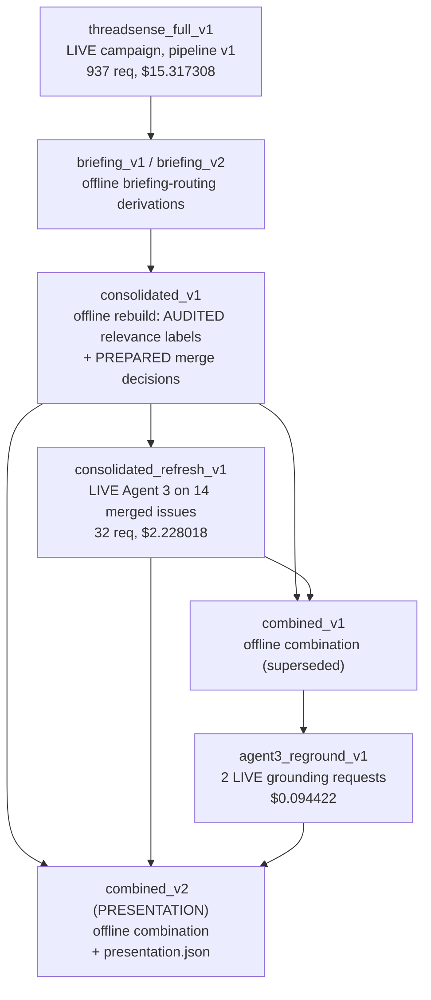
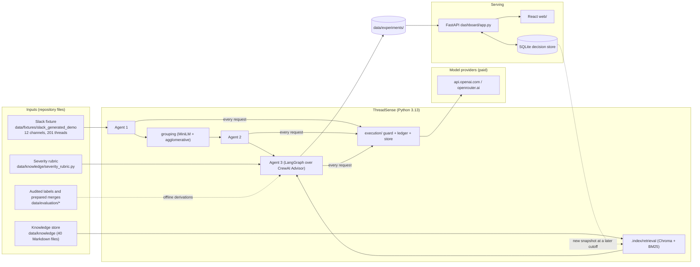
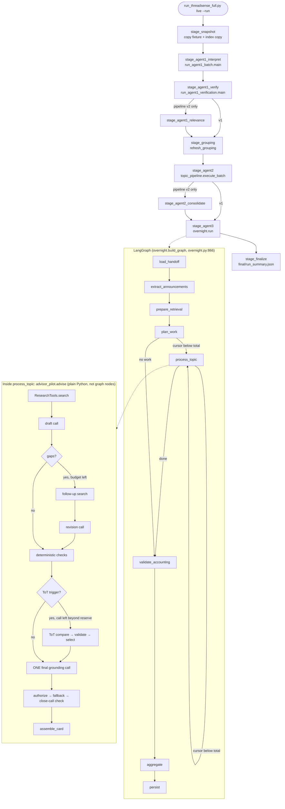

# ThreadSense end to end: architecture

How ThreadSense works from Slack input to the dashboard, written for an engineer new to the project. Claims cite code
(`path:line` as of checkout `d212041`; line numbers drift as the code changes), a saved artifact or a test. Contracts,
IDs and artifacts are in the companion [SCHEMA_AND_ARTIFACT_MAP.md](SCHEMA_AND_ARTIFACT_MAP.md); results are in
[../evaluation.md](../evaluation.md).

Evidence labels used throughout:

| Label | Meaning |
|---|---|
| **LIVE** | implemented and observed in a saved live run |
| **OFFLINE-TESTED** | implemented; exercised only by offline tests or prepared judgments |
| **AUDITED** | a developer-audited judgment standing in for a model judgment |
| **HUMAN-EDIT** | human-edited wording, then checked by a live model |
| **FIXTURE** | synthetic, hand-written data |
| **PROPOSED** | not implemented, or not supported |

## 1. What ThreadSense does

Synthetic Slack threads from four annotation projects (audio_multimodal, multilingual_eval, response_preference,
safety_classification) are turned into a morning brief for team leads (TLs), in four steps:
1. Agent 1 interprets and verifies each discussion thread.
2. Threads are embedded and clustered.
3. Agent 2 names topics.
4. Agent 3 researches each topic against a knowledge store and writes **AdviceCards**: a summary, a severity, a
   recommended action with a copyable draft, and review reasons.

A FastAPI + React dashboard shows the cards and records TL decisions. A decision never executes anything.

**Control, reasoning and validation are separate:**
- **Control:** Python owns control flow: the campaign stage runner, a sequential LangGraph over work items, and budget
  and reservation logic.
- **Semantic reasoning:** model calls only. Agent 1 runs on CrewAI or a direct HTTP verifier, Agent 2 on direct HTTP,
  and Agent 3 on CrewAI with one task per stage.
- **Validation:** Pydantic contracts, deterministic checks, and **one final grounding call per topic**. That call judges
  every Advisor statement that a card presents as established, and nothing after it can add or change such a statement.
  A card also shows text the grounding call does not judge: fixed UI and template text, quoted source material, Agent 2
  topic names, attributed Agent 1 notes, and labelled editorial suggestions. Section 7.1 lists exactly what is and isn't
  judged.

**Three control layers, not one:**
1. The **campaign runner** (`run_threadsense_full.py` → `pipeline.execute`) is a plain Python stage loop over saved
   directories. It is *not* LangGraph.
2. **LangGraph** exists only inside the Agent 3 stage (`overnight.build_graph`), sequencing work items. The standalone
   `run_agent3_overnight.py` uses the same graph; the refresh run was launched that way, outside the campaign runner.
3. The **Advisor** (`advisor_pilot.advise`) runs inside one graph node, `process_topic`, as ordinary Python calls:
   research, draft, revision, ToT, grounding and routing.

**Current design vs the presentation evidence.** The current pipeline (`threadsense-full-run-v2`) includes two stages
the campaign did not have:
- **Agent 1 relevance filtering** (`agent1_relevance`): a model judgment plus one verifier request per proposed
  exclusion.
- **Cross-group consolidation** (`agent2_consolidate`): an Agent 2 merge judge over candidate sets, using direct HTTP.

The presentation run was produced under pipeline v1. **AUDITED substitutes** stood in for these two stages: developer
relevance labels and prepared merge decisions, applied offline. Neither live stage has run.

## 2. Baseline

| Item | Value | Evidence |
|---|---|---|
| Checkout inspected | `d212041d09a019cf103cf169fd45b6388fb56b8a` ("ToT audit", 2026-11-08), branch `refactor_agents1_2`, clean tree (`git status` empty) | `git log -1` |
| Presentation run | `data/experiments/threadsense_full_v1_combined_v2/` | located by `run_manifest.json.derivation.version == "combined-briefing-v2"` with `supersedes: …combined_v1`. It is the only run with `presentation.json` |
| Its provenance | `derivation.provenance: OFFLINE_COMBINATION`, `model_calls: 0` | `combined_v2/run_manifest.json` |
| Original campaign | `data/experiments/threadsense_full_v1/` | `run_manifest.json`: `kind FRESH_LIVE`, `created_at 2026-11-05T16:32Z` |
| Campaign code and settings | checkout `4d44b8b` (branch `dashboard_design`) plus recorded hashes of dirty files; pipeline **`threadsense-full-run-v1`**; Agent 3 pilot **v7**, prompts **v18** | `threadsense_full_v1/run_manifest.json` (`configuration`, `checkout`) |
| Campaign models | Agent 1 interpreter `openai/gpt-4o-mini-2024-07-18`; verifier `openai/gpt-4.1`; Agent 2 `openai/gpt-5.4-2026-03-05` (low reasoning effort); Agent 3 `openai/gpt-6.1-sol` (medium effort, 24k input cap, 16,384 output, 0 SDK retries) | same, `configuration.models` |
| Current code vs campaign | Current code is pilot **v8** (`advisor_pilot.py:49`), ToT controller v2, shadow policy, and pipeline v2 stages. The campaign ran pilot v7 under pipeline v1. Current code has **not** produced a full live run | manifests; `pipeline.py:30-34` |

### Lineage of the presentation run

The parents are recorded in `combined_v2/run_manifest.json`:
- `data/experiments/threadsense_full_v1_consolidated_v1`
- `data/experiments/threadsense_full_v1_consolidated_refresh_v1`
- `agent3_reground_v1/overlapping_speech.json`
- `agent3_reground_v1/format_compliance.json`

`consolidated_v1` itself names `threadsense_full_v1` and `threadsense_full_v1_briefing_v2`.

**This is not one untouched end-to-end live run:**
- Relevance labels are **AUDITED**: `data/evaluation/agent1_thread_relevance_labels_v1.json`, "DEVELOPER_AUDIT … not
  confirmed by a team lead".
- Cross-group merges are **AUDITED**: `data/evaluation/agent2_consolidation_decisions_v1.json`, "PREPARED_AUDIT … not
  live Agent 2 judgments".
- 49 cards are reused from the campaign. 14 merged issues were advised live in the refresh, and 2 of those cards were
  replaced by targeted live re-groundings.
- The format card carries 3 **HUMAN-EDIT** statements, each judged SUPPORTED by the live model.
- The refresh also recorded pilot v7. The v8 checks (author-count scope, temporal eligibility, partial pending) were
  applied **offline** during combination (`derivation.checks`).

### Thread reconciliation (accounting is not processing success)

| Step | Threads | Evidence |
|---|---|---|
| Raw threads in the demo fixture | **201** | `.index/retrieval/manifest.json` `corpus.current_day_announcements.source_threads_in_window`; `data/fixtures/slack_generated_demo` (12 channels) |
| → announcements (knowledge-source route, never interpreted) | **23** | same, `announcement_threads: 23`; `morning_brief.json.counts.window_announcements: 23` |
| → discussions sent to Agent 1 | **178** | same, `discussion_threads: 178`; ledger: 178 `agent1_interpret` requests |
| → rejected by Agent 1 (`AUTHORITY_INELIGIBLE`, `multilingual_eval` `C_MULTI_QA` `1790866887.000147`); **recorded as unfinished, not processed further** | **1** | `threadsense_full_v1/final/run_summary.json.unfinished_work`; `stages/agent1_verify/stage_manifest.json.agent1_rejected`; `ACCEPTANCE.md:7-8`, `:72` |
| → accepted, verified, clustered and advised | **177** | `clusters.json.thread_count: 177`; `morning_brief.json.counts.discussion_members: 177` |
| → on the 63 active presentation cards | **174** | `presentation.json.totals.active_threads` |
| → processing history (AUDITED relevance labels) | **3** | `morning_brief.json.processing_history` |

What **`accounting.status: COMPLETE`** means (`overnight.validate_accounting`, `overnight.py:489-568`): it is a check
on **disposition accounting** over Agent 3's inputs. It verifies that:
- every Agent 2 handoff member, announcement-route member and processing-history member is recorded exactly once;
- every inherited obligation is in the Model Review Queue;
- no card shows grounding PASSED while a judgment is still pending.

It does **not** mean every item was processed successfully:
- `CARD_WITH_STAGE_FAILURES` and cards whose grounding failed are valid dispositions.
- The thread Agent 1 rejected never enters the Agent 2 handoff, so Agent 3's accounting does not see it.

The campaign's own "Status: COMPLETE" (`threadsense_full_v1/ACCEPTANCE.md:7-8`) states the rejection explicitly. The
derived runs, including the presentation run, carry Agent 3's COMPLETE and **do not mention the rejected thread**: it
appears only in the campaign artifacts. Any completion claim should therefore read "177 of 178 discussions processed;
1 rejected by Agent 1 and recorded as unfinished".

### Counts (reported separately, never summed)

| Measure | Value | Source |
|---|---|---|
| Active cards in the brief | **63**: 52 Needs Review, 8 Recommended Action, 3 Observation | `combined_v2/presentation.json.totals` |
| Threads on active cards | **174** | same |
| Processing-history threads (not briefed) | **3**: 2 greetings and 1 avatar question; AUDITED labels | `morning_brief.json.processing_history` |
| Card records in `cards.json` | **95**: 63 active + 29 replaced (history only) + 3 processing history | `presentation.json.totals.card_records` |
| Model Review Queue items | **37**, all `agent1:inherited_agent1_review` | `morning_brief.json.counts.review_queue_by_kind` |
| Discussion threads accounted for | 177 accepted by Agent 1 + 1 rejected (`AUTHORITY_INELIGIBLE`, recorded as unfinished) | `threadsense_full_v1/final/run_summary.json.unfinished_work` |
| Raw counts in `morning_brief.json.counts` | 95 cards, 76 / 12 / 7 | these include replaced and history records; use the presentation totals instead |

### Costs (from each stage's own ledger; copies and replays add $0)

| Stage | Requests | Charged | Ledger |
|---|---|---|---|
| Agent 1 interpretation | 178 | $0.055073 | `threadsense_full_v1/final/run_summary.json.ledger.by_stage` |
| Agent 1 verification | 496 fresh + 10 reused | $3.670577 | same |
| Agent 2 taxonomy | 76 | $0.307283 | same |
| Agent 3 (81 work items) | 187 | $11.284375 (execution ledger) / $10.135588 (Agent 3 application ledger); see below | same / `stages/agent3/overnight_run/morning_brief.json.usage.totals` |
| **Campaign total** | **937** | **$15.317308** | `ledger.committed_usd` (execution ledger) |
| Consolidated refresh (14 issues) | 32 | $2.228018 as recorded (application ledger); $2.463882 if priced like the execution ledger | `threadsense_full_v1_consolidated_refresh_v1/morning_brief.json.usage.totals`; recomputed read-only from saved usage |
| Targeted grounding checks (2) | 2 | $0.094422 as recorded (application ledger; token usage not saved, so it cannot be repriced) | `agent3_reground_v1/*.json.usage` |
| Offline derivations, combination, presentation | 0 | $0 | `derivation.model_calls` |
| Network-disabled replay `threadsense_full_v1_replay` | 0 | $0 | the cache served every response |

The distinct paid total is **$17.639748** over 971 requests, as recorded by the stage ledgers. Those figures mix two
pricing bases. Pricing the refresh like the campaign ledger gives **$17.875612**; the re-ground basis stays
unresolved.

**Why there are two Agent 3 figures ($10.135588 vs $11.284375).** Both describe the same 187 requests and the same
provider-reported usage: 2,298,134 input tokens, 553,932 output tokens, **0 cache reads and 2,297,573 cache-write
tokens** (read from the `agent3` rows of `threadsense_full_v1/ledger.sqlite3`, opened read-only).

| Measure | Value | Computed by | Treatment of cache writes |
|---|---|---|---|
| Execution ledger `charged_usd` | **$11.284375** | `execution/pricing.py:64` `settled_cost` (rates in `PRICES`, verified 2026-11-05 per the module docstring) | prices `cache_write_tokens` at the `gpt-6.1-sol` write rate ($2.50/M); remaining uncached input at $2.00/M |
| Agent 3 application ledger `usage.totals.charged_usd` (shown as "$10.1356" in that run's `morning_brief.md`) | **$10.135588** | `advisor_pilot.py:433` `CostLedger.settle`, rates from LiteLLM's local map (`model_prices` `:469`) | reads only `cached_tokens` and prices **all** other input at $2.00/M, so cache writes are not charged at the write rate |

The difference is exactly 2,297,573 × $0.50/M = **$1.148787**.

- The **execution ledger is the campaign's enforced budget** and the basis of the $15.317308 total.
- The **application ledger** is the Agent 3 workflow's own pre-check: in the campaign it ran under the execution
  ledger; standalone, as in the refresh and the re-grounds, it is the only budget.
- Neither figure is a provider invoice; none is saved.

Reservations (`reserved_usd`) are upper bounds settled to these charges; they are not costs. The historical ledgers
are unchanged.

### Libraries: direct, transitive, unused

| Library | Status | Where (direct imports outside `legacy/`) |
|---|---|---|
| crewai 1.15.27 | direct dependency, direct import | `agents/thread_interpreter.py:4`, `thread_relevance.py:144`, `decision_evidence_audit.py:13`, `advisor_pilot.py:575/599/623`; also `topic_analyst.py:6`, which nothing on the presentation path imports |
| langgraph 1.2.18 | direct, direct import | `agents/overnight.py:867` only |
| chromadb 1.5.9 | direct, direct import | `retrieval/index.py` |
| sentence-transformers 6.1.0, scikit-learn 1.9.1, numpy | direct | `retrieval/embeddings.py`; `legacy/grouping_v1.py:167` (sklearn); `topic_merge.py` |
| fastapi 0.162.0, pydantic 2.12.5, pyyaml, python-dotenv | direct | `dashboard/app.py`, contracts, `knowledge_markdown.py`, `config.py` |
| litellm 1.105.0 | transitive (via `crewai[litellm]`), **imported directly** | `advisor_pilot.py:471` (price map) |
| httpx 0.28.1, tiktoken 0.14.0, transformers 5.20.1, uvicorn 0.54.0 | transitive, **imported directly** (not declared in `pyproject.toml`) | `execution/guard.py`, `advisor_pilot.py`, `execution/pricing.py`, `retrieval/embeddings.py`, `scripts/run_dashboard.py` |
| openai 2.54.0, torch 2.14.1 | transitive, used indirectly (by LiteLLM/CrewAI and sentence-transformers) | no direct import |
| langchain-core 1.7.2 | transitive (by langgraph), **not imported** | no `langchain` import in `src/`, `scripts/` or `tests/` |
| mcp 1.28.1 | transitive (by crewai), **unused** | no import; the only mention is a docstring in `scripts/generate_thread_blueprint.py:10` |
| Frontend | react 18.3.1, react-dom, framer-motion 11.18.2; dev: vite 5.4.21, tailwindcss 3.4.19, @playwright/test 1.62.1 | `web/package.json` (pinned) |

## 3. System boundary

Nothing posts to Slack or calls an external system on approval. The only outbound network calls are model requests
through `execution/guard.py`, and the guard refuses asynchronous provider calls (`guard.py:172-177`).

## 4. Execution path

### 4.1 Entry point and control structure

The campaign entry is `scripts/run_threadsense_full.py:206` `main`:
- `live --run` calls `start` (`:148`), which writes `run_manifest.json`.
- `go` (`:167`) installs `execution.guard.Guard` (`guard.py:141`) and calls `pipeline.execute` (`pipeline.py:445`).

`execute` loops over `run.stages`: `STAGES` (v1, used by the campaign) or `STAGES_V2` (`pipeline.py:30-34`). It keeps
a stage only when its manifest is COMPLETE and its dependencies' manifest hashes are unchanged (`pipeline.py:211-213`
`current`).

Stages connect through **saved files, not function returns**. Each stage reads the previous stage's output directory
(`Run.output`, `pipeline.py:177`) and writes `stages/<stage>/stage_manifest.json`. Agent 1 and Agent 3 run their own
CLI modules in-process (`load_script`, `pipeline.py:86`).

**LangGraph** (`overnight.py:866-882`):
- The nodes are `load_handoff`, `extract_announcements`, `prepare_retrieval`, `plan_work`, `process_topic`,
  `validate_accounting`, `aggregate` and `persist`.
- The edges are sequential, plus conditional edges from `plan_work` and `process_topic` back to `process_topic` while
  `cursor < total`.
- The state is the `GraphState` TypedDict (`overnight.py:237`): `cursor`, `total`, `stop_reason`, `stop_outcome`,
  `status` and `counts`. The data itself lives in `Runtime` and on disk.
- There is no checkpointer. Resume uses the run's own manifest and topic files.
- **ToT, research, grounding and routing are ordinary Python calls inside `process_topic`**, not graph nodes.

**CrewAI:**
- **Agent 3:** `CrewAIClient` builds three role Agents once (`advisor_pilot.py:617`; researcher, analyst, verifier;
  `tools=[]`, `max_iter=1`, `max_retry_limit=0`). Each stage creates one `Task` and a one-task `Crew`
  (`advisor_pilot.py:627-629`). `RequestGuard` (`advisor_pilot.py:485`) allows **exactly one HTTP request per stage**,
  which also blocks CrewAI's forced-final-answer and rate-limit retries. Tested in
  `tests/test_agent3_request_boundary.py:73` `test_one_stage_sends_exactly_one_http_request`.
- **Agent 1 interpretation:** one Agent/Task/Crew per thread (`thread_interpreter.py:229-268`) with **`max_iter=3`,
  `max_retry_limit=0`**. Observed vs proved:
  - **Observed:** the campaign recorded **178 requests for 178 threads**, all SETTLED (ledger rows, stage
    `agent1_interpret`).
  - **Not proved:** no Agent 1 equivalent of `RequestGuard` exists. The transport guard refuses only a resend of an
    identical failed body. CrewAI's executor can issue a further request with a different body, such as a
    forced final answer (documented for Agent 3 at `advisor_pilot.py:588`). The per-thread maximum therefore depends on
    CrewAI internals and is not established here.
  - The interpreter is a frozen, fingerprinted file and is not changed to simplify this.
- **Agent 1 verification and Agent 2 do not use CrewAI.** Both make single-attempt direct HTTP calls through
  `verification_requests.send_once` (`verification_requests.py:44`), which the guard also wraps (`guard.py:179-184`):
  - Agent 1 verification documents at most 4 calls per thread (`verification_pipeline.py:154` docstring) and recorded
    496 fresh + 10 reused requests over 177 threads.
  - Agent 2 sends one request per candidate group (`topic_pipeline.execute_batch`, `maximum_requests=len(payloads)`,
    `pipeline.py:359`); the campaign recorded 76.
- **Enforced Agent 3 boundary** (proved by `RequestGuard` and tests):
  - **one HTTP request per stage**;
  - at most **4 model calls per work item**: draft, revision, ToT, grounding, with grounding always reserved;
  - a work item starts only when 2 requests fit;
  - a run-wide dollar ceiling.

### 4.2 Stage table

The model-call column gives the maximum per item. The reuse column says what can be served without a new request.

| # | caller → callee | path:symbol | input | processing | output / artifact | libraries | model call? | cache / reuse boundary | failure behaviour |
|---|---|---|---|---|---|---|---|---|---|
| 1 | `execute` → `stage_snapshot` | `execution/pipeline.py:219` | `data/fixtures/slack_generated_demo`, `.index/retrieval` | copy and hash the fixture; copy the index | `snapshot/slack/`, `snapshot_manifest.json` | shutil | no | kept if the dependencies are unchanged | refuses if the copied tree hash differs from the source |
| 2 | `stage_agent1_interpret` → `run_agent1_batch.main` | `pipeline.py:234`; `scripts/run_agent1_batch.py:85` | snapshot channels JSON | `load_threads` (`:45`) → `MockSlackAdapter.get_threads` (`adapters/mock_slack.py:140`, paginated) → `routing.partition` (`routing.py:88`; channel type from `data/config/channel_routes.json`, no name inference `:85`) → announcements go to `source_ingestion.extraction_report`; discussions go to `interpret_thread` (`agents/thread_interpreter.py:229`) | `interpretations.json` (ThreadInterpretation + `input_sha256`), `review_required.json`, `failures/`, `announcement_sources/` | CrewAI, LiteLLM, Pydantic | yes (CrewAI, `max_iter=3`) | guard request cache by exact body; `--retry-failed` is off, so rejections are kept for review | an authority or reference violation (`validate_interpretation_references`, `thread_interpreter.py:139`; eligible authors `:112`) rejects the thread. It is recorded and goes no further (1 thread in the campaign) |
| 3 | `stage_agent1_verify` → `run_agent1_verification.main` | `pipeline.py:296`; `scripts/run_agent1_verification.py:331` | Agent 1 baseline + `discussion_view` (`pipeline.py:247`: announcements and rejected threads removed) | `verify_and_revise` (`agents/verification_pipeline.py:143`): source analysis, prose comparison, at most 1 revision, re-check; documented as at most 4 calls per thread (docstring `:154`; the per-thread maximum was not separately verified). Unresolved findings are retained for review | `agent1_verified_v2/interpretations.json` (`verification_status`, `review_required`, `review_findings`) | direct HTTP (`verification_requests.py`) | yes | identities must match the baseline exactly (`pipeline.py:303-304`); 10 responses reused | a refusal stops the stage, keeping output and accounting |
| 3b | `stage_agent1_relevance` | `pipeline.py:320`; `agents/thread_relevance.py:363` `build_stage` | verified export + interpretations (`--relevance` judgments) | structural checks; one verifier request per proposed model exclusion (`assess_exclusion` `:241`); unconfirmed exclusions stay eligible | `clustering_input/`, `processing_history.json` | direct HTTP | yes | — | **pipeline v2 only; not run live** (OFFLINE-TESTED: `tests/test_thread_relevance.py:205`, `:228`) |
| 4 | `stage_grouping` → `refresh_grouping` | `pipeline.py:342`; `topic_grouping.py:64` | Agent 1 export | `approved_grouping` (`topic_grouping.py:12`) loads the **byte-checked** `legacy/grouping_v1.py`; MiniLM-L6-v2 at a pinned revision, offline (`HF_HUB_OFFLINE`); `AgglomerativeClustering` (complete, cosine, threshold 0.5, per project and batch; `legacy/grouping_v1.py:165-177`) | `grouping_v1/clusters.json` (177 threads, 76 clusters, 27 singletons), `embedding_cache/` | sentence-transformers, torch, sklearn | no | embedding cache keyed in the report (`embedding_cache_key`) | refuses if the script hash, model revision or package versions differ (`topic_grouping.py:16-28`) |
| 5 | `stage_agent2` → `execute_batch` | `pipeline.py:352`; `agents/topic_pipeline.py:120` | `load_candidate_payloads` (`topic_inputs.py:26`) | one taxonomy request per group (`agent2-taxonomy-v7`); validation and export (`topic_taxonomy.py:55`, `:80`); severity deferred to Agent 3 | `agent2_v1/records/<cluster>/{request.json,response.raw.bin,result.json}`, `effective_output.json` (handoff v2, schema 8) | direct HTTP | yes (1 per group; 76) | `execute_batch` refuses existing directories, so a resume uses a new attempt directory with cache hits | an unprocessed group stops the stage |
| 5b | `stage_agent2_consolidate` | `pipeline.py:369`; `agents/topic_merge.py:242` | topics + member vectors | candidate sets from similarity cliques (`:108`); one judge request per set; whole-group validation (`:146`, `:316`) | `consolidation.json` | numpy, direct HTTP (`LiveJudge` `:182`) | yes | — | **v2 only; not run live.** The presentation used `PreparedJudge` (`:162`) offline (AUDITED) |
| 6 | knowledge ingestion (offline, ahead of time) | `scripts/build_retrieval_index.py` → `retrieval/index.py:106` `build_index`; `corpus.py:117` `collect`; `knowledge_markdown.py:127`; `chunking.py:142` | `data/knowledge/**.md` (40 files), announcements before the cutoff | front matter → SourceRecord; chunking `knowledge-chunks-v2` (FAQ question/answer units); MiniLM embeddings; Chroma collections guidelines / faq / decisions | `.index/retrieval/` (112 chunks, 63 documents, `build_fingerprint 4da16f09…`) | chromadb, sentence-transformers | no | the index is immutable; decisions reach it only through a new snapshot directory | the Chroma client is closed after build (see `docs/development.md`) |
| 7 | `stage_agent3` → `run_agent3_overnight.build_runtime` → `overnight.run` | `pipeline.py:403`; `scripts/run_agent3_overnight.py:37`; `agents/overnight.py:885` | Agent 2 output dir, snapshot fixture, index | the LangGraph above; `plan` (`overnight.py:319`) makes one work item per topic (`topic:<topic_id>`) or consolidated topic (`consolidated:<id>`) | `stages/agent3/overnight_run/` | LangGraph | via `advise` | `freeze` (`overnight.py:405`): resume only with identical fingerprints; completed topic files reused, interrupted ones not resent | a topic that raises becomes `TOPIC_FAILED` with members kept (`:470-479`); budget exhausted becomes `UNPROCESSED_BUDGET` (`:453`) |
| 7a | `process_topic` → `advise` | `overnight.py:426`, call at `:460`; `agents/advisor_pilot.py:1119` | topic packet (`topic_packet` `:932` / `consolidated_packet` `:904`) | the steps below | topic result JSON | — | — | — | — |
| 7b | `advise` → `ResearchTools.search` | `advisor_pilot.py:1133-1140`; `agents/advisor_evidence.py:283`; `retrieval/search.py:67` `Retriever` | project, batch, as-of cutoff, query | BM25 + exact dense cosine, RRF (k=60), MMR (λ=0.9); `version_mode=current` withholds superseded versions; a `supersession_check` search in `history` mode when something was withheld | evidence ledger (`m:…`, `k:…` IDs; `use` labels) | chromadb (stored vectors), in-house BM25 | no | 6 retrieval calls per topic (`overnight.PER_TOPIC`) | `StaleIndexError` on a snapshot that does not match its sources |
| 7c | `advise` → `Stages('draft')` → `CrewAIClient.complete` | `advisor_pilot.py:1141`, `:840`, `:621` | rules + topic + evidence (`model_view`, names hidden; `advisor_evidence.py:255`) | researcher Agent drafts claims, summary, details, action, severity and gaps (AdvisorDraft v11) | `drafts.initial` | CrewAI → LiteLLM → httpx | **1** | guard cache by exact body | a failure is recorded; the card still issues with no Advisor statement shown |
| 7d | follow-up + revision | `advisor_pilot.py:1156`, `:1162` | gaps the draft names | up to 3 follow-up searches by `ResearchTools`, then at most 1 revision | `drafts.final`, `follow_ups` | CrewAI | **≤1** | runs only if a call stays reserved for grounding | `SKIPPED_RESERVED_FOR_GROUNDING` |
| 7e | deterministic checks | `advisor_checks.py:290` `normalize`, `:580` `structural_issues`, `:1203` `build_severity`, `:1009` `temporal_check` | draft + ledger | citation and use rules, role-not-name prose, severity bound to rubric signals, temporal priority | `structural`, `severity`, `temporal_before_grounding` | Python | no | — | a structural failure fails grounding without a semantic pass |
| 7f | ToT | `advisor_pilot.py:1182-1188`; `agents/advisor_tot.py` `compare` / `check_candidates` / `select` | draft, temporal result, ledger | triggers (temporal conflict, confidence < 0.60, open confirmation, action choice); one analyst call for 2-3 candidates; validation against the ledger; categorical selection | `tot` record | CrewAI | **≤1** (`reserve=1`) | — | `UNAVAILABLE`: review reasons unchanged |
| 7g | final grounding | `advisor_pilot.py:1191-1199`; `advisor_checks.py:660` `statements`, `:824` `grounding_result`; `_final_grounding` `advisor_pilot.py:1052` | every statement that can reach a card or a reviewer, plus ToT alternatives | verifier Agent judges each statement (SUPPORTED / PARTIALLY / UNSUPPORTED), action sufficiency, alternative sufficiency and source consistency | `grounding` (statements with effective verdicts) | CrewAI | **1** (always reserved) | transport cache: only an identical request body. `ReplayClient` (`:669`): statement-level reuse under the conditions in §6 (`tests/test_execution_layer.py:216`) | a failed or skipped call gives GROUNDING_NOT_RUN: nothing is shown as established |
| 7h | authorize → fallback → close-call check → card | `advisor_checks.py:1292` `authorize`; `advisor_tot.fallback`, `choice_after_grounding`, `card_action_candidate`; `advisor_checks.py:1509` `assemble_card` (line rule `:1594`) | grounding + draft + packet | only SUPPORTED statements reach the card; the action needs SUPPORTED text, sufficiency and intervention need; inherited flags attached (`inherited_flags` `:1375`) | `card` (AdviceCard v4 in the campaign), `review_items` | Pydantic | no | — | card assembly failure gives a minimal card with members and flags (`advisor_pilot.py:1239`) |
| 8 | `validate_accounting` → `aggregate` → `persist` | `overnight.py:489`, `:599`, `:691`; `report` `:708` | all outcomes | every member, obligation and announcement-route item gets a disposition; review queue (`:581`) | `cards.json`, `review_queue.json`, `morning_brief.json/.md`, `accounting` | — | no | — | accounting INCOMPLETE marks the stage STOPPED (`pipeline.py:422`) |
| 9 | `stage_finalize` | `pipeline.py:430` | stage manifests + ledger | summary | `final/run_summary.json` | — | no | — | — |
| 10 | offline derivations | `scripts/derive_briefing_repair.py`, `derive_consolidated_run.py:95`, `derive_combined_brief.py:195`, `build_presentation.py` | saved runs + labels / decisions / regrounds | briefing-routing-v2 (`briefing_policy.py:178`); relevance via `thread_relevance.build_stage(labels=…)`; merges via `PreparedJudge`; combination with byte-exact re-ground verification (`derive_combined_brief.py:133`) | new run directories; `derivation.json`; `presentation.json` | — | no (the refresh and re-grounds are separate paid runs) | parents are checked by hash; each write goes to a new directory | refuses a card whose Agent 2 binding changed (`derive_consolidated_run.py:145`) |
| 11 | dashboard | `scripts/run_dashboard.py` → `dashboard/app.py:25` `create_app`; `runs.py:75` `Run`, `:449` `Catalog` | run directories | read-only catalog; run instance hash; alternatives and presentation layer | JSON API | FastAPI, uvicorn | no | runs are read-only | localhost only; unknown run gives 404 |
| 12 | frontend | `web/src/App.jsx:154` → `/api/runs/{run}/brief` (`app.py:64`); `CardView.jsx:244` → `/api/runs/{run}/cards/{card}` (`app.py:85`) | API JSON | renders totals, cards, alternatives, evidence and decisions | browser | React, Tailwind | no | — | — |
| 13 | TL decision | `DecisionPanel.jsx:109` → `api.js:33` POST with `Idempotency-Key` → `app.py:161` `decide` → `decisions.py:214` `build_decision` → `DecisionStore.submit` (`:361`) | `DecisionRequest` (`decisions.py:80`) | allowed kinds by card line (`decisions.py:42`); alternatives only from `Run.alternatives`; idempotency key + `expected_head` | `card_decisions` row (TLDecisionEntry v3) + `indexing` row PENDING | sqlite3 | no | the same key and body replays the stored response | a key reused with another body raises KeyReused; a stale head raises StaleHead (409); approval never executes |

## 5. Data walkthrough

### 5.1 One thread end to end: "Japanese text rendering issue"

| Step | Artifact (path) | Field excerpt |
|---|---|---|
| Raw Slack | `data/experiments/threadsense_full_v1/snapshot/slack/channels/C_MULTI_GENERAL.json` | channel `C_MULTI_GENERAL` (multilingual_eval, `multi_batch_11`, GENERAL). Root `ts 1790933070.000168`, user `U017`: "Anyone else seeing this? Japanese characters show as boxes after I reopen the task." Reply `1790933126.000113`, `U014`: "Can we reproduce the rendering problem in another browser or task?" |
| Route | `routing.route_kind` (`routing.py:70`) | channel type GENERAL → DISCUSSION |
| Canonical identity | `handoff_inputs.member_id` (`:30`) | (multilingual_eval, multi_batch_11, C_MULTI_GENERAL, 1790933070.000168) → `member_e08c392659a693b36ca4c663` |
| Agent 1 interpretation (LIVE) | `stages/agent1_interpret/agent1_interpretations_v1/interpretations.json` | model gpt-4o-mini-2024-07-18; `resolution_state UNRESOLVED`; `authority_evidence_message_ids []`; `input_sha256 7bcd20ad…` |
| Agent 1 verification (LIVE) | `stages/agent1_verify/agent1_verified_v2/interpretations.json` | `verification_status VERIFIED`, `review_required false`, `handoff_version 1` |
| Cluster | `stages/grouping/grouping_v1/clusters.json` | `cluster_1347c5d0d6cba2cd`, singleton, representative question "Is anyone else seeing Japanese characters showing as boxes…" |
| Agent 2 topic (LIVE) | `stages/agent2/agent2_v1/records/cluster_1347c5d0d6cba2cd/result.json` | topic `cluster_1347c5d0d6cba2cd/topic_1` "Japanese text rendering issue"; `preliminary_severity UNKNOWN / UNASSESSED`, deferred to AGENT3 |
| Consolidation | `threadsense_full_v1_consolidated_v1/consolidation.json` | not merged (passes through) |
| Agent 3 work item (LIVE) | `stages/agent3/overnight_run/topics/topic__cluster_1347c5d0d6cba2cd__topic_1.json` | `work_id topic:cluster_1347c5d0d6cba2cd/topic_1`; `model_calls`: draft OK (1 HTTP), grounding OK (1 HTTP); ToT `NOT_TRIGGERED` |
| Evidence ledger | same file, `result.evidence_ledger` (7 items) | `m:C_MULTI_GENERAL:1790933070.000168` (MEMBER_REPORT); `k:multilingual-eval-instructions@1.2:ea925467` and `k:multilingual-eval-faq@1.1:e2ea02bf` (CURRENT_GUIDANCE); `k:multi-japanese-review-pending@1.0:124c6b92` (PRIOR_DECISION) … |
| Grounded statements | same file, `result.grounding` (status PASSED, basis SEMANTIC) | 13 statements, all SUPPORTED: `claim:c1..c4`, `summary:s1..s2`, `detail:d1`, `action`, `action:rationale`, `action:need`, `resolution:member_e08c…`, `severity:rationale`, `reporter:U017`. `action_sufficiency SUFFICIENT`, essential `claim:c1..c4` |
| Campaign card | same file, `result.card` | `card_72cd7571f2e61fc90326b14c60551ee1`, AdviceCard v4, RECOMMENDED_ACTION, ESCALATE_ENGINEERING, severity LOW |
| Presentation card | `threadsense_full_v1_combined_v2/cards.json` | `card_a37d099e37a1a518cecba2f78d298b45`, AdviceCard v5. `derivation.parent_card_id card_72cd…`, `text_provenance PARENT_RUN_JUDGMENTS`, `changes []`. `briefing.status IN_BRIEFING` (relevance label `rel_cluster_1347c5d0d6cba2cd_topic_1`, DEVELOPER_AUDIT). `next_step ACTION_RECOMMENDED` |
| Backend | `GET /api/runs/threadsense_full_v1_combined_v2/brief` (`app.py:64`) and `GET …/cards/card_a37d…` (`app.py:85`) | `{card, semantic_source, alternatives: [], allowed_decisions: ['APPROVE_ACTION'], review, presentation, display_title}`; `details.action_candidate` is `null` (no comparison ran) |
| Frontend | `web/src/CardView.jsx:244` `CardView`, `:31` `ActionTab`, `DecisionPanel.jsx:109` | accent `RECOMMENDED_ACTION`, copyable draft, "Saves your decision only. Nothing is posted or executed." (`DecisionPanel.jsx:175`) |
| Decision binding (code inspection; nothing written) | `app.py:161-186`, `decisions.py:214`, `:361` | `run_key = "threadsense_full_v1_combined_v2#ac7f00eb7ae34fa3…"` (`Run.ref`, `runs.py:89`); namespace `operational` (LIVE run). With `--decision-origin DEMO_SCRIPT` the entry goes to the `demo` namespace. A decision on the parent card does not apply here (`tests/test_briefing_policy.py:216`) |

### 5.2 An excluded greeting → processing history

| Step | Evidence |
|---|---|
| Raw | `C_MULTI_GENERAL.json`, root `1790901493.000191` (`U014` "Happy language-day Friday, everyone!"), reply `1790901539.000113` (`U017` "Happy Friday! Hope the language queues behave today.") |
| Live campaign | Agent 1 VERIFIED ("light-hearted greetings … no substantive questions"). Clustered as singleton `cluster_be4e3bac742eccb3`, and it **received a card** in the live run |
| AUDITED label | `data/evaluation/agent1_thread_relevance_labels_v1.json`, label `rel1_C_MULTI_GENERAL_1790901493.000191`: `SOCIAL_ONLY`, `input_sha256 c4fccc81…`, evidence messages both IDs. The file states the labels "stand in for the Agent 1 relevance judgment that the cached run never made" |
| Offline rebuild | `scripts/derive_consolidated_run.py:101-102`: `thread_relevance.load_labels` + `build_stage(labels=…)` |
| Presentation | `combined_v2/morning_brief.json.processing_history[]`: `member_a797fa3de3e75b654a60160a`, `source AUDITED_LABEL`, `outcome "PROCESSING_HISTORY (SOCIAL_ONLY; not clustered)"`, `inherited_agent1_obligation false`, `card_id card_ff4a48fb49dca95afa4f49be1db866b8` (history record, not served as an active card) |
| Guarantee | `tests/test_thread_relevance.py:138` checks that an excluded thread keeps its review obligation; `:157` checks that a label bound to other input is not applied |

### 5.3 The NSFW close call → displayed alternatives

| Step | Evidence |
|---|---|
| Work item (LIVE) | `threadsense_full_v1/stages/agent3/overnight_run/topics/topic__cluster_44314b0d10532bdb__topic_1.json`: trigger `OPEN_CONFIRMATION`, comparison v3 `decision CLOSE_CALL`, `close_call true` |
| Candidates | `focused_discussion` (SCHEDULE_ALIGNMENT, `incumbent true`, grounding SUPPORTED, sufficiency SUPPORTED); `written_clarification_request` (POST_ALIGNMENT, SUPPORTED, SUPPORTED); `observe_existing_threads` (NO_ACTION, issue `APPLICABILITY_OVERSTATED`, UNSUPPORTED) |
| After grounding | `choice_after_grounding.status UNRESOLVED`; viable = card action SCHEDULE_ALIGNMENT + `written_clarification_request`. Card reason "Unresolved action choice" → NEEDS_REVIEW |
| Presentation card | `card_f4a3eb4eecb5c6addd902518d19c19a1` (parent `card_551371f41074d3e1b2820992731febdb`) |
| Dashboard (read-only call) | `Run.action_candidate` gives `{candidate_id: focused_discussion, basis: INCUMBENT}` (derived; the campaign predates `tot.card_action`). `Run.alternatives` gives one option: `written_clarification_request`, `relation DIFFERENT_ACTION`, `closely_matched true`, `preferred_by_comparison false` |
| Frontend | `CardView.jsx:55`, heading "Closely matched options (none preferred)"; presentation-layer `choice` box (`CardView.jsx:325-329`) |
| Decision | `CONFIRM_ANNOUNCEMENT` with `alternative_id written_clarification_request` stores `grounded_source SUPPORTED_ALTERNATIVE` and `advice_id card_…:written_clarification_request` (`decisions.py:224-230`, `:279`; `tests/test_agent3_tot_shadow.py` `test_tl_decisions_record_the_alternative_and_the_card_action_link`) |

## 6. Persistence, caching and costs

| Concern | Where | Behaviour |
|---|---|---|
| Raw request/response capture | `execution/guard.py:80` `Execution.execute`; `execution/store.py:22` `Store` | exact request body saved **before** sending; raw response bytes saved before parsing; content-addressed under `<run>/objects/` |
| Request ledger and budget | `execution/ledger.py:50` `Ledger` (SQLite `ledger.sqlite3`) | `reserve` (`:98`, atomic hard-ceiling check) → `mark_sent` → `settle` / `mark_uncertain`. An UNCERTAIN or failed key is never resent. Tested: `tests/test_execution_layer.py:115`, `:139`, `:149`, `:159` |
| Local result reuse | `Execution.execute` cache key = method + URL + canonical JSON body (headers and credentials excluded; `guard.py:35`) | served from this run, then from named parent runs. REPLAY disables the network (`guard.py:159`, `:186-195`). Tested: `test_exact_replay_makes_zero_calls_and_ignores_headers` (`:69`) |
| Provider prompt caching | the provider side; recorded as `cache_savings_usd` in the ledger | Agent 1 shows read savings ($0.0071 interpret, $0.0237 verify). Agent 3 requests reported **0 cache reads and 2,297,573 cache-write tokens**: no savings, and the execution ledger charges a write premium (see §2, Costs). CrewAI's prompt-cache marker is stripped for Agent 3 (`advisor_pilot.py:572` `_provider_llm_class`). Provider caching is **not** local reuse: it changes the price but still sends the request |
| Parsed outputs and intermediates | stage attempt directories; Agent 2 `records/<cluster>/`; Agent 3 `topics/*.json` (raw included in `model_calls`) | every model output is kept even when parsing fails (`test_raw_output_survives_a_parsing_failure`, `:103`) |
| Embedding and index caches | grouping `embedding_cache/` (key in `clusters.json`); `.index/retrieval/` (Chroma) | the grouping embedding config must equal the frozen baseline; the index is immutable, and a new cutoff or decision set means a **new snapshot directory** |
| Per-stage reuse | `pipeline.Run.current` (`:211`) | a stage is kept when its dependencies' manifest hashes are unchanged (`test_resume_keeps_completed_stages_and_makes_no_calls`, `test_execution_pipeline.py:46`) |
| Per-topic reuse | `overnight.process_topic` (`:438`) | a completed topic file is reused on resume; an interrupted one is resent only on explicit `--release` |
| Fingerprints | campaign `configuration` (`pipeline.py:124`): fixture and knowledge tree hashes, rubric, index, models, `agent3_prompts` (`advisor_pilot.py:1371` `prompt_fingerprints`), pilot version, **`agent3_tot_controller`** (current code). Overnight `fingerprints` (`overnight.py:367`): also handoff, announcements, work plan, budget, **`tot_controller`**, optional `tot_shadow_policy`, `flag_impact` | resume is refused on any change (`overnight.py:405` `freeze`; `run_threadsense_full.py` resume check) |
| Cards, exports, manifests | `overnight.persist` (`:691`); derived runs' `derivation.json`; `presentation.json` | the run instance hashes the four instance files; the presentation layer applies only to its instance |
| Decision store | `dashboard/decisions.py:328-341` schema; WAL, `synchronous=FULL` (`:351`, `:356`) | append-only; `UNIQUE (run_key, card_id, sequence)`; idempotency table |

### Resume, replay and rebuild

- **Resume** (`run_threadsense_full.py resume`) refuses a changed semantic configuration. A changed checkout is recorded
  in `resumes`, with a reason, and is not hidden.
- **Agent 3 resume** (`overnight.freeze`) refuses any fingerprint change. **Legacy runs** recorded before the controller
  fingerprint, including every saved run, lack `tot_controller`, so a resume of them is refused: they ran under other
  controller rules.
- **Replay** writes a new directory with network access disabled; every response must come from the parent's store.
  - **Any change to a request body** misses the cache and stops the replay (`NetworkDisabled`). This covers a prompt,
    a schema, the evidence view, retrieval results, the statements sent to grounding, a premise's status, or a
    **pre-grounding ToT change** that selects a different action or alters which candidates are judged.
  - A **post-grounding** change re-derives cards from the same responses. Examples: `finalize`, `fallback`,
    `choice_after_grounding`, `authorize`, routing, display. `rules_vs_parent` records the changed configuration keys
    and prints "Rebuild under changed rules" (`run_threadsense_full.py:136-147`; tested
    `test_agent3_tot_shadow.py::test_a_replay_under_changed_rules_is_labelled_a_rebuild`).
- **Branch** writes a new directory, reusing responses from the parent; `--run` sends only the requests the cache
  cannot serve.

**When a grounding response can be reused:**
1. **Transport cache** (`guard.py:35` `cache_key`, `:80` `execute`): only when the grounding request body is
   byte-for-byte the same after canonical JSON: same rules, sent schema, statements (IDs, kinds, text, evidence,
   attributions, dependencies), premise statuses, open review flags, governing sources, declared conflicts and the full
   evidence context. Headers and credentials are excluded. Anything else means a new, paid request, or a stopped
   replay.
2. **`ReplayClient`** (`advisor_pilot.py:669-788`): offline, per statement, with no network. A recorded verdict is
   reused for a statement only when all of these hold:
   - the grounding rules digest, evidence view and sent `GroundingJudgment` schema equal the recorded run's manifest
     (`grounding_inputs`, `:790`);
   - the evidence context set is identical;
   - the statement's kind, text, evidence IDs, attributions and dependencies are unchanged;
   - a statement with premises (ACTION, ALTERNATIVE) additionally needs the current grounding contract version and each
     premise presented with the status it was judged with. The one allowed exception is a non-essential premise that
     moved from deterministically rejected to pending.

   Recorded sufficiency and source-consistency judgments come back only on that exact path. Every other statement is
   **PENDING**, and its text is withheld from the card; nothing is invented.

**Consequence for ToT.** A controller change that alters **which action is selected before grounding** changes the
`action` statement and the set of `alternative:<id>` statements. It therefore changes the grounding request:
- in production it costs one new grounding request per affected topic;
- a replay stops;
- `ReplayClient` withholds the changed action as PENDING.

The same applies to a trigger change: adding or removing a ToT call changes the request sequence. Only **post-grounding**
controller changes rebuild at $0. They are `fallback`, `finalize`, `choice_after_grounding`, `card_action_candidate`
and the dashboard display. The v2 controller fixes were of this kind, or affected inputs no saved run contains
(see [agent3-tot-design.md §6](../agent3-tot-design.md)).

### Change-impact table

| Change | Reusable | Must be recomputed | Cost |
|---|---|---|---|
| UI (`web/src`) | all runs and data | `npm --prefix web run build` | $0 |
| Export or report wording (`overnight.report`, `build_presentation.py`) | all cards and verdicts | re-render (`run_threadsense_full.py render`, `build_presentation.py --write`); writes `morning_brief.md` / `presentation.json` in a run dir | $0 |
| Advisor draft prompt or schema | Agent 1, grouping, Agent 2 stages (`test_changed_agent3_prompt_recomputes_only_agent3`, `test_execution_pipeline.py:57`) | every Agent 3 request (new request bodies) | paid (Agent 3 was $11.28 for 81 items) |
| Grounding rule text or `GroundingJudgment` schema only (`GROUNDING_RULES`, sent only in the grounding payload, `advisor_pilot.py:1045`) | draft, revision and ToT request bodies stay identical (cache hits through a parent run) | every grounding request; `ReplayClient` reuses no verdict (its `grounding_inputs` differ) | paid, 1 request per item |
| Pre-grounding statement construction (`advisor_checks.statements`, `sendable`, premise statuses, deterministic rejections) | draft, revision and ToT bodies | grounding requests for every topic whose sent statements change | paid per affected topic |
| Evidence view (`model_view`, `EVIDENCE_VIEW_VERSION`) | nothing at Agent 3 | every Agent 3 request: the view is used in the draft and ToT payloads (`_split`, `advisor_pilot.py:1006`) as well as grounding | paid (all of Agent 3) |
| A shared model contract (e.g. `Claim` in `AdvisorDraft`) | — | every request whose sent schema includes it, usually all stages | paid |
| ToT trigger, candidate validation or **pre-grounding selection** (`triggers`, `check_candidates`, `select`, `alternatives`) | topics whose selection and alternatives come out the same | grounding for each topic whose selected action or judged alternatives change; a ToT request where triggering changes. Resume is refused (controller fingerprint) | paid per affected topic |
| ToT **post-grounding** logic (`finalize`, `fallback`, `choice_after_grounding`, `card_action_candidate`), routing, display | every request | derived selections and cards. Resume is refused; replay is labelled a rebuild | $0 (offline) |
| Briefing routing or presentation policy | every verdict | derived runs (`derive_briefing_repair.py`, `build_presentation.py`) | $0 |
| Merge decisions (consolidation) | Agent 1, grouping, Agent 2 topics; Agent 3 cards of unmerged topics (reused in `consolidated_v1`) | Agent 3 for each new merged issue (the refresh: 14 issues, 32 requests) | paid per merged issue |
| Agent 1 (prompt, model or the 14 fingerprinted files) | snapshot | Agent 1 → descendants (`test_changed_upstream_interpretation_recomputes_its_descendants`, `:70`). Fingerprinted files also invalidate historical preflights | full campaign |
| Knowledge or chunking | Agent 1/2 | a new index snapshot; Agent 3 (evidence IDs `k:…` drift; scripted judgments need regenerating, see `docs/development.md`) | Agent 3 paid |

## 7. Guardrails and human review

### 7.1 What the grounding guarantee covers

| Card content | Judged by the final grounding? | Source |
|---|---|---|
| Claims, summary and detail sentences, the action (label, instruction, draft, scope note, targets: exactly the text the card shows, `_action_text` `advisor_checks.py:646`), action rationale, intervention need, no-action reason, severity rationale, signals and reporters, per-member resolution, announcement handling, review note, ToT alternatives | **Yes**: each is a statement (`statements`, `advisor_checks.py:660`). Only a SUPPORTED verdict is shown; anything else is withheld, never repaired (`authorize` `:1292`) | live model judgment |
| Severity **level** | bound deterministically to the rubric from judged signals (`build_severity` `:1203`) | rubric |
| The `reasoning` paragraph | assembled from SUPPORTED claims plus fixed template sentences and an **attributed** Agent 1 note (`_reasoning` `:1400`) | mixed, labelled |
| Fixed UI and template text: action labels, review-reason details, next-step explanations, "Nothing is posted or executed" | not judged; fixed wording in code | code |
| Quoted source material: related-thread opening text, evidence panels, thread view | not judged; verbatim source text, shown as a source | fixture or knowledge files |
| Topic name / display title | not judged by Agent 3 | Agent 2 output (LIVE) |
| `presentation.json` posting suggestions and editorial notes; `agent3_tl_suggestions_v1.json` | **explicitly not judged**, and labelled so in the export and the UI | developer text |
| Format card: 3 human-edited statements | **yes**: re-judged by a live grounding call (`agent3_reground_v1`) and labelled "Human edits, verified by the live model" | HUMAN-EDIT |

**Rule:** changed recommendation text must be grounded again before it is shown. `reground_topic.py` sends one grounding
request over the edited statements, and `derive_combined_brief.py:133` (`verify_reground`) accepts a re-grounded card
only if it rebuilds byte-for-byte from the recorded generations, the edits and the saved grounding response. Display
layers can add labelled, unjudged text; they never alter judged text.

### 7.2 Guardrails

| Guardrail | Enforced in |
|---|---|
| Authority (Agent 1) | `thread_interpreter.py:112` `get_authority_eligible_message_ids`, `:139` `validate_interpretation_references`; a violation rejects the thread (`run_summary.json.unfinished_work`) |
| Request budgets and reservation | `Budget` (`advisor_evidence.py:48`): 4 model and 6 retrieval calls per topic (`overnight.py:46`). `Stages.__call__` (`advisor_pilot.py:860`) skips a stage that would consume the call reserved for grounding. A topic starts only if 2 requests fit (`overnight.py:47`, `:162-167`). The run-wide dollar ceiling is in `execution/ledger.py:98` |
| One HTTP request per stage | `RequestGuard` (`advisor_pilot.py:485`); `tests/test_agent3_request_boundary.py:73`, `:99` |
| Citations and evidence use | `advisor_checks.py:328` `claim_issues` (incident facts cite member messages; guidance cites current guidance or an established announcement); `structural_issues` `:580` |
| Dates and source precedence | `retrieval/versions.py:59` `VersionIndex` (superseded, enacted, withdrawn); `advisor_checks.py:1009` `temporal_check`, `:1140` `temporal_decision`; retrieval `as_of` filter (`search.py:176`) |
| Reporter counts | `advisor_checks.py:201` `prose_issues` with `about_authors` (`:104`): plural author counts checked against message authors; reporters from their own messages (`build_severity` `:1203`) |
| Severity | `advisor_checks.py:1203` `build_severity`: level bound to the unchanged rubric (`data/knowledge/severity_rubric.py`, `severity-rubric-v3-semantic-signals`); MEDIUM/HIGH must cite a rubric signal; otherwise UNASSESSED with a review reason |
| Action sufficiency and intervention need | `advisor_checks.py:767` `sufficiency_verdict`, `:824` `grounding_result`; `authorize` `:1292`. NO_INTERVENTION_NEED withholds the action |
| Inherited obligations | `advisor_checks.py:1375` `inherited_flags`; `overnight.py:489` `validate_accounting` (every member and obligation has a disposition); `coverage` in `advise` (`advisor_pilot.py:1258`) |
| Names in prose | models see canonical IDs and roles only (`model_view`, `advisor_evidence.py:255`); card prose uses roles |

**Model Review Queue vs AdviceCard review:**
- **Queue items** (`ModelReviewItem`, `advice_contracts.py:632`) are upstream model-output obligations; all 37 here are
  Agent 1 verification cases. A TL acts on them with ACCEPT / REJECT / DEFER (`decisions.py:48` `EFFECTS`;
  `POST /api/runs/{run}/review-items/{item}/actions`, `app.py:188`).
- **Card review** is a TL decision on an AdviceCard, with kinds by line (`decisions.py:42`):
  - RECOMMENDED_ACTION: `APPROVE_ACTION`;
  - NEEDS_REVIEW: `CONFIRM_FAQ_UPDATE`, `CONFIRM_ANNOUNCEMENT`, `OVERRIDE_SEVERITY`, `DISMISS`, `ROUTE_TO_EXPERT`;
  - OBSERVATION: none.
- An alternative can be the starting text (`alternative_id`). **Nothing executes:** `approval_is_not_execution: True`,
  execution `not_executed`, outcome `not_observed`.
- Decisions reach retrieval only through `scripts/build_decision_snapshot.py`, which builds a new index at a later
  cutoff. By default only `operational`-namespace decisions are included.

**Run isolation, idempotency and provenance:**
- Each decision binds to `run_key#run_instance`.
- `DecisionStore.submit` (`decisions.py:361`) requires an idempotency key and the expected head. The same key with the
  same body replays the stored response; the same key with another body is refused.
- Every entry records `namespace` (operational / demo / test, from the run mode), `judgment_provenance` and
  `decision_origin` (TL_DASHBOARD / DEMO_SCRIPT / TEST).
- Tested in `tests/test_dashboard.py` and `tests/test_briefing_policy.py:216`, `:326`.

**ToT** (canonical: [docs/agent3-tot-design.md](../agent3-tot-design.md)):
- **Selection** is categorical: the model's decision plus fixed gates. There is no numeric score.
- **A close call** keeps the incumbent. If two different action types survive grounding, it adds a review reason
  (LIVE: the NSFW card).
- **A withheld action can never be restored** through the fallback, including a duplicate under another ID
  (`advisor_tot.fallback`; `test_agent3_tot_shadow.py`).
- **The experimental shadow policy** (`tot_policy.py`, opt-in) is a partial-order check that only records.
- **Limitation:** ToT candidates carry no documentation targets, so a documentation-update challenger can never be
  selected or used as a fallback.

**Feature status:**

| Feature | Status | Evidence |
|---|---|---|
| ReAct research | OFFLINE-TESTED, opt-in (`research_mode='react'`, `advisor_research.py:21`); production uses `batch` | `agent3_react_comparison_v1` (offline) |
| Flag-impact assessment | experimental, opt-in shadow (`advise(flag_impact=True)`); routing ignores it | live shadow `agent3_flag_impact_live_v1`; off in the campaign (`agent3_options.flag_impact: False`) |
| ToT shadow policy | OFFLINE-TESTED; no live explicit replacement exists | `data/experiments/agent3_tot_shadow_eval_v1/report.json` |
| MCP | **unused** (transitive install only) | no import |
| LangChain | **not used directly** (langchain-core is transitive via langgraph) | no import |
| Agent 1 relevance and Agent 2 consolidation stages (pipeline v2) | OFFLINE-TESTED; **not run live**. The presentation used AUDITED substitutes | `pipeline.py:31`, campaign `pipeline: threadsense-full-run-v1` |

## 8. Implementation versus demonstration evidence

| Claim | Label |
|---|---|
| Agent 1 → grouping → Agent 2 → Agent 3 over the 178 discussions (23 announcements routed to knowledge): 177 processed, 1 rejected by Agent 1 and recorded as unfinished; Agent 3 disposition accounting COMPLETE | **LIVE** (campaign) |
| Agent 3 advice on 49 reused cards; 14 merged issues; 2 re-ground cards | **LIVE** (campaign, refresh, targeted checks) |
| 8 Recommended Action and 3 Observation cards in the presentation run | **LIVE-derived**: live Advisor judgments, routed by the offline briefing policy (Observation requires a supported no-action reason) |
| Close call surviving grounding goes to TL review (NSFW: two viable options, none preferred) | **LIVE** (unresolved close call) |
| ToT replacement, ToT fallback, LOW_CONFIDENCE and ACTION_CHOICE triggers | **OFFLINE-TESTED** |
| Relevance exclusions (3 threads) | **AUDITED** (developer labels; the live semantic verifier has not run) |
| Cross-group merges (14 merges of 29 topics) | **AUDITED** (prepared decisions; the live merge judge has not run) |
| Briefing relevance labels on cards | **AUDITED** (`label_source DEVELOPER_AUDIT…`) |
| Format card's 3 statements | **HUMAN-EDIT**, judged SUPPORTED by the live model |
| Posting suggestions and editorial notes in `presentation.json` | developer text, labelled "not judged" |
| `observation_demo_fixture_v1`, `dashboard_states_fixture_v1` | **FIXTURE** |
| Numeric ToT margin; MCP tools; LangChain agents; a ToT graph node | **PROPOSED or unsupported** |

## 9. Coordination and scaling trade-offs

- **Sequential by design.** Stages, work items and requests run one at a time: one guarded request per stage, no
  asynchronous provider calls. This keeps accounting exact and replay deterministic. Agent 3 latency scales linearly:
  187 requests for 81 items: 60 items used 2 requests, 17 used 3 and 4 used 4 (median 2, maximum 4).
- **Files as the integration bus.** Stages exchange content-hashed directories, which allows resume, replay, branch and
  offline derivation without recomputation. The cost is many artifacts and long paths: Windows MAX_PATH issues are
  noted in `docs/development.md`.
- **One verifier call per topic** limits cost and makes grounding the single semantic gate, but one large request
  carries everything; the 24k input cap was binding in earlier passes.
- **Frozen components** (grouping script, Agent 1 runners) protect historical fingerprints. They also force workarounds
  such as module-constant injection (`pipeline.py:306`) and derived discussion views.
- **Offline derivations** let policy changes ship at $0. They also produce runs whose cards were judged under earlier
  prompts or pilot versions; the derivation records this.
- **Scaling limits:**
  - Chroma is used only as a vector store, with dense ranking by exact cosine because of HNSW instability (`docs/development.md`).
    That is fine at 112 chunks but O(n) per query.
  - The dashboard reads whole run directories into memory.
  - The SQLite decision store is single-node.

## 10. Verified limitations and open uncertainties

1. The presentation run is an offline combination: relevance and merge decisions are AUDITED, and current code (pilot
   v8, controller v2, pipeline v2) has never produced a full live run.
2. The pipeline-v2 live stages (`agent1_relevance` with semantic verification, `agent2_consolidate` with `LiveJudge`)
   have never run live.
3. ToT replacement, fallback and the shadow policy have no live evidence. Documentation-update candidates can never be
   selected.
4. Agent 1 interpretation uses CrewAI `max_iter=3`. The campaign observed 1 request per thread (178 for 178), but no
   per-thread maximum is proved (§4.1).
5. Several directly imported libraries (httpx, tiktoken, transformers, uvicorn, litellm) are not declared in
   `pyproject.toml`; they are pinned only through `uv.lock` as transitive dependencies.
6. `morning_brief.json.counts` in derived runs report history-inclusive numbers; the active totals live only in
   `presentation.json`.
7. The presentation run's brief reports Agent 3's `accounting COMPLETE` and does not mention the thread Agent 1
   rejected; only the campaign artifacts record it (§2, Thread reconciliation).
8. The refresh and re-ground costs come from the Agent 3 application ledger, which does not charge cache writes at the
   write rate. The refresh is $0.235864 lower than execution-ledger pricing would give; the re-ground difference cannot
   be computed, because its token usage was not saved.
9. **Not established:**
   - the contents of existing decision stores (`.state/dashboard/`, `D:/tsb/demo-*.sqlite3`); they were not opened;
   - which of the two Agent 3 pricing bases matches the provider's invoice (no invoice is saved);
   - the per-thread maximum for Agent 1 interpretation, and the per-thread distribution of Agent 1 verification calls
     (only the total, 496 + 10 reused, was checked).

### Follow-ups

- Add the Agent 1–rejected thread to derived briefs' accounting or derivation summary, so their COMPLETE claims carry it.
- Price cache writes in `CostLedger` (`advisor_pilot.py:451-455`) the way `execution/pricing.settled_cost` does, or
  label its figures as excluding the write premium. Also review `CostLedger.reserve`, which uses the input rate, not
  `max(input, cache_write)` as `pricing.reservation` does.
- Record per-response token usage in `reground_topic.py` outputs so their cost can be repriced.
- Declare directly imported transitive libraries in `pyproject.toml` (requires `uv lock`).
- Replace the history-inclusive legacy count fields in derived briefs, or label them in the export.
- The `presentation.json` stage-cost row for the refresh shows $2.228 (application ledger) without naming the pricing
  basis. Regenerating it would change a run-bound file, so it is left unchanged here.
